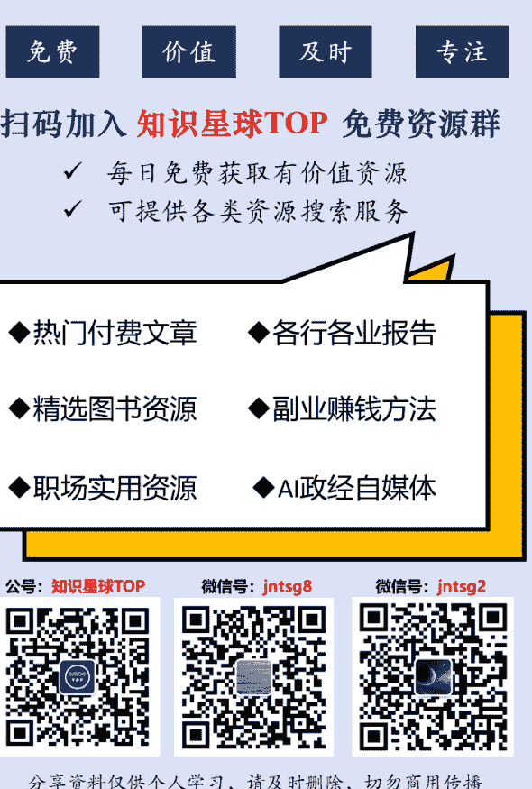

# 职场权力斗争

原创：灰玻璃 公号：灰玻璃25年6月5日

任何人，只要被升职到管理岗位，就必须面对权力斗争。学姐向认为，一件事既然无法躲避，不如提高技巧。

职场的本质就是利益场，年轻人必须先学会拆解，站在高位后才能懂大佬风轻云淡的本质。

如果向上社交的核心是引诱别人利用自己，那职场也是。基层是做事的，讲的是执行、服从；中高层就得折腾磨人，讲的是利益交换和博弈。

这篇文章是付费文章，学姐会讲到入职场如何向上管理，怎样成为嫡系、怎样与领导利益共生、向上交流；走上高层后，如何提防别人大胆用起下属，如何恩威并施、构建自己的人才底牌；

专门针对女性的，如何利用性别红利，怎样处理女领导的暧昧和领导的意图；还有送礼与关系推进、自保与站队之事。

这些我知道我觉得大家很有必要知晓，因为我在咨询过程中，发现太多人不知道如何向上管理，如何做利益交换，这里面很多学校不教、父母不会的潜规则和底层逻辑。

## 01 什么是权术？

职场中，永远是身份决定利益，利益决定立场。比如做下属的第一原理是要提高自己的不可替代性，而中高层是想要办法削弱下属的不可替代性，防止其被反制。

许多人都只会站在自己利益的立场上思考问题，这就会涉及到博弈和权术，就是你要去悟、去摸，但永远不要告诉对方的东西。

比如刚入职场，你要去摸索这个组织的生态构成。洞察领导和同事的背后支持者、所处的关系网、所属的团体及他的心性；老板没有性格弱点，各部门领导之间是否存在微妙的竞争关系。

这种洞察力是要你自己去观察和感悟的，但是千万不要在同事中分享以体现你的聪明。因为洞察力过猛，太聪明是职场最差的，这种话被传播就会会让领导感到害怕和忌讳。所以不要说，更不要。

## 02 基层——成为嫡系与向上交换

如何成为嫡系：70%的可用（业务能力）+20%的可信（忠诚）+10%的亲（价值观匹配）。

首先，你必须要有能力，能够出业绩、能带团队、能给解决方案。如果是个无能之人，那第一关就过不去，连基础价值都没有。培养蠢人就是浪费资源。最好的管理方法是只筛选不培养，很可能是徒劳。

其次，是否可信。如果不忠诚，耍聪明多边站队、左右逢源，那除了干点活，迟早也是弃子。学姐再次强调，职场上忠诚成本太高，让领导太大了。而且领导一定会权衡和打压，因为聪明之人如一把锋利的匕首，当我不知道刀柄握在自己手里时，你的存在就是威胁。

最后，是否可亲。要看年轻人是否懂规律，还有“人性”，就是能够提供精准的情绪价值。价值观一致的下属，成本更低，更容易配合。

以上三点分别对应：
- 专业度
- 信任度
- 亲密度

重要程度递减。如果你是一个不可替代的技术天才/专业权威，不会包容你，甚至重用你。但如果你能力平平，还无法建立信任和亲密度，那一旦更好的候选出现，上位者就会优化你。

## 如何向上管理：满足领导的信息感+忠诚度安全感

所有想升职的人都必须向上管理，把你纳入领导的“掌控体系”，而不能让领导来猜你正在干什么、想要什么。上位者才有的权力，下者根本没有资本。懂得适时汇报、懂得展示过程、懂得让领导参与，哪怕成绩一般，也更容易获得认可。因为让领导有了“掌控”的感觉。看懂你的进程、理解你的思路、参与你的成果。尤其是秘书、人事、招标、财务这种重要岗位，一定要透明，很多领导都想具备掌控权，不然就没安全。

同时，除了业务能力，领导提拔下属会考察你的忠度和人品，因为没人会提拔一个隐患。套路有很多，比如：

- 用已知的事情试探你，看你是否对他坦诚；
- 在非正式场合，留意你对“竞品”同事的点评，判断你的人品立场及是否有隐性攻击的小动作；
- 借他人入口来套路你的话，作为多维信息来源交叉验证；
- 关键时刻，看你是否立即跟随他的号召站队；
- 用个人私事来测试你的态度，比如打印私人文件、代购私物品等；
- 看你是否有底线，能否将组织利益放在个人利益之上。

术的应对层面：
1. 业务方面你要提前汇报+数据汇报，即使领导没要求，你都要主动周报+关键节点汇报，以防他对信息失控、人事失控。
2. 永远不要对领导有恶意评价，因为你不知道对面的是他的暗礁；
3. 逢年过节主动给领导微信问候或寄送时令物，平时不合心意，可以借此时自然地盘托；
4. 让领导私人事务办得和自己一样漂亮，注意保密；
5. 扮演好情报员角色，你听到的有价值适时向他汇报（如他的平行“竞品”的对称动作），帮助领导及时掌握公司竞争生态；
6. 做人不要过于圆滑，适当暴露，让他留出指导的空间。

外，我额外提醒的一个点，我观察到很多新人怕记不住领导的交待，喜欢在任何大会小会上录音。学姐建议不要录音，要录一定要让领导知道你录了（他在录音环境下可能会被藏锋、调整话术）。如果你私自录了，但凡个录音出去了，不管有没有敏感信息，你的职场之路都完了。

## 如何与领导利益共：甘当棋子+向上交换

职中，利益关系大多是串联的，只有领导上去你才能上去。如果一个管理者管不住底面的牛鬼蛇神们，要么在公司被边缘化，要么被空降。新领导上任时一定会权衡你的用处并不会留下缝隙。职场上帮领导就是自己，你们是利益共同体。甘当棋子要有觉悟，聪明人会主动去摸领导的需求，看他现在缺什么：
- 业务
- 信息
- 资源
- 情绪
- 关系

向上交换：你提供什么价值，才能换什么。如果有些事情是你自己做的，领导不需要花费时间搞定，结果是值得的。

## 03 中高层——管理力与掌控力

中高层人才稀缺的，当你真正上管理岗位，发现这类人才其实是追求成就为主，管理的本质是追求结果导向。

### 如何提升领导力：
- 业务能力强
- 横向关系强
- 资源分配
- 人格魅力

### 对应：
- 结果
- 忠诚
- 价值观匹配

### 获得：
- 结果
- 忠诚
- 人格魅力

### 交换：
- 结果
- 资源
- 情绪
- 关系

这种权力是是力，让下属，服从。只要你赢了，一切好。

另外，刚上管理岗位时，早期是要给下属当教练，在他身边参与并控，会非常累。只有观察对方才能接住事，事后大胆授权，变成权威型领导才会轻松。

## 恩威并施

人才是依靠信息和项目出来的。对于主靠班、有工作积极性的下属，你要给予正面奖励，比如：
- 情绪
- 信息
- 资源支持
- 给老板露脸机会
- 汇报权
- 给培训资源
- 升名额

确保你在职场竞争中保持优势地位。对于不服管、躺平式下属，你要对负面激发恐惧，引起蛤鱼效应要多加强，打破他们的舒适圈。如果他们对整个团队带来破坏性影响时，你不能再做好了，必须开人杀一儆儆。

## 如何防止被下架：分权+制衡+培养竞争机制

嫡系是Leader为了降低用人风险、增强把控能力，基于合作契约和长期信任维持的半固定利益体系。其存在职场合理。但嫡系失控，会对你的管理造成威胁和混乱，这时你要实施政治平衡术。

熟读历史、政治权谋的人应该清楚如何对下属分权和制衡。核心打法是在心腹人物内部有意的制造、培养两个小集团，使其相互斗争、相互监督，以增加你的信息透明度和权力集中。帝王术已经给我们带来了示，这种分权是为了起到平衡砝的作用，以防止他们拉帮结派、不听指挥，更是防止你下属信息隔离和架空。要注意尺度，不能让下属内斗消耗过多的精力，以免影响整体的凝聚力和战斗力。

另外就是培养竞争机制，大厂的赛马机制和互为AB就给我们打样了。华为是不承认苦劳，允许躺平，不保护落后。美的方的洪波，他的管理模式就是让下属没有安全感。任何管理者在岗位上有“继任者计划”，每个人一定有3个继任者，谁第一、第二、第三排得很清楚，管理者自己也清楚，美的会让他们参与面试，选自己的“后备”。

## 04 送礼与关系推进

职场上，送礼不是给无能人的机会，而是给优秀的人加杠杆，通过卡口。学姐强调，身为管理者一定要理性大于感性，因为职场的本质是交换。

学姐提到的嫡系公式：嫡系=70%的可用（业务能力）+20%的可信（忠诚）+10%的亲（价值观匹配）。

## 05 性别红利与模糊管理

女性在职场更容易获得起跑优势，尤其是当你一定主持活动，在重要项目、路演、论坛、行业研讨会等演讲时，你会更容易被领导选中代表团队发言。我建议女性朋友抓住这种时刻，因为这是我们数不多以较低资历被大boss、行业核心客户看见并建立身份的机会。某种程度上，汇报权几乎等于项目主导，这属于我们的性别红利。

同时，职场男性更容易提男性（女性同理），因为同性更容易引发竞争焦虑。加之我们女性普遍顺从、宜性更高，只要业务能力跟上，职场上数量更多的领导会导致先测试和收编我们，稳住他人的基本盘。

对于很多女性提到的模糊管理，职场中男女之间的关系确实容易游走在灰色地带，领导对你的定位会随着你给出的表现和价值发生改变。对于有的女性，当男领导/男客户先见你的女性特征的时候，会本能带点择偶波动，只有在你身上可见更大的事业价值时，他会对你产生尊重，认为你是一员能够征战的、没有别性的猛将。

> “为了你所用的猛将”的稀缺性，大过性的稀缺性，但脑子正常的领导都能看清，知道更应该把你放在什么位置。

所以，我们女人自己就要把握好边界，展现自己的业务能力，用专业压过色彩，不要自我化。

## 性别通用技巧：

逢年过节送礼：
- 端午：季节限定
- 7月：蜜桃
- 8月：山楂
- 9月：西湖龙井

男贵送指南：对于领导、男贵人，可以送酒、品牌威士忌、红酒等。还可以考虑古龙井、茶叶、人参、深海鱼油等保健品、电子产品配件。

女人送礼指南：对于中年领导、女贵人，可以送身体护理、滋补品（燕窝、阿胶、藏红花）、演出门票（如剧场《红楼梦》、《此青绿》）、香氛盒、下午茶券。如果确认领导肤质，可以送蓝之逸、雅兰等高端护肤品。平时也可以屯几套瓷器、单杯、套装。屯这种没有保质期的小礼物，随时拿出来做职场刷脸。

如果领导频繁用锅，多次不兑现承诺、见下属好的，这种人不值得跟随，要么走，要我们要取代而之。如果只是单次没兑现承诺，后面还是有回补动作，那么我们一定要带条件才能背锅和配合。

## 站队艺术：局势判断+利益同盟

新人不用站队，做好手头业务工作即可。因为大头兵站队不会有人怪你，这时候的势能和影响力都太弱，你站错或站对，意义都不大。或者你没得选，只能站一下。

中层要开始学习站队，领导在资源有限的情况下，定是优先选忠、主动靠拢，他会将资源倾斜给谁。因为大你，也是他自己。同时，中层要有意识的在公司同级中选择队友建立利益同盟，即两人之间晋升都能帮到对方。

高层要强站队，越往上立场越要鲜明，高层的竞争非常激烈，因为位置就这么两个，这时你还试图中庸，不对领导下重，那么领导也定不会对你下重。

当然，职场中绝大部分时候都是身不由己，我们没有选择培养的阶和权利，这也是权力让人绝望的地方。你只能站队的部门和领导这里，你怕你知道你弱，必输，必输不行，必须站。

当然，对于能力实在强的选手，即使输了，对对手阵营的领导也会考虑将你收留，因为你对他整体布局有用处。

## 老实生存：提高“得罪成本”+有功必赏+及时回击

1. 提高得罪成本。这也是站队的必要性了，如果公司中高层里领导看好你，有山头罩你，那其他人在悄悄地牺牲你的利益时，会先估量一下得罪的隐含成本。

有功必赏。当你做出一定成就，最后分蛋糕时被忽略时，其实可以主动去补偿的。你可以私下和领导表达，只要不是诚意公开的事故，很多东西都可以和leader隐性“讨价还价”。做人不能太老实，主动为自己争取利益也是一种能力。

及时回击。职场中，如果有同事看着很多人的面子你立威，必须当面回击。因为对你来说不仅是一次反击，而是要在其他时候，你有能力回击，得罪你会会有得罪成本。这是“打得一开，免得百亏”。

一旦你被人欺了没反应，会引起其他人也从你身上套，最终会影响你的正常社交。

## 结语

最后学姐说，可能很多人会觉得在职场既要进攻、又要防守，动这么多心眼实在太累了，一种思想上的累。

那学姐建议你，坚定的选择医学、理工科、研发技术岗位，只要你肯吃技术上的苦，就不用吃那么多与人博弈的苦。这个社会生存规律就是：业务越艰难，人际越简单；业务越简单，人际越艰难。

没有什么完全的捷径，就得也要吃好这碗饭的底数。拿了物质供给，一样也要有契约精神，要知进退、顾家庭角色分工和语权的让渡。

所以，一切无非生存策略。

当你积累自己的原始资本，这种精神上的苦性对比越来越低时，学姐鼓励你跳出来，自己做老板，自己规定，毕竟职场的尽头是创业。不过学姐要提醒一下，创业也不是什么桃花源之地，还要面临人性管理中的劣性，是另一个赛道的精神磨耗。

还是学姐开头那句话，一事既然无法躲避，不如提高技巧。大家平时要有意识地积累财富，广泛地学习历史，尤其是政治-历史-人类物谱等，这对你们洞察人性、把握职场高端局极大的帮助。

祝大家都能按照自己的意愿过一生。

免费 价值 及时关注

## 扫码加入 知识星球TOP 免费资源群

- 免费获取有价值资源
- 可提供各类资源搜索服务

| 热门付费文章 | 各行各业报告 |
| 精选图书资源 | 副业挣钱方法 |
| 职场实用资源 | AI政经自媒体 |

公号：知识星球TOP 微信号：jntsg8 微信号：jntsg2

分享资料仅供个人学习，请及时删除，勿商用传播
