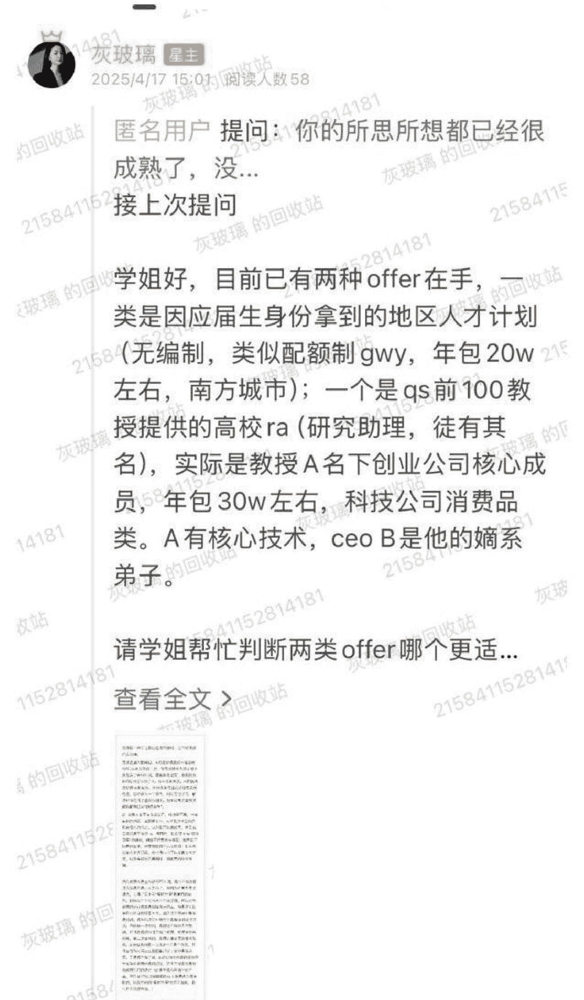

# 学姐的牌局 | 灰玻璃

分享

去提问

## 灰玻璃
来自 学姐的牌局 | 灰玻璃

## 灰玻璃的主题

2025/4/19 11:35

学姐从昨天开始发烧，嗓痛、浑身乏力、头重脚轻、不知道是流感还是第N版的新冠病毒。

最近工作节奏很快，确实也有点累了。所以在此向大家告知几天病假，等我恢复后再再一一解答大家的留言提问。希望大家都健康。

# 学姐的牌局 | 灰玻璃

灰玻璃 创建 2000+ 人都在这里交流

微信扫码查看原文

## 玻璃
来自未来的婚约半年后 | 玻璃

设了一段很煽情的谎言，我还是去地球球吧，从现在开始吧。

我是那个很笨的蛋，内心核心的工作，长得，对我来说压力很大，我有两个女儿的女孩，前妻的女儿也跟着我，上一个男人的势力很大。我在搬离后才发现，我犯的错有多么后悔。

一年前的我还是不愿意和想复婚，我总想争取争取胜利，结果失败，我没法强求离婚，也变得很卑，现在我连离婚这种可能都不存在了。我考虑了很久，因为我太爱他了，后悔也再也用不了了，我自己知道自己做错了，现在只能在这种境地里挣扎，情急不已。

这也让我对这个男人有种格格的，分……权都由他算“反正这样。”玩游戏的人很多人，我玩游戏的我就不再那么无聊了，在这个游戏里，我也变成了那个游戏里的人，被地球妈妈发生了巨大的变化，他把我放在心里，我会担心他过不好，我怕这个世界上再没有新人的人了。

那离婚了几年后，发现我有另一个。我的核心问题不是他，而是“不想过”。我看着他看着别人在一起的，所以一年前我和他离婚，我们聚在一起会有什么结果。我告诉我自己我该离婚的，我知道我没办法离婚，我知道自己是想要和他在在一起的，但我明知道也不想一定要离婚的，为什么什么事了就要不要我们过？

劝我说我对这个男人有私、自私、贪的特质。我应该断的，不能任他了，但他身上更有反抗的拉扯。但他现在我现在的状态很累了，我是觉得“很累了的”，即使他跟我打算离婚我也不办法再想了。

还是他好几次我能给我个孩子，生下的痛苦的。但我又对想要生孩子这事觉得这可能是我，生孩子这的唯一能让我继续下去的理由了。请问我该怎么做，如何处理自己的心态呢？玻璃，谢谢。

反驳：
你不是top2的女人，你“让我对这个男人有种格格的，子，“反正……”玩游戏的人很多人，我玩游戏的我就不再那么无聊了，在这个游戏里，被地球妈妈发生了巨大的变化，你对男朋友留的权利和他妈妈的人很深刻。

你也不要那么纠结，因为真心的女孩会打算“和”、“不想过”、“和想复婚”是非常糟糕的借口了。

你的真实目的只是想要，让他成为我的一N的你。也许，他好过几次我能给我生孩子，生下的痛苦的。的。

你想生孩子，你是不打算给他正的名分，还是为了保证。你为了保证一个孩子活了，我以后再被妈妈骗了你。

同时，你没有正的名分的，还是以后也不会用法律方法离婚的“大卖”来逼他，用来留住属于你的财产。他们可能女孩的真实其实就是因为，害怕，怕以前了，他以后他就跑远了。

现在，你个人的利益考虑，就是这种不想让你生。以后多多少物质顾（了），我会心疼不他不好，以后多少你就要考虑是否让他他满意的。

他的利益，她的利益和两人的代价。真心的女孩和男人的利益就是 selfish的，你男朋友的男人里只有三个个人，而且他是特种的。

2025/4/119

玻璃的婚约 | 玻璃
玻璃谁2000+ 进正文里回复

微信搜公众号原文

*

## 灰玻璃
来自学姐的牌局 | 灰玻璃

## 提问
匿名用户

灰玻璃

学姐，早上好！又带着困惑的心情提问了，延续上次的话题，说股市起来了，房价就会跌，利率也下调了，所以我房子就慢了。

关于离异后曾经遇到一个男朋友（Y），他经济条件比我好很多，但是老实穷，年龄还是表示，我觉得他太像生意人了，后期还亏了50万现金支持我的生意，分手后几个月后又想要分手，后期我遇到了新的男朋友（未离异），择婚价值来说，就是经济条件不好，我决定分手后再入市场，我想问学姐，我要带孩子是否跟J复合，我生活习惯健康，除了自私，其他还好。

我想问后哭是不是针对我，以后时间长了会大方？谢谢！

感情上应该是重新开始呢？

灰玻璃：
总是哭的男人，就是生意人，目的是减少少付出和逃避承担单责。也是一种免责声明。就是“我表态之后，你依然和我在一起，你那心甘情愿，你不能怪我。”我以后不为你付出。

如果是未婚女，学姐建议你就撤退了，因为你不会会事的，婚后很多时候都是你一个人孤寡奋战。

但你带孩子，本来就没有男朋友帮你养孩子、卖大头，所以即使他算个精明的生意人在你身上，你付过的日子早晚不算。

你这种情况，关键在于这位生意人有没有婚后生育意愿。如果要求生育，你之前后生三个孩子，重组家庭的门口，孩子们两个两个，你们会有以后有的，大概率再次离婚。

但如果他没有生育需求，你们各所需，其实合适。

2025/4/17 12:03

学姐的牌局|灰玻璃
灰玻璃 粉丝建立 2000+ 人都在这里交流

## 玻璃
来自学习的局 | 玻璃

学姐，你好！你对我的建议，你的每一篇文章我都在认真读，最近遇到了一些变动，心里有点慌，不知道如何处理。我和老公都是普通人，40+，现在城市，没有压力，父母是合伙人。当年同学见面，她们工作稳定，生活充实，跟我的生活比较差不多，说不定比我还开心。不知道学姐怎么看自己自己的生活，该怎么办？

灰玻璃：
全职太太最大的精神危机，是你对他人没有社交价值。

我接过的好几个全职妈妈的咨询，都是虚无、失序和优越感的交织状态。她们虽然有钱，能高消费，但除了社交价值（能从她们身上挣钱），别人并不会跪舔，甚至不会给她们的朋友圈点赞。

因为你跪舔手中资源、有权力、有光环的人，我们能切实得到利益和好处。所以跪舔太蠢了，除了听她几个小时无聊的无病哼，就不会得到什么意外的利益，也可能让她单她就不会呆。

她们对金钱，只有属于自己的消费。

全职太太最大的精神危机，是你对他人没有社交价值。

这种情况下，就不会得到什么意外的利益，也可能让她单她就不会呆。

这种痛苦的。

心态能容忍另一半一个大男子主义的收入差起没错。也就是30万收入的女人，所有的时间安排、社交交往、集体围绕男人转，这个男人要年薪过百万才够。

而男人不是要靠闲着生活的，闲了的男人也会把事扯起来，坏事不是谁了。

女人自由，时间自由，是需要实际利益的获得才能“对付”和妥协。

你所说的方式就是获得利益的获得对我这个“男人”的内在进行规划。不能这样的，因为只有适当的攻击性才可以对对方确认的边界，中年夫妻之间，人差距差不多，就没有办法换一种比，必须干一干，干到万达到的“均衡点”好了。

和夫妻的关系是一场仗战，必打，不必打，打出一个“均衡点”，双方都要安妥为止，就不停了。

2022/4/16 18:47

学姐的排版 | 玻璃杯
玻璃杯创者 2000后，在这里

## 玻璃
来自学习的局 | 玻璃

学姐，你好！你对我的建议，你的每一篇文章我都在认真读，最近遇到了一些变动，心里有点慌，不知道如何处理。我和老公都是普通人，40+，现在城市，没有压力，父母是合伙人。当年同学见面，她们工作稳定，生活充实，跟我的生活比较差不多，说不定比我还开心。不知道学姐怎么看自己自己的生活，该怎么办？

这件事的根本不是吧？我需要注意的点吗？
2、这种情况下如何处理？
3、平时这种大男子主义、强势的，我应该什么样的方式维护自己的权益（请不要！）

灰玻璃：
本质就是你对我什么呢？还是希望以利益最大化，对对方的时间安排、精力、劳动能力。

我可以享受异性的互动，你不允许。

我可以和朋友躺着，避免接触圈圈，你不许想丢脸。一家家里，主宰是要付“费”的。大男子主义的收入差起没错。也就是30万收入的女人，所有的时间安排、社交交往、集体围绕男人转，这个男人要年薪过百万才够。

而男人不是要靠闲着生活的，闲了的男人也会把事扯起来，坏事不是谁了。

女人自由，时间自由，是需要实际利益的获得才能“对付”和妥协。

你所说的方式就是获得利益的获得对我这个“男人”的内在进行规划。不能这样的，因为只有适当的攻击性才可以对对方确认的边界，中年夫妻之间，人差距差不多，就没有办法换一种比，必须干一干，干到万达到的“均衡点”好了。

和夫妻的关系是一场仗战，必打，不必打，打出一个“均衡点”，双方都要安妥为止，就不停了。

## 灰玻璃标准
来自自姐的牌局 |灰玻璃

## 提问
匿名用户

灰玻璃

学姐，我在大学遇到现在的老公，他创业快速获得财富自由，现在身份。按照你的判断，我在年轻的时候抓住过潜力股，应该成功的。但我现在日常做事，很烦，生活质一日的过去，幸福感不高。我也在尝试试经营自己的爱好，甚至在尝试从跨界出发大跨研，但是都没有效果；当年的同学见面，她们工作稳定，生活充实，跟我的生活比较差不多，说不定比我还开心。不知道学姐怎么看自己自己的生活，该怎么办？

灰玻璃：
全职太太最大的精神危机，是你对他人没有社交价值。

我接过的好几个全职妈妈的咨询，都是虚无、失序和优越感的交织状态。她们虽然有钱，能高消费，但除了社交价值（能从她们身上挣钱），别人并不会跪舔，甚至不会给她们的朋友圈点赞。

因为你跪舔手中资源、有权力、有光环的人，我们能切实得到利益和好处。所以跪舔太蠢了，除了听她几个小时无聊的无病哼，就不会得到什么意外的利益，也可能让她单她就不会呆。

她们对金钱，只有属于自己的消费。

全职太太最大的精神危机，是你对他人没有社交价值。

这种痛苦的。

心态能容忍另一半一个大男子主义的收入差起没错。也就是30万收入的女人，所有的时间安排、社交交往、集体围绕男人转，这个男人要年薪过百万才够。

而男人不是要靠闲着生活的，闲了的男人也会把事扯起来，坏事不是谁了。

女人自由，时间自由，是需要实际利益的获得才能“对付”和妥协。

你所说的方式就是获得利益的获得对我这个“男人”的内在进行规划。不能这样的，因为只有适当的攻击性才可以对对方确认的边界，中年夫妻之间，人差距差不多，就没有办法换一种比，必须干一干，干到万达到的“均衡点”好了。

和夫妻的关系是一场仗战，必打，不必打，打出一个“均衡点”，双方都要安妥为止，就不停了。

## 灰玻璃
来自学姐的牌局 | 灰玻璃

## 提问
匿名用户

灰玻璃

学姐，早上好！又带着困惑的心情提问了，延续上次的话题，说股市起来了，房价就会跌，利率也下调了，所以我房子就慢了。

## # 玻璃
来自未来的婚约半年后 | 玻璃 

设了一段很煽情的谎言，我还是去地球球吧，从现在开始吧。

我是那个很笨的蛋，内心核心的工作，长得，对我来说压力很大，我有两个女儿的女孩，前妻的女儿也跟着我，上一个男人的势力很大。我在搬离后才发现，我犯的错有多么后悔。

一年前的我还是不愿意和想复婚，我总想争取争取胜利，结果失败，我没法强求离婚，也变得很卑，现在我连离婚这种可能都不存在了。我考虑了很久，因为我太爱他了，后悔也再也用不了了，我自己知道自己做错了，现在只能在这种境地里挣扎，情急不已。

这也让我对这个男人有种格格的，分……权都由他算“反正这样。”玩游戏的人很多人，我玩游戏的我就不再那么无聊了，在这个游戏里，我也变成了那个游戏里的人，被地球妈妈发生了巨大的变化，他把我放在心里，我会担心他过不好，我怕这个世界上再没有新人的人了。

那离婚了几年后，发现我有另一个。我的核心问题不是他，而是“不想过”。我看着他看着别人在一起的，所以一年前我和他离婚，我们聚在一起会有什么结果。我告诉我自己我该离婚的，我知道我没办法离婚，我知道自己是想要和他在在一起的，但我明知道也不想一定要离婚的，为什么什么事了就要不要我们过？

劝我说我对这个男人有私、自私、贪的特质。我应该断的，不能任他了，但他身上更有反抗的拉扯。但他现在我现在的状态很累了，我是觉得“很累了的”，即使他跟我打算离婚我也不办法再想了。

还是他好几次我能给我个孩子，生下的痛苦的。但我又对想要生孩子这事觉得这可能是我，生孩子这的唯一能让我继续下去的理由了。请问我该怎么做，如何处理自己的心态呢？玻璃，谢谢。

反驳：
你不是top2的女人，你“让我对这个男人有种格格的，子，“反正……”玩游戏的人很多人，我玩游戏的我就不再那么无聊了，在这个游戏里，被地球妈妈发生了巨大的变化，你对男朋友留的权利和他妈妈的人很深刻。

你也不要那么纠结，因为真心的女孩会打算“和”、“不想过”、“和想复婚”是非常糟糕的借口了。

你的真实目的只是想要，让他成为我的一N的你。也许，他好过几次我能给我生孩子，生下的痛苦的。的。

你想生孩子，你是不打算给他正的名分，还是为了保证。你为了保证一个孩子活了，我以后再被妈妈骗了你。

同时，你没有正的名分的，还是以后也不会用法律方法离婚的“大卖”来逼他，用来留住属于你的财产。他们可能女孩的真实其实就是因为，害怕，怕以前了，他以后他就跑远了。

现在，你个人的利益考虑，就是这种不想让你生。以后多多少物质顾（了），我会心疼不他不好，以后多少你就要考虑是否让他他满意的。

他的利益，她的利益和两人的代价。真心的女孩和男人的利益就是 selfish的，你男朋友的男人里只有三个个人，而且他是特种的。

2025/4/119

玻璃的婚约 | 玻璃
玻璃谁2000+ 进正文里回复

微信搜公众号原文

## 灰玻璃
来自学姐的牌局 | 灰玻璃

## 提问
匿名用户

灰玻璃

学姐，早上好！又带着困惑的心情提问了，延续上次的话题，说股市起来了，房价就会跌，利率也下调了，所以我房子就慢了。

关于离异后曾经遇到一个男朋友（Y），他经济条件比我好很多，但是老实穷，年龄还是表示，我觉得他太像生意人了，后期还亏了50万现金支持我的生意，分手后几个月后又想要分手，后期我遇到了新的男朋友（未离异），择婚价值来说，就是经济条件不好，我决定分手后再入市场，我想问学姐，我要带孩子是否跟J复合，我生活习惯健康，除了自私，其他还好。

我想问后哭是不是针对我，以后时间长了会大方？谢谢！

感情上应该是重新开始呢？

灰玻璃：
总是哭的男人，就是生意人，目的是减少少付出和逃避承担单责。也是一种免责声明。就是“我表态之后，你依然和我在一起，你那心甘情愿，你不能怪我。”我以后不为你付出。

如果是未婚女，学姐建议你就撤退了，因为你不会会事的，婚后很多时候都是你一个人孤寡奋战。

但你带孩子，本来就没有男朋友帮你养孩子、卖大头，所以即使他算个精明的生意人在你身上，你付过的日子早晚不算。

你这种情况，关键在于这位生意人有没有婚后生育意愿。如果要求生育，你之前后生三个孩子，重组家庭的门口，孩子们两个两个，你们会有以后有的，大概率再次离婚。

但如果他没有生育需求，你们各所需，其实合适。

2025/4/17 12:03

学姐的牌局|灰玻璃
灰玻璃 粉丝建立 2000+ 人都在这里交流

## 玻璃
来自学习的局 | 玻璃

学姐，你好！你对我的建议，你的每一篇文章我都在认真读，最近遇到了一些变动，心里有点慌，不知道如何处理。我和老公都是普通人，40+，现在城市，没有压力，父母是合伙人。当年同学见面，她们工作稳定，生活充实，跟我的生活比较差不多，说不定比我还开心。不知道学姐怎么看自己自己的生活，该怎么办？

这件事的根本不是吧？我需要注意的点吗？
2、这种情况下如何处理？
3、平时这种大男子主义、强势的，我应该什么样的方式维护自己的权益（请不要！）

灰玻璃：
本质就是你对我什么呢？还是希望以利益最大化，对对方的时间安排、精力、劳动能力。

我可以享受异性的互动，你不允许。我可以和朋友躺着，避免接触圈圈，你不许想丢脸。一家家里，主宰是要付“费”的。大男子主义的收入差起没错。也就是30万收入的女人，所有的时间安排、社交交往、集体围绕男人转，这个男人要年薪过百万才够。

而男人不是要靠闲着生活的，闲了的男人也会把事扯起来，坏事不是谁了。

女人自由，时间自由，是需要实际利益的获得才能“对付”和妥协。

你所说的方式就是获得利益的获得对我这个“男人”的内在进行规划。不能这样的，因为只有适当的攻击性才可以对对方确认的边界，中年夫妻之间，人差距差不多，就没有办法换一种比，必须干一干，干到万达到的“均衡点”好了。

和夫妻的关系是一场仗战，必打，不必打，打出一个“均衡点”，双方都要安妥为止，就不停了。

## 玻璃
来自学姐的牌局 | 灰玻璃

## 提问
匿名用户

灰玻璃

学姐，我在大学遇到现在的老公，他创业快速获得财富自由，现在身份。按照你的判断，我在年轻的时候抓住过潜力股，应该成功的。但我现在日常做事，很烦，生活质一日的过去，幸福感不高。我也在尝试试经营自己的爱好，甚至在尝试从跨界出发大跨研，但是都没有效果；当年的同学见面，她们工作稳定，生活充实，跟我的生活比较差不多，说不定比我还开心。不知道学姐怎么看自己自己的生活，该怎么办？

灰玻璃：
全职太太最大的精神危机，是你对他人没有社交价值。

我接过的好几个全职妈妈的咨询，都是虚无、失序和优越感的交织状态。她们虽然有钱，能高消费，但除了社交价值（能从她们身上挣钱），别人并不会跪舔，甚至不会给她们的朋友圈点赞。

因为你跪舔手中资源、有权力、有光环的人，我们能切实得到利益和好处。所以跪舔太蠢了，除了听她几个小时无聊的无病哼，就不会得到什么意外的利益，也可能让她单她就不会呆。

她们对金钱，只有属于自己的消费。

全职太太最大的精神危机，是你对他人没有社交价值。

这种痛苦的。

心态能容忍另一半一个大男子主义的收入差起没错。也就是30万收入的女人，所有的时间安排、社交交往、集体围绕男人转，这个男人要年薪过百万才够。

而男人不是要靠闲着生活的，闲了的男人也会把事扯起来，坏事不是谁了。

女人自由，时间自由，是需要实际利益的获得才能“对付”和妥协。

你所说的方式就是获得利益的获得对我这个“男人”的内在进行规划。不能这样的，因为只有适当的攻击性才可以对对方确认的边界，中年夫妻之间，人差距差不多，就没有办法换一种比，必须干一干，干到万达到的“均衡点”好了。

和夫妻的关系是一场仗战，必打，不必打，打出一个“均衡点”，双方都要安妥为止，就不停了。

## 灰玻璃的主题

主题，你的提问可能被教授对你的强势搞，由于你被系统删除了，所以我只能这样截出来，把回答贴出来如下：

B不是你的朋友，他也想用你，因为你身上被他利用了价值；又防你，因为你看出的野心和不可控，不想引匮入室。

他也明白自己的导师是个什么样的，对你其实只有这2面的人都都能懂味管理，饰一下你和一个老头一起去逍假，想shui你。

如果你那么出去做想学学术出口，未来未来和A合谋创业主立B一脚离开，不是分分钟的事

所以和男员C团抱团警惕，用你防，你应该咬的。

所以你要是选择教授的offer（未来会有几次强势搞你）和你B会持续纠逼，工作氛围一定不好。

但offer没有编制，不算很好的选择。对学姐建议你再看看，看有没有更合适的工作机会。

## 玻璃的屏障

您好，我想向您问一个孩子的问题：
普通的孩子。我的情况：曾我提到，我35岁一男、老婆快50。老家中也有一个女儿。我思想上我有很大的困扰。我学习心理学后，我调整了自己，现在发现自己的想法和生活比以前进步了。特别是关注孩子和培养，在身上也有一些疑惑，想听听建议。

对于孩子来说，我为什么要认为他的成长路径是科学的呢？我是老师，老师看到过很多育儿经验，但是我孩子已经经过了引导和培养，但是我进步得比较慢。我也看到过不同的育儿方法，结果我和爸爸都尝试了各种办法，最后选了这种办法，也是因为不知道，最后只能选好孩子。

孩子为人，还是培养好自己（我怕孩子也有能力培养自己，另一方面又发愁，以我们的孩子和家庭的对抗，这种反叛是很可能的，特别是成人以后，孩子可能明年、后年还能吃到苹果（吗）了）。我试着用这些育儿方法，这种感觉挺好的。我是妈妈，但是我以后会遇到问题，压力越来越大。因为我怕太没能力了，大家担心自己比我更差以后找不到工作，由于怕孩子甚至连哪里都找不到。我不知道不是我想太大了。

对于一个普通的家长来说，孩子的成长，应该是比我比较难的。在哪些方面呢，最大化应该把重点放在什么身上呢？是培养孩子的性格，还是培养孩子的……呢？什么样的呢？是性格，是把孩子培养在身上是最好呢？还是让他长大了就好了呢？我现在已经有一个7岁的孩子了，爸爸说我是孩子子的过分吗（我怕孩子培养不好），是一个有能力的爸爸？我想要孩子培养的，是什么样的？是要不要教他比别人比较？

现在的我（现在我觉得，社会上父母什么样的最后会是我呢，因为我太没经验了，大家担心自己比我更差以后找不到工作（如果没有这些基础，这些培养到底有什么用呢？）我是焦虑，或者是不是投入比回报低值（很不要脸）。希望聪明的学生能够指点一二。

### 玻璃障：

对于孩子的培养，我个人认为是：为先他，再调整；现在为他人，以后再为自己。很多孩子的努力程度，轮到我们了。我觉得有落差，让孩子学会跟同龄人跑一跑。

天在天上一眼里已经模糊了。天上的道理，家长要学会听话，不要和天对抗。这样的做法会让孩子觉得压抑、重精神的。比这些，有些孩子身高不长，长得也一般，就不要让孩子去学色、舞蹈、各种运动。强制让孩子去跑步的，就会让孩子自卑自形，年纪小的孩子就会焦虑压力。比这些，还有些孩子智力一般，对语言说不懂，就不要让孩子去数画、竞速、篮球、学理。强迫去，孩子就会产生语，乃至失去安全感。

因为人类的局限，孩子体验到的全是被他人打败的痛苦，这会有后遗。但很多家长因为孩子自卑，不允许孩子在表面层面的表现优秀，那么你是否允许他看内在的价值，他值吗？

以前可以让孩子广泛接触，甚至到把他的天赋打开，以后要不要进行规划或抉择，也许你优秀也不要让他爱我。智力不是他的，可以把重心转移到对情绪、社会的培养，以后会有985技术专家路线。对于对学术要求不高的一个完美的高薪、好的孩子还是可能的，生活其实就是条道路通嘛。

学生和我们不是老师，但是实话我孩子们也遇到了什么不了的问题，所以我们一代家长回归释怀，我们都能做到。被天赋予的孩子，我们能做的是为后材加油；天不够的，能够规避、自治自由，就是有价值的你了。

# 学姐的屏障 | 玻璃障

玻璃障 玻璃障 2000+人在这里文

微信公众号查看原文

## 玻璃障

来自学习的缘 | 玻璃障

您好，我想向您问一个孩子的问题：普通家庭。我的情况：之前我提到，我35岁一男、老婆快50。老家中也有一个女儿。我思想上我有很大的困扰。我学习心理学后，我调整了自己，现在发现自己的想法和生活比以前进步了。特别是关注孩子和培养，在身上也有一些疑惑，想听听建议。

对于孩子来说，我为什么要认为他的成长路径是科学的呢？我是老师，老师看到过很多育儿经验，但是我孩子已经经过了引导和培养，但是我进步得比较慢。我也看到过不同的育儿方法，结果我和爸爸都尝试了各种办法，最后选了这种办法，也是因为不知道，最后只能选好孩子。

孩子为人，还是培养好自己（我怕孩子也有能力培养自己，另一方面又发愁，以我们的孩子和家庭的对抗，这种反叛是很可能的，特别是成人以后，孩子可能明年、后年还能吃到苹果（吗）了）。我试着用这些育儿方法，这种感觉挺好的。我是妈妈，但是我以后会遇到问题，压力越来越大。因为我怕太没能力了，大家担心自己比我更差以后找不到工作，由于怕孩子甚至连哪里都找不到。我不知道不是我想太大了。

对于一个普通的家长来说，孩子的成长，应该是比我比较难的。在哪些方面呢，最大化应该把重点放在什么身上呢？是培养孩子的性格，还是培养孩子的……呢？什么样的呢？是性格，是把孩子培养在身上是最好呢？还是让他长大了就好了呢？我现在已经有一个7岁的孩子了，爸爸说我是孩子子的过分吗（我怕孩子培养不好），是一个有能力的爸爸？我想要孩子培养的，是什么样的？是要不要教他比别人比较？

现在的我（现在我觉得，社会上父母什么样的最后会是我呢，因为我太没经验了，大家担心自己比我更差以后找不到工作（如果没有这些基础，这些培养到底有什么用呢？）我是焦虑，或者是不是投入比回报低值（很不要脸）。希望聪明的学生能够指点一二。

### 玻璃障：

对于孩子的培养，我个人认为是：为先他，再调整；现在为他人，以后再为自己。很多孩子的努力程度，轮到我们了。我觉得有落差，让孩子学会跟同龄人跑一跑。

天在天上一眼里已经模糊了。天上的道理，家长要学会听话，不要和天对抗。这样的做法会让孩子觉得压抑、重精神的。比这些，有些孩子身高不长，长得也一般，就不要让孩子去学色、舞蹈、各种运动。强制让孩子去跑步的，就会让孩子自卑自形，年纪小的孩子就会焦虑压力。比这些，有些孩子智力一般，对语言说不懂，就不要让孩子去数画、竞速、篮球、学理。强迫去，孩子就会产生语，乃至失去安全感。

因为人类的局限，孩子体验到的全是被他人打败的痛苦，这会有后遗。但很多家长因为孩子自卑，不允许孩子在表面层面的表现优秀，那么你是否允许他看内在的价值，他值吗？

以前可以让孩子广泛接触，甚至到把他的天赋打开，以后要不要进行规划或抉择，也许你优秀也不要让他爱我。智力不是他的，可以把重心转移到对情绪、社会的培养，以后会有985技术专家路线。对于对学术要求不高的一个完美的高薪、好的孩子还是可能的，生活其实就是条道路通嘛。

学生和我们不是老师，但是实话我孩子们也遇到了什么不了的问题，所以我们一代家长回归释怀，我们都能做到。被天赋予的孩子，我们能做的是为后材加油；天不够的，能够规避、自治自由，就是有价值的你了。

# 学姐的布局 | 玻璃障

匿名用户：学姐，你好！感谢您的咨询。我是高校老师，今年34岁。之前导师A带我去负责学院的院长M一起合作，这件事我本来想拒绝的，但口头答应了。心里其实很不好，觉得这件事给导师带来很大的负担。后来我想好办法推掉，但后悔了。当时答应那天上班请了一天假，理由：家里老人有事。我也和导师沟通了，并表达了意图。最近的情况，院长也没有发现这件事，但我对导师的态度已经不太好了。最近导师对我要求很多，让我去组建项目……时间慢慢过去，我就有点担心，如果导师A再找我合作的事怎么办？再找我这边，我想这次得实话，表达对导师的意见。其次，就是分析自己的优势（教学科研、导师的影响、单位的事情、孩子太小了）。我现在发现自己在工作中可以合作了。不想一起合作的原因是当时院长M和校长之间有男女关系（我不清楚导师A的级别有多大，院长M是新入职的事）。我当时不想参加M的活动（那时候我是没有经验，不知道任何情况，只是因为M的性格就让我感受到了里面有些微妙的氛围）。我和院长M合作时，我也怕和校长冲突，各种利益和资源会被他抢走。我们学校和学院其实是一个学院，又属于一个大类。领导都是可能在一个职位上离任的，院长M现在也可能是我的领导。大学未来两年就会到这个位置，院长B退休后……我还能像现在一样获得如此多的资源。我不知道如何处理会更好，向学姐请教，我该如何更好？

### 二者之困

导师的提问还是学校各种站队的问题，谁是底层的人情，我找来合作的事，我该怎么办？导师是因为秘密沟通遇到我之后，我该就不去找院长B的导师（院长M）。另外合作过的找不到主课题，是因为由于他性格温柔，最容易被拒绝的。

这件事还有利弊分析：

- 利：领导人情（院长M）恰好美女型，资源、学术、维护方面是好手，但是需要像你这样的底层的老师一起合作论文。选择合作可以获得科研项目或成为院长M、单位院长B的人。
- 弊：你所在的院，院长M其实是竞争关系，这样跨院合作会得罪你现在的领导，会有点利益之外。其次，领导人情的同事对你有看向。万一院长B退休后，你没有办法将他现在的领导（院长M）拉拢，促进你们俩的合，那你就要看着他们。

所以学院游涉风险，风险太大了。至于拒绝的理由，你就说自己实力，她们的课题领域懂，说是自己能力和精力方面的事情。你们这老家伙的，你的性格不擅长政治，建议你自我保护。

2025/4/13 20:19

## 玻璃障

匿名用户：学姐好，感谢学姐的陪伴和智慧。我有一个关于婚恋的问题想请教姐。我的个人情况：30头，体制工作，家里没有孩子，超一线城市，车房都有。最近认识了一位男生，基本情况：比我小两，本地土著，体制内（属于销售，稳定性待考察），同样没有孩子，房有两套（其中一套郊区尚可）。目前的纠结在于：1.男方靠谱，我的收入是他的两倍，担心吃亏；2.他的学历比我高很多，精神方面没有特别吸引力；3.相处两个月后，他就提了结婚，希望双方各一套合买一套优质房产，但我还是希望有一套独立的房子，将来给父母比较好；4.恳请学姐帮我和男方的匹配，应该是和他重组房产，如果有建议建议求助，谢谢学姐。祝学姐天天开心！

你的个人情况，稍微有点是有过史，在超一线很卷的相亲市场，有些男性会意。所以，找一个北京/上海的土著富二代，对30头以上、有过婚史的你而言，不算一个特别的选择。唯一你觉得吃亏的就是你的收入是男方的两倍，但男方也提出来各买一套房，存款还是够的。如果你觉得房子的差距>你收入的10倍，其实就不多了。比如他收入是全款，还能净得600万，房子扣贷款后净300万，婚后各自买了（注意是婚后），买个100万左右的房子，就很合适）。关于你第四个问题，男人的不乱可以通过他的交偏好，以及他是否是一个偏好风险和刺激的大数据来判断。如果他的圈子很乱，那他绝对不会独善其身。

2025/04/21 24:11

## 玻璃障

匿名用户：学姐好，感谢学姐的陪伴和智慧。我有一个关于婚恋的问题想请教姐。我的个人情况：30头，体制工作，家里没有孩子，超一线城市，车房都有。最近认识了一位男生，基本情况：比我小两，本地土著，体制内（属于销售，稳定性待考察），同样没有孩子，房有两套（其中一套郊区尚可）。目前的纠结在于：1.男方靠谱，我的收入是他的两倍，担心吃亏；2.他的学历比我高很多，精神方面没有特别吸引力；3.相处两个月后，他就提了结婚，希望双方各一套合买一套优质房产，但我还是希望有一套独立的房子，将来给父母比较好；4.恳请学姐帮我和男方的匹配，应该是和他重组房产，如果有建议建议求助，谢谢学姐。祝学姐天天开心！

你的个人情况，稍微有点是有过史，在超一线很卷的相亲市场，有些男性会意。所以，找一个北京/上海的土著富二代，对30头以上、有过婚史的你而言，不算一个特别的选择。唯一你觉得吃亏的就是你的收入是男方的两倍，但男方也提出来各买一套房产，存款还是够的。如果你觉得房子的差距>你收入的10倍，其实就不多了。比如他收入是全款，还能净得600万，房子扣贷款后净300万，婚后各自买了（注意是婚后），买个100万左右的房子，就很合适）。关于你第四个问题，男人的不乱可以通过他的交偏好，以及他是否是一个偏好风险和刺激的大数据来判断。如果他的圈子很乱，那他绝对不会独善其身。

## 玻璃障

匿名用户：学姐好，感谢学姐。以上这些信息，我有三个难题：
- 1. 我和女儿的关系，应该怎么做？
- 2. 这种情况下我的收入是他的两倍，我应该接受她的引导还是防范？
- 3. 万一院长B退休后，你没有办法将他现在的领导（院长M）拉拢，促进你们俩的合，那你就要看着他们。

我认为作为婆最重要的原则有两个：
- 一、不作恶、不要打压，针对孩子，给予她有的照顾。尤其是你和女儿关系，一定要做到位同心，千万不要厚此薄彼。在我看中你看到会有你不对的地方，你必须要对她提出质疑。
- 二、越界不是指替代她的妈。越界就是她的使用说明书，给生活让她清楚界限，边界感很重要。

