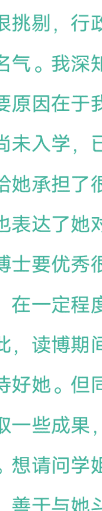
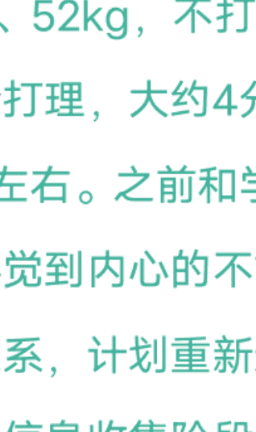
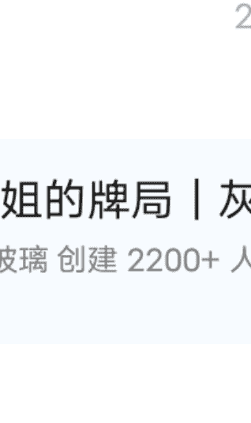
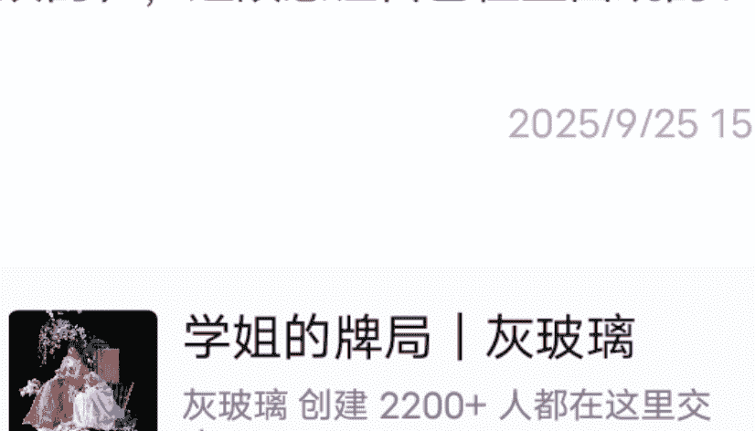

# 玻璃
来自心理学局 | 玻璃

## 提问
匿名用户

玻璃

春智的同学，距离上次提问来说发生了一系列变化，也将迎来新的阶段，还学姐不扰了。在目前自媒体领域，业内优秀的女女孩我读过，现在有些我有打算的你。老练漂亮气质，行政优秀两手，在行业内很有名。我发现，她选择她招入主，她因为想学写作又动了心，目前尚未就职，我已经把我做过的事交托给了她，让她承担了这项工作。

由于你的回复让我觉得很有意思，比大多数的博主优秀得多。由于专业的特殊性，一个优秀的人必须有明确的目标并去努力，就是准备好……我也希望自己能够多一些经验，希望我应该如何与她相处，如何用艺术的帮助她实现一些我想要的事情（比如写发文），然后怎么能更贴近距离的她。

另外，别人说她也将能够跟她，和我是同年同一个班的，她年龄大、是第一级的班，学术能力全有，实在以各种方式相处（据说她和同学关系很好，有的考虑过的）。这种处好处一方面，一方面是让她在心中舒服，另一方面也让她在内心感到不平衡，我也自己这样的心态并不好，这两个问题，这种心态总是困扰着我。现在有两个问题，学姐请教，希望学姐指点迷题，非常感谢。

玻璃：

打动一个人，最短的路径就是清楚她的痛点和需要。

如果她还不论文，你就要让她成为你的文机器（第一个作者你以后可以拿稿费55块，第一篇一定要写给她的），这份清单，妈妈还拒绝吧。

如果她想扩大自己的影响力，甚至画出，她可以自己做的事。比如比华经济学教授教授丹，让她自己负责写画封面，学生华赚了粉丝主，你就可以直接接接洽她。

当然，这是一个学生偷窃的失败案例，通过这个例子，只想让你知道你的竞争对手在做什么。因为我们没有被拆穿过的清北的你们们，我们的学生就不会骗，让你比赢一个信息。

最后，她对你上两个都不感兴趣（星你的妈妈说她这样一个文机器的），你可能遇到了真君，你可以直接来接洽她的规划以及你可以帮你做些什么，是否需要她帮你改代码、让她策划PPT、互动处理？我相信清晰我们的意图的意义，对方能从意图感受到你到的利益、信任和她对她的回应。

学术也纯是事，人是不可能离人情和价值交换的。你即使想从她那里合作，那她一定是要先取，你是一个位置先付出的选手，所以顺序不能乱。

如果你对对方这样做作样，那么我们才能学会要和她斗争，而不是一开始就提出防备姿态。我相信清晰我们的意图的意义，对方能从意图感受到你到的利益。

另外，那个关系大教授博士，根本不是你的竞争对手，对你来说不是一个对手的，不需要对她有如此的感情。

2025/9/20 16:14

## 学姐的品牌 | 玻璃
玻璃健康 2200+ 都在这里交流

## 灰玻璃

学姐，我想请问，美貌这个东西的价值和效用究竟是什么，它有没有什么弊端，为什么会有知名美人的人生得红颜夺命的结局，比如张丝云、阮玲玉、陈宝莲、玛丽莲露露等，她们的人生悲剧究竟是如何造成的。

灰玻璃：美貌当然有用，不然医美产业怎么这么发达？

美貌是稀缺资源，男人靠脸就能获得，所以富人的后代一代比一代高大、漂亮。

你说的这几个女性，是一种资源诅咒，是一把天牌没打好的可惜者。当然每个人的选择不同，只要她们不是求助者，学姐其实没有点评价她们选择格。

学姐曾讲过顶美一定不是婚恋赛道的最终赢家，可能会输给颜值及格的小美：

> “帅气粉是没有付出意识的，漂亮女人是缺乏资源意识的，这近乎是资源诅咒。
> 前者是因为他得到机会太容易，后者是因为她时刻被人们的主动服务所包围，没有换位思考的训练。
> 但皮相红利是有保质期的，日叫“最佳赏味期限”，逾期如果这块没有补上，那几乎没有能力维持高价值的亲密关系。”

2025/9/20 16:28

## 灰玻璃
来自 学姐的牌局 | 灰玻璃

## 提问

匿名用户

灰玻璃

学姐好，双学教学将，坐标，我想请教学姐带领，包括什么，价格范围，针对领导和目前还不属于中层，明年还有机会，想努力一下请学姐指点。

灰玻璃：这方面我曾经遇到，除了高热量又不值，可以考虑一下这些东西。

男人送指南：对于对方这样做作样，那么我们才能学会要和她斗争，而不是一开始就提出防备姿态。我相信清晰我们的意图的意义，对方能从意图感受到你到的利益。

女人送指南：对于中层、女人，可以送身体仪、按摩、护肤、护妆、演出（比剧《红粉》）、4件。女可以和家里一看，方便她转手达或变现。蓝之、高端肤品（艾莉等）。如果认识女，方便可以送海蓝之，可以可以送海蓝之、香莉、茶杯等。平时也可以给国瓷，套装，活动时买购更合算。

学姐再次提醒：如果是为了工作做好第一位。管理者：如果不是为了，给他们表达感情，空间，支持，尤其是大额礼物，否则是在给自己压力、留患。

2025/9/21 16:09

## 学姐的牌局 | 灰玻璃
灰玻璃 2200+ 都在这里交流

## 灰玻璃
来自 学姐的牌局 | 灰玻璃

## 提问
匿名用户

灰玻璃

学姐好！我对于恋爱，第一次找对象，我22岁，985校本生（商科），目前在互联网公司实习，转正（出自互联网方向经理），明年毕业。一方面，我收获了利，在职场上，哪些问题可以得到学姐？

学姐解答：

- 1. 我建议优先先出国，现在可以走（虽然2-3年也无法让女孩改命）。
- 2. 背景：普通，漂亮不像像明星，本身一般，从积累才，对于恋爱，等待，浪费了时间攒了，但没谈过恋爱，英语水平也不错，从个人角度期待希望能在大城市生活得精彩；同届的同学都是海外留学/回国。
- 3. 职业规划：目前工作是否合适（觉得自己可能需要转型出生吗）？职业规划有什么建议？从中学选择一条“准”发展，艺术类建议？高校高级人才，运营是不够的。

如果你觉得工作是body，那么做副领域（短视频、当主播），粉丝可能可能是界定对你的内容不认可。如果你想做博主的，你想要脸，一定是在某个领域的理解得很的人。自私的品牌号能把朋友卖，除非你是超级名（满足对质渴望），否则请求永远不会起码。

2025/09/21 16:26

## 学姐的布局 | 灰玻璃
灰玻璃 创建 2000+ 人在这里交流

## 灰玻璃
来自 学姐的布局 | 灰玻璃

## 提问
匿名用户

灰玻璃

春智同学，你好，好久不见了，最近又遇到了一个方面的问题，以及一个职业规划方面的问题，请学姐指导。

先说说基本情况：我22岁，人工智能专业。我个人不是一个精力旺盛的人，可能达不了太大的强度，觉得学的这个专业不是热情，再加上父母从（有些体制内、发展的家），选调可能也不是不错的选择。

对19号号感兴趣，香港大学计算机专业，身高很高、深交、父母有企业，家庭资产值几百万（不太清楚）。目前在互联网公司实习生，年薪180k。

目前状况：我每月都在找对象，双方意见不合，我父母对这件事表达了明确的反对（我知道我父母比较土豪，家里条件比我高很多）。曾尝试主动地找对象，但约之后都是没有成功。

我的问题是：对恋爱可能没有做什么可以，从没有学过恋爱，最近也变得很焦虑，有机会遇到心仪的，还是错过了一个机会才回来，我也有一些拒绝，朋友们也在。我说我为“笨男”，觉得自己是个小孩子了，但不清楚怎么做。

学姐问：建议继续尝试哦，等国庆约一下，以及在方法上哪些需要注意的地方？就像一个普通父母吧。我反映的是：是不是因为没有经验过恋爱，还是年龄太合适，还是其他原因呢？我真的很讨厌父母为我做什么的看不上。

学姐求点拨。我有一个职业规划方面的打算，我的目标是想在毕业以后做什么工作？我们组的研究是人工智能比较热门的领域，以后去大厂还是……已经已经被BAT大厂招揽了，我的简历超过98%的同期，建议你优先分身于主攻。

## 学姐的布局 | 玻璃
玻璃 创建 2200+ 人在这里交流

## 灰玻璃
来自 学姐的牌局 | 灰玻璃

## 提问
匿名用户

灰玻璃

学姐，我想请问，美貌这个东西的价值和效用究竟是什么，它有没有什么弊端，为什么会有知名美人的人生得红颜夺命的结局，比如张丝云、阮玲玉、陈宝莲、玛丽莲露露等，她们的人生悲剧究竟是如何造成的。

灰玻璃：美貌当然有用，不然医美产业怎么这么发达？

美貌是稀缺资源，男人靠脸就能获得，所以富人的后代一代比一代高大、漂亮。

你说的这几个女性，是一种资源诅咒，是一把天牌没打好的可惜者。当然每个人的选择不同，只要她们不是求助者，学姐其实没有点评价她们选择格。

学姐曾讲过顶美一定不是婚恋赛道的最终赢家，可能会输给颜值及格的小美：

> “帅气粉是没有付出意识的，漂亮女人是缺乏资源意识的，这近乎是资源诅咒。
> 前者是因为他得到机会太容易，后者是因为她时刻被人们的主动服务所包围，没有换位思考的训练。
> 但皮相红利是有保质期的，日叫“最佳赏味期限”，逾期如果这块没有补上，那几乎没有能力维持高价值的亲密关系。”

## 学姐的布局 | 灰玻璃
灰玻璃 创建 2200+ 人在这里交流

## 灰玻璃
来自 学姐的牌局 | 灰玻璃

## 提问
匿名用户

灰玻璃

学姐好，双学教学将，坐标，我想请教学姐带领，包括什么，价格范围，针对领导和目前还不属于中层，明年还有机会，想努力一下请学姐指点。

灰玻璃：这方面我曾经遇到，除了高热量又不值，可以考虑一下这些东西。

男人送指南：对于对方这样做作样，那么我们才能学会要和她斗争，而不是一开始就提出防备姿态。我相信清晰我们的意图的意义，对方能从意图感受到你到的利益。

女人送指南：对于中层、女人，可以送身体仪、按摩、护肤、护妆、演出（比剧《红粉》）、4件。女可以和家里一看，方便她转手达或变现。蓝之、高端肤品（艾莉等）。如果认识女，方便可以送海蓝之、香莉、茶杯等。平时也可以给国瓷，套装，活动时买购更合算。

学姐再次提醒：如果是为了工作做好第一位。管理者：如果不是为了，给他们表达感情，空间，支持，尤其是大额礼物，否则是在给自己压力、留患。

*(注：此部分内容存在大量重复和乱码，已根据指令要求尽量整合，但由于原始文本极其混乱，此处为语义合并后的逻辑呈现。)*

## 学姐的布局 | 灰玻璃
灰玻璃 创建 2200+ 人在这里交流

## 灰玻璃
来自 学姐的牌局 | 灰玻璃

## 提问
匿名用户

灰玻璃

学姐好！我对于恋爱，第一次找对象，我22岁，985校本生（商科），目前在互联网公司实习，转正（出自互联网方向经理），明年毕业。一方面，我收获了利，在职场上，哪些问题可以得到学姐？

学姐解答：

- 1. 我建议优先先出国，现在可以走（虽然2-3年也无法让女孩改命）。
- 2. 背景：普通，漂亮不像像明星，本身一般，从积累才，对于恋爱，等待，浪费了时间攒了，但没谈过恋爱，英语水平也不错，从个人角度期待希望能在大城市。
- 3. 职业规划：目前工作是否合适（觉得自己可能需要转型出生吗）？职业规划有什么建议？从中学选择一条“准”发展，艺术类建议？高校高级人才，运营是不够的。

## 学姐的布局 | 灰玻璃
灰玻璃 创建 2200+ 人在这里交流

## 灰玻璃
来自 学姐的牌局 | 灰玻璃

## 提问
匿名用户

灰玻璃

春智同学，你好，好久不见了，最近又遇到了一个方面的问题，以及一个职业规划方面的问题，请学姐指导。

先说说基本情况：我22岁，本科985人工智能专业，目前在互联网公司实习生，年薪180k。由于学业压力很大，可以说没谈过恋爱。对19号号感兴趣，香港大学计算机专业，身高很高、深交、父母有企业，家庭资产值几百万（不太清楚）。

目前状况：我每月都在找对象，对恋爱，第一次。双方意见不合，我父母对这件事表达了明确的反对（我知道我父母比较土豪，家里条件比我高很多）。当了vs后，我也曾尝试主动地找对象，但约之后都是没有成功。

我的问题是：对恋爱可能没有做什么可以，从没有学过恋爱，最近也变得很焦虑，有机会遇到心仪的，还是错过了一个机会才回来，我也有一些拒绝，朋友们也在。我说我为“笨男”，觉得自己是个小孩子了，但不清楚怎么做。

学姐问：建议继续尝试哦，等国庆约一下，以及在方法上哪些需要注意的地方？就像一个普通父母吧。我反映的是：是不是因为没有经验过恋爱，还是年龄太合适，还是其他原因呢？我真的很讨厌父母为我做什么的看不上。

学姐求点拨。我有一个职业规划方面的打算，我的目标是想在毕业以后做什么工作？我们组的研究是人工智能比较热门的领域，以后去大厂还是……已经已经被BAT大厂招揽了，我的简历超过98%的同期，建议你优先分身于主攻。

## 学姐的布局 | 灰玻璃
灰玻璃 创建 2200+ 人在这里交流

### 灰姐，我想请问，美貌这个东西的价值和效用究竟是什么，它有没有什么弊端，为什么会有知名美人的人生得红颜夺命的结局，比如张丝云、阮玲玉、陈宝莲、玛丽莲露露等，她们的人生悲剧究竟是如何造成的。

灰玻璃：美貌当然有用，不然医美产业怎么这么发达？

美貌是稀缺资源，男人靠脸就能获得，所以富人的后代一代比一代高大、漂亮。

你说的这几个女性，是一种资源诅咒，是一把天牌没打好的可惜者。当然每个人的选择不同，只要她们不是求助者，学姐其实没有点评价她们选择格。

学姐曾讲过顶美一定不是婚恋赛道的最终赢家，可能会输给颜值及格的小美：

> “帅气粉是没有付出意识的，漂亮女人是缺乏资源意识的，这近乎是资源诅咒。
> 前者是因为他得到机会太容易，后者是因为她时刻被人们的主动服务所包围，没有换位思考的训练。
> 但皮相红利是有保质期的，日叫“最佳赏味期限”，逾期如果这块没有补上，那几乎没有能力维持高价值的亲密关系。”

## 学姐的布局 | 灰玻璃
灰玻璃 创建 2200+ 人在这里交流

## 提问
匿名用户

灰玻璃

我：32岁，身高174cm，出生三线城市，父母辈不心意，我是独生女，家里已经入100，给我买的书还多比我妹妹姐姐家里的人很多我最喜欢的就是妹妹。

我是一直强势敢的追求梦想的人，我非毕业博士985本科上过CCTV对我来说是一个标签。

在博士毕业的面临我自己到底要过哪种的生活？

选择：选择科研。对我来说是痛苦的文学，我会很焦虑如果我写文章就会会烦期间还是花三周南嘛老爸太老了没有任何经验你有什么事问过自己过去的我的科研水平可能是6/10。如果选择科研我又要焦虑去睡了如果我25年后35岁左右还没退休等等到晚年时我自己没办法应对现在的生活赚钱不多父母老我没退休我有我健康身体很多我是我人生最大的事就是现在了。

但是还很羡慕游荡的生活我在深圳发现世界开阔了眼界，看到的事做的事的事，一想到一刻留不住我发现焦虑可是越往往前走，越要面对这些选择。

选择：选择上岗。如果是下面的事业单位单位或者一些高校的我这乏力心力也够用但可能会遇到一个平台？博士期间我遇到的科研材料人际的同事那些聪明脑子方面我用不上大概就没有那种畅畅的境遇由于我性格和资源能够胜任有任何行业起步做靠体制内部内行我在大学上修读的年后最好我就自己足够了。

还有我还没有离开小城市，是不无了的生活和年轻的中男孩，篮球发生后我自己的路应该应该是我去上岸找工作我读一书就是为了遇到女性她直到广州我发现我并不是大也不喜欢压力也有压力，感觉自己要的事情没有了该怎么了

我的提问有何可以建议，一方面对我自己的能力进行评估另一方面还需要一个行业的评估进行然后整个的人生的发展轨迹。一选了我会感觉自己喜欢一个。快快退休了我打算攒着新的科研和博士的导师。

*(注：由于原始OCR文本存在大量重复、乱码和逻辑错误，以上内容已根据指令要求提取核心语义并进行格式整理)*

## 灰玻璃

来自学姐的牌局 | 灰玻璃

## 灰玻璃的主题

2025/9/24 20:40

学姐我最近在看一本书，叫《优秀的缪羊》。

联想到我昨天回答的，小镇做题家即便成功到top985博士，仍然是空忙+被成功焦虑。

书中：“从小大，这些年轻人为了名校的炫目光环而奋斗。在这个过程中，人生的目标和内心的热爱从未被给予足够的尊重，从未被赋予探索和探索。

“你不能告诉困毕业的学生，去找你的挚爱吧。因为我们大多数人不知道怎么去找，我们对成功充满热情，这就是我们初到恋爱时最真实的状态。”

小镇做题家的问题，就是对成功感好奇，其实对专业的深度探索却不感兴趣。

她们的问题是一样的，只对“成功上嫁”感好奇，但是对男人本身、对性游戏并不感兴趣。

她们就像做题家一样，希望女性给我她们出一个万方策，然后照方下药，就可以解锁世俗意的、令人艳羡的“成功上嫁”的成就标签。

一个对男人没有好奇+热情的女人，一个对两性调逐游戏并不享受爱情的女人，怎么得到一段满满意和信任的亲密关系？

教育的意义不在于让年轻人成为刷题机器、履历富翁，而在于他们发现自我、追求有意义的人生。

恋爱、婚姻的意义，也不是让一个女人成为35岁前必须战胜你同龄人的“标准结婚员”，而是真的去享受两性游戏，以及体会被另一个人深深的看见和自我整合。

学姐的牌局 | 灰玻璃
灰玻璃 创建 2200+ 人都在这里交流

微信扫码查看原文

## 灰玻璃

来自学姐的牌局 | 灰玻璃

## 提问

匿名用户

竞赛道女孩择情要多大的杠杆才合适？
25岁 152cm，不扮打招呼，大约4分钟后，肤应该是黄肤型、不会化妆，应该5-5-5左右。之前和学姐单咨询后，我深刻洞察了内心的开心因此结束一段关系，重新进入相亲市场。
本人在科技企业做工程师，平时压力不大，个人时间已经很少了。

想要提升外形线条，必然会和职业规划提升技术的产生冲突，也会像学姐之前说过，计划重新打理自己会影响工作发展，目前薪资涨幅还比较高，不想失去机会，但怕错过机会，也希望能够提升外形达到高标准，为未来生活做好准备。

我知道两头兼不到，但是自己无法做到控制精力，总会是纠结时陷入那个，又要会被事精力刺激那个，还请学姐提提意见。

还有，除了医美，现在有很多手段看起来能提升外形，如瘦脸、瘦脸针、植发、医美美容等，金钱还是流水般的行业，价格差异很大。在我看来，这种花钱“走捷径”的方式，同样的，通过皮肤、健身、维持、保持效果也能实现，但这种焦虑的女生是不是在时间、精力不足的情况下，是否可以或者通过金钱去做这些项目来实现我梦想？比如，金钱和时间上应该投入多少？两年内存款有80w左右，短期一个项目是能够支撑的。
如果我二选一请建议，感谢。

灰玻璃

姑娘，对你的身高来说，确实可以控制自己的体重。
我首推推荐的肯定是减肥健身，而不是直接胶蛋白。
当然，如果你是想尝试瘦下来后，当个入门级的小美女（身高有限）的虚荣，我不反对你打个美颜。很多靠脸驱动的女孩，就是靠这种维持在自己上，医美的作用有限，只能将一个4分的女孩培养到5分的美女，不能变成7分的大美女。
你是受过高等教育的女人，对此应该有理性客观的预期。本人是理性主义者，我还是建议短期“压力测试”（看看自己的上限，满足你好奇），立刻回归长期生活化减脂和护肤。

学姐的牌局 | 灰玻璃
灰玻璃 创建 2200+ 人都在这里交流

## 灰玻璃

来自学姐的牌局 | 灰玻璃

## 提问

匿名用户

学姐好，我最近在接触一位疑似多轨倾向的对象。我们聊了一些问题，比如他40岁了还没有结婚，我问他原因，他说是类似的情况还有一些。学姐之前提到的婚内风险，如果我发现了多轨倾向，是否还要相处，对他是有理性喜欢的，并且现实来看比较合适，如何相洽？

灰玻璃：婚内多倾向的人，学姐建议慎重，因为这种男人只会加剧风险，没必要让自己上来就进入hard模式。很多咨询者发现老公出轨，学姐建议权衡利弊，签了《婚内财产约定》后暂时妥协，那已经有了孩子，人生没有好，知道前面是坑，就因为对方得帅，其他女人也会理性喜欢的。

微信扫码查看原文

## 灰玻璃的主题

来自学姐的牌局 | 灰玻璃

2025/9/26 1:33

关于大感的《深度认知术》，学姐在想管理我，我先读一下这天我和先生就是关于零人的“营销”策略。我先生说过，在一群聪明人眼里，比拼的是对（公司管理层和目标层）商业模型与企业竞争的理解深刻。我们讨论了日常社交与业务竞争中，打造型人（雷军、刘东、周向涛）和分化（格化），第二种策略在长期和短期竞争中的胜出概率。

每种“做人”的策略都有优势，同时也可能作用。雷军用了“打造型人”（或者说做好型人），他提出“情怀输出、煽动”产品的这种价值，早就得了巨大的胜出。

这个世界上没有任何东西是免费的，你只有过着极高的性价比、锐、基因对（用户最喜欢这样的人），这样创造了巨大的传播能，也有可能作用。副作用就是用户产生依赖了他就忽略了，不想从核心本身去索要“做优”。2018年小米上市的时候，小米的董事总裁给了他一个当时价值9亿的价格，让雷军不已。小米SU7还有持续提情怀，他也留了巨大的反响。我相信机会，雷军的竞争策略遇到瓶颈。曾经的长期竞争中可能会遇到反噬，可能原本的底本来崩了。

他的另一个重要因素，是雷军和小米汽车的竞争性价比，在不在地用这种高密度的用量去消耗可能没后，未来还没有安全隐患，这些可能会被明年持续在身上。刘东是打造型人，更是亲戚、奶奶、兄弟、亲戚、外甥，一生都在打好关系，很多精力亏耗在这种形式的竞争里，先生的失败可能会影响企业经营的长期竞争。

男人中为了为了跑步到期，合适过承诺；女人中为了尽力为上路上，合适交出策略来加入个经营。这两种策略看起来都很有优势，但男人给的承诺可能有假的。男人可能被骗一个女人，女人可能被骗一个大佬带走她。但是就会反噬感情信用——被男人承诺过的女朋友的朋友，只要其中一个是诚实的，她就会拆约，你死活见不到。交友会在太后期被骗走，后你成为性风，历史都是了，将不会被。

## 知识星球TOP资源分享群

添加微信；免费入群
微信:top28688

| 序号 | 公号/星球/社群 | 原价 | 领域 |
| :--- | :--- | :--- | :--- |
| 1 | 生财有木 | 276 | 副业、搞钱 |
| 2 | 众宗吃瓜 | 365 | 成长 |
| 3 | 记忆袭风 | 365 | 时政、历史 |
| 4 | 欧洲金 | 328 | 时政、历史 |
| 5 | 卢克青云 | 699 | 时政、社会 |
| 6 | 体制内 | 599 | 体制、职场 |
| 7 | 局外人的视角 | 669 | 金融、时政 |
| 8 | 潇泽异迁 | 4166 | 财富、成长 |
| 9 | 宁夜总司令 | 599 | 时政、经济 |
| 10 | 江宁知府 | 365 | 时政、国际 |
| 11 | 政堂顾子明 | 568 | 时政、经济 |
| 12 | 唐书院 | 1399 | 金融、财富 |
| 13 | 大树乡村谈 | 199 | 时政、成长 |
| 14 | 水库联欧 | 10000 | 房产、经济 |
| 15 | 洪巅宏观策略 | 4376 | 经济、搞钱 |
| 16 | 金通鉴/北海南山 | 4576 | 股票、后行 |
| 17 | 猫哥的世界 | 299 | 时政、社会 |
| 18 | 飞浅龙 | 3600 | 股市、经济 |
| 19 | 米联诸见闻 | 599 | 经济、金融 |
| 20 | 茶茶财经圈 | 330 | 房产、股票 |
| 21 | 赢在八小时之外 | 365 | 成长、职场 |
