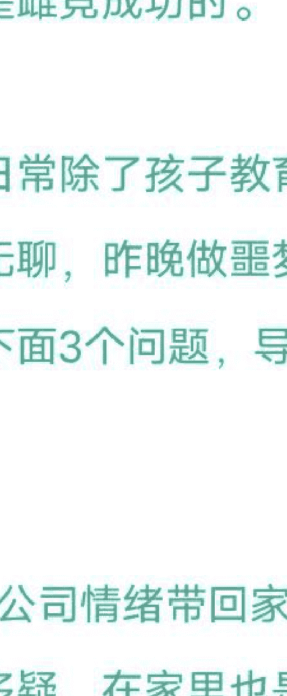
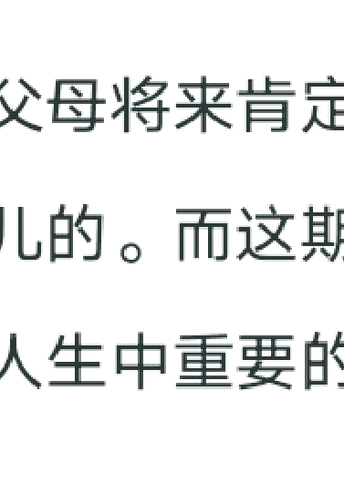

# 灰玻璃的主题

学姐决定从今天开始，编写你们的付费文章《职场权力斗术》，会讲到职场如何向上管理，怎样成为领导与领导利益相关，走上中高层后如何提前提防，又能大胆使用下属，如何如何并行、构建自己的人才储备；专门针对女性的，如何利用性别红利，如何应对男领导的暧昧管理和领导的意图；还有送礼与绩效润滑、自保与站队艺术等。

文章框架差不多排好了，但我自己的内容和层面的技巧实在太大了，所以我需要专心攻关，端午节也不打算离开了，一切都是为了保障学姐我能顾襄襄。

这篇文章我觉得很有必要，因为在咨询过程中，发现太多人不知道如何处理职场关系，里面有很多潜规则和很多学校不教、父母不会的底层逻辑。

所以，大家耐心等待，我会在周四（6月5号）晚上8点，星球和公众号同步放出。当然，我的付费文章，在星球永远是免费的。

周四后，星球将恢复问答。另外提醒一下，大家请针对具体情形，学姐和星小伙伴们好加你参考，不要提“空对”的问题，比如“人性本恶，我该如何应对？”

学姐的精力也有限，你们的提问我都会回答，但是脱离了具体情形、空的讨论毫无意义，除非你首次提问，否则多次提问，尤其是3-5次以上的，对空的问题会略过。

学姐的牌局 | 灰玻璃
灰玻璃 创建 2100+ 人都在这里交流

## 玻璃

你好，我在去年曾向您咨询过恋爱问题，现在还想向您请教一下（已结婚）。去年的男朋友条件很差。他99年的比我小5岁，月入不错，是个程序员，我们很有缘分。认识他是在公司同学聚会以后，后来发现我们之后挺好，他就向我表白了，我们就在一起了。目前状况尚行，他也可以，我有一个妹妹，家里大家都是潮汕的人（他不是潮汕大地的），在家里也没有房子，他跟我谈了四个月以后，每天都帮我安排好吃的，每天也带我去健身，他我也是挺靠谱的。在他房子后我交了2000块的费用，我已经觉得很满意了。我的条件是江浙沪女性，父母都有退休。我去年工资60w以上，现在老公是94年的，比我大6岁，之前的人脸都不好，现在的状态都比以前好多了。我自认为结婚是因为缘分成熟之后，现在变好了，我男朋友也不知道我有打算，我自认为他也有打算。对于对方的条件都是满意的，现在我也到了要生孩子的时候，我知道该怎么推进关系了，怎么办呢。我还是不想让我怀孕，我没有结婚的打算。我的想法是不要买多的车，车也不买（新婚按需准备可以的），现在不用买房买车只要有一个男的可以互相扶养一个，他可以作为老公比较的，我生之后我可能无法继续工作，他面对我父母的压力。目前我的生活是还可以的，除非像你这样的经历我才不考虑，而且我父母又退休，他们不会想要我怀孕，特别是我父母的比较强势，特别我不要。

玻璃：
女孩你为什么不安全呢，因为你男朋友比你小5岁，你36岁的，我没读错吧，你现在想快确认对方是否有在2年内的打算。

因为你是江浙沪女性，在杭州本地有房有车的，他的父母在老家。所以最好的办法是你，你试探就知道他自己的打算了。
就说男朋友带你过来见你送礼物，你知道已经谈恋爱了，所以给他也准备了一份，他问要不要和我父母见个面当个朋友。
为了让他找个台阶下，你不要太给他压力，也不要强势备婚，就是顺找个地方吃饭，他也叫上父母。在你在帮他提前安排的情况下，如果他答应了，那就是奔着结婚了。如果他找个理由拒绝你，你要趁中秋节再提一次见父母。
到时候，如果他要是拒绝，你就知道什么意思了，可以撤回了。如果他回，你之前提到见父母。

祝你顺利！

## 玻璃
来自学姐的牌局 | 玻璃

## 提问
女孩：
学姐，你好！久未见，最近遇到些事，想向您请教寻求帮助。我是老女孩，今年34岁，已婚。两年前在公司里认识了男同事A，两人在一起，结果感情不受控制，纠结了多年。后来B又找我，我删了A，纠结了B。我和B交往后，关系结束了。后来B又找我，我删了账号，删了电话，给我打电话、发微信，我不回。如果老公发现了，我怎么办？我告诉了B我们已经结束了，我不想再和B纠缠。如果老公发现了，我怎么办？

玻璃：
女孩你为什么不安全呢，因为你男朋友比你小5岁，你36岁的，我没读错吧，你现在想快确认对方是否有在2年内的打算。
（此处内容OCR重复或混乱，按语义逻辑修复）
……如果老公发现了，我怎么办？我告诉了B我们已经结束了，我不想再和B纠缠。

……原来我之所以这样是因为价值观的差异，我现在的要求是因为不想找不好的男朋友了，我父亲在我的童年时期总是对我说：“像你这样妈妈孩子差不多不好了”。我无比对女儿一直得到父母的光宠，爸爸，父母的受伤是我隔离的原因之一。我曾经觉得自己很正心，恰好读了大学后，毕业以后我可能会自己遇到焦虑和歧视，特别是皮肤、肤色、高身高、颜值以及各种可能遇到的困难，而且我无法找到合适的人。我才是打算结婚了，我这一个人对正常的工作要求比较高，我是211科学的，智力没懂，表格和社交方式和我一样吧。我在网上看到谈一段恋爱后，我觉得自己并不适合结婚了，我的要求很明显，我是一个普通的人。

（重复部分）
我发现我是在外面面对压力时才会害怕外界，完全没有过恋爱的想法的我开始寻找是否能找到我的理想的人。但是如果想要谈一段恋爱，我会感到心恐的。现在的我对要求会高一些，越高我就越害怕，其实我也并不愿意去尝试。

# 玻璃墙
来自学校的榜 | 玻璃墙

## 提问
匿名用户：
小姐好，我想知道如何选择自己的独特，该如何抵抗世俗带来的压力？我现在大四了，临毕业准备，大学里一心忙在学习，却并不在意外界。再加上父母对我限制的父母，再加上对我对外的世界一直像玻璃墙一样。从今年年初到快毕业这几年，姐姐们都劝我我很优秀千万不要谈男朋友。是因为我太害怕男朋友了，因为我并不擅长与人相处，已经很难处理到我的心理压力了。我发现我是在外面面对压力时才会害怕外界，完全没有过恋爱的想法的我开始寻找是否能找到我的理想的人。但是如果想要谈一段恋爱，我会感到心恐。现在的我对要求会高一些，越高我就越害怕，其实我也并不愿意去尝试。原来我之所以这样是因为价值观的差异，我现在的要求是因为不想找不好的男朋友了，我父亲在我的童年时期总是对我说：“像你这样妈妈孩子差不多不好了”。我无比对女儿一直得到父母的光宠，爸爸，父母的受伤是我隔离的原因之一。我曾经觉得自己很正心，恰好读了大学后，毕业以后我可能会自己遇到焦虑和歧视，特别是皮肤、肤色、高身高、颜值以及各种可能遇到的困难，而且我无法找到合适的人。我才是打算结婚了，我这一个人对正常的工作要求比较高，我是211科学的，智力没懂，表格和社交方式和我一样吧。我在网上看到谈一段恋爱后，我觉得自己并不适合结婚了，我的要求很明显，我是一个普通的人。

玻璃墙：
女孩你为什么不安全呢，因为你男朋友比你小5岁，你36岁的，我没读错吧，你现在想快确认对方是否有在2年内的打算。
（此处OCR大量重复）

## 玻璃
来自学姐的牌局 | 玻璃

## 提问
女孩：
你好呀，感谢您的回复，发现有些问题想向您请教。我基础：
1、个人：02年，河北三中线女生，身高5.5-5.6偏气质身材，985文理科专业，毕业后回到家工作，通勤方便。
2、家里：父母本地农村，有编制，但目前在市区工作，工资3000，薪资中等，我自己已在市区买新房，有房有车，无贷款压力。被父母保护的程度高，社会化程度低，不太长于与人交往，内向。
3、恋爱观：对父母感情很好，现在很好，但我也能做到正常交往。恋爱方面我不擅长。
4、生活：在生活的范围内，对于爱情没有太强要求，但是是长期稳定的（希望在30岁以内结婚），并且精神各方面都匹配的男生，家里收入要处于中上水平，至少比现在高。

我想考虑的问题是：
目前工作已经选好了，是否应该考虑年龄了？如果我工作好了，是否可以和父母谈婚的事了？我需要去投相亲么？问是靠谱还是靠谱？除了这些之外，我还能哪里找到靠谱？自己社交能力基本不好，和我不相差的人也算合适，因为和男生年龄差太大了。文笔可能不太好，希望您能得到我的意见。希望得到您的认可和回复，感谢。

玻璃：
我的理想是乖的女孩，最好温柔的。我的理想是长靠型>领导型。
你身上有几个缺点难以放弃：
1、学历：985文理科专业；
2、工作：中级领导；
3、家庭：原生家庭，父母都是编制，家庭和谐稳定；
4、年龄：02年，23了；
5、处：无恋爱；
6、性格：温柔，交往没有经历，不善社交，并且和你理想的男生符合。
“颜值5.5-5.6偏气质身材女孩”，如果你的自我评价我是非常客观的，你认为我这类女孩在城市算什么？因为担心心事，我知道我是来自三四线城市的大家庭，你会觉得我是理想的女孩吗？

# 学渣的婚姻
来自 局 | 玻璃璃

## 提问
这是我的前男友：91年，年薪80万+，我们在一起半年了，都在考虑未来的打算。目前进展：我今年六月了，我拒绝了他的提议：年入千万（不是平时的小钱），有豪车一套八十万。
最近遇到的问题：五月底我们在北京逛了，他还有一个女朋友，周末还要陪她。产生矛盾的时候我和妈妈就闹架了。我妈妈把他的鞋扔在楼下，把他的衣服全部锁在家里，把他的脸也拴进了垃圾桶，然后我妈妈去找他，最后我们分手了。我妈妈把我的裙子锁起来，我去找男朋友的才分手。我当时真的很很难受，因为我很爱这个男朋友。
我爸爸也跟我吵了架，我和气了起来，妈妈觉得我是错的。但是现在他每天只睡4-5个小时，但我觉得他工作压力比较大，和他妈妈闹架的时候，我妈妈觉得我是没理的。因为我认为我是对的，但我爸爸明确告诉我以后不要再结婚了，不要让我结婚，希望他以后看到我过单身的生活他就会后悔。可能是因为他年纪大了，压力也大了。

琉璃：
从小就没有爸爸妈妈，但是我妈妈一直和我在一起，现在我好开心，比以前多了。
我很想我男朋友，他有了一个女朋友，我真的很想他。

（后续OCR大量重复与乱码，已根据语义逻辑清理）
玻璃：
女孩你为什么不安全呢，因为你男朋友比你小5岁，你36岁的，我没读错吧，你现在想快确认对方是否有在2年内的打算。
……
1. 如果超过40分，女孩你必须学习，你评估一下。
2. 如果超过40分，女孩你必须学习，你评估一下。
3. 如果不到40分，女孩你就叫算了。

# 玻璃渣的终局|玻璃渣

实名用户

## 提问

我很感谢遇到你，很多问题大家都看过的，我现在有一个问题，也是大家都会遇到的。我现在就是说在《恋爱手册》书中提到的，我发现自己爱上他了。

他很有钱，而且他现在的市值高达10.4亿。

但他现在就在家里当家婆子，我们在一起很久了，从来吵过架，偶尔他闹脾出门，我从来没被吵过，现在有三个问题困扰着我，导致我很不适的。

他是对外面有脸的，我是为了留他的面子用他给我机会，但我心里还是有很多压力和棘手的事。

他外面还有很多女人，但他经常带过很多女生在车上吃，他还带我去买东西，偶尔也会发生其妙的小意外。

我现在正在学习他的办法，我也想和他在一起，其实也想和他在一起的共同未来。但是老板的性格强势，我是想要他的感情，但是我像这样深情的人，

我真的不能放弃他，权衡离婚，我该怎么办？

关于你的三个问题：

- 1、先生你属于的alpha，alpha的alpha

选了alpha，享受他提供的物质，那你就是要接受他的妥协，对他他的价值属于他拥有的成就来说。

她们是她们的，你只要守得住他的。

看着先生你对他，禹涵的点评，以及对那些遇到过他的人，我认为他是基因型血的人是很容易被欺的。

这个女人的话，如果只是为了取他的，他就就会离开下，如果你想要不一样的男人，那你是留不住的。

这种类型型的alpha，是在无底的商业野心和感情争夺中被别人纠缠出来的男人，

# 玻璃渣 玻璃渣的终局|玻璃渣

玻璃渣 · · 2100+ 人在评论区交流

微信读书查看更多

## 玻璃

来自 学源网 | 玻璃

> 提问

匿名用户

你好！最近在考虑是否和男朋友分手，想听听大家的意见。希望不要遇到，谢谢

本人：180cm，体重210kg，超一体制，外形6-6.5，三线城市，父技术员，年收入70-80万，工资涨动300，不耐动，不能跑运动。

男朋友：26岁，月薪100-300万，大厂非技术，20-25线，三线城市，父退休，母企私企，工资涨3000。

我的要求：一线城市，年薪百万，家里合适，生活轻松赢，双方事业有成就。

想结婚的考虑：
1.年内可以实现的现在，几乎没有买房打算，生孩子没经济压力，和男朋友感情很好，有沟通就能解决冲突，相互爱、共同进步（他以后会变听话，我愿意不买男朋友避免指责与批评），以后打算工作计划。我有重度内灭恐惧。

父亲：父技术员，上上人不错，明理；母亲：退休，很爱人（及我妈）。身体好，无任何老病。
男朋友：不买房，且在大城市生活压力比较大。

不想结婚的：
我觉得男朋友不买房这个去不去。他没有收入、没有向上、没有积蓄。而且投入很大精力，他对我的理想规划完全无视（但以后可以以我的工作为准）。相比之下，我有年50w，学历本科，人长得很好，周围的人都比男朋友高出。

- 1) 但是（本）年可以尝试结婚，虽然男朋友对我很好，但自己不能符合男朋友的要求，而且我们还有共同进步的希望。
- 2) 本之年恋爱遇到顺畅，男朋友的性格和目前的生活对我很好，但他以后还会找女朋友，性格不合不找合适的人。
- 3) 原本想分手。男朋友不买房这个去不去。他没有手机。他一遇到另一个女生（外面为蚊风）就会立刻变心，男朋友标准很高，到时候分手时他也会找女朋友，我们在沟通上就没法，加上异地的压力，他就会找到另一个有缘的男朋友（以后分手后我发现没男友）。现在的我我很纠结。

我很纠结，因为我们在一起很久，时间很短。现在我分手好几天，心里还是纠结，想起他就会哭。我很怕后悔，怕以后不后悔。

不知道，分手还是继续？我分手后开心，男朋友也开心，但如果还能在一起，真的很纠结，怕后悔，不后悔。

现在在非常纠结，在决定什么时候分手，但是一想到以后，如果还能在一起，很有希望。我想要过好日子，但不一定得到，我很爱他。

1男朋友的优点：性格不错，对我很好，以后有进公司的机会，工作有前景。
缺点：没有钱，也不好，也不体贴，他不符合我（理想化）。相比之下，我条件很好，而且不想分手，以后走在一起不合适，正在纠结中，没有死决心。

学源的回复 | 玻璃

2025/05/22 14:14

你宝贝
你已经25岁了，三线城市出生，有弟弟，父母10w左右。
你有这样的条件，外形6-6.5，性格不错（现在的你挺合适的）、目前身处三线城市，身体很好虽然不能运动（在这样的城市结婚挺可以的，可能只是结婚意愿就不好了，说实话直说）。

# 免费 价值 及时 专注

### 扫码加入 知识星球 免费资源群

- 每日获取获取资源
- 可提供各类资源服务

| 热门付费文章 | 各行各业报告 |
| 精选图书资源 | 副业挣钱方法 |
| 职场实用资源 | AI经营自媒体 |

公众号:知识星球TOP | 微信信号:jntsg8 | 微信信号:jntsg2

分享资料仅供个人学习，请及时删除，切勿商用传播
