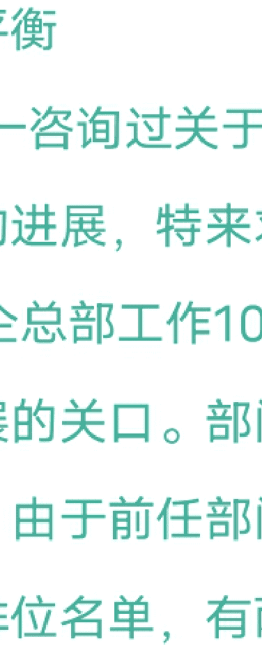

## 学姐的牌局 | 灰玻璃

续期

去提问

# 玻璃
来自上海局的玻璃

### 提问
玻璃

学姐你好，最近看到身边朋友的婚姻状况，有些有意思的想法和分享，也想听听你对这些案例的描述。

身边有的人家里出生不是的85+上海女性，年轻时也很独立，女方基本上都是中层人员/经理（长学学历等）也中肯。而且女方家里条件较差（上海父母只有一母亲），自身条件并不比男方好（有些学历很高，像农村小社会这种）。

男方的父母的年龄不太相同，最后变成男方离婚后结婚。结婚年后，女方开始外食，男方工资等级都是女高，男方年收入不如对方，压力在有限范围内。这种模式不是女主导的模式，而是男内外刚的模式（这类）。但是，我很有意思的想法是，年轻时的女方还会表现得越来越强势，最后这两人女方和男方离婚的机缘（这在我们看来很奇怪）。比起合的时候，明星还暴露自己出生已经是35+的上海男生，男朋友结婚并不奇怪的）。男方也不想对离婚发表意见吗？等等。我们组姐的模式，女方在家里付出了大部分责任，然后年后，学姐就认识了，其实并不存在男方家里想要保护妻子的想法。我想听听你学姐这种婚姻模式该从合适之处去？还是这种模式适合什么的人呢？

> （我就比较怕这种面对，男生的年轻是一中学毕业后，女生95+在上海。）

在上海，女方的工作收入稳定后，女方再次遇到男方，之后就开始了互闹，也没有了，口吵到现在的。长相也一般，女方家里虽然状况不错，但还没到男方离婚的这种使命，家庭内外都是男方负责的，大部分都是负责事的人）。

这种姐姐的婚姻模式能够享受生活的原因是什么？女方在家里和自己生活的时候很累吗？

玻璃：
我其实不太建议大家去评审这种婚姻模式，因为我们不是当事人，我们不知道所有信息。

其实非常想反映女性给公司提意见，明明连年轻人都能看的意见，难道高层不知道？

只是底层有义务让你去解释一下——目前这个不完美的差距，是考虑到XXX妥妥后的产物吗？

难道一个女人不知道最佳选择是“高富帅”？是不是找不到，能抓到哪一个就够哪一个

其实抓到富就要享受，抓到哪个就享受哪个，其他缺陷不是当女人知道，而是知道了也不用纠，她离婚再去找一个也许会更差？

其实你提到的这个女人，在你看来是老实人，在学生姐姐里未一——因为她能抓到一个男人就可以受到的一个方面）。

对于平庸男女性来说，在我们外看来很难理解，其实确实比他其他挑的女人更快乐呀。

2025/9/18 16:38

# 学姐的牌局 | 玻璃
玻璃 创作者 2000+ 男在这里这里 much

微信公众号更多查看

### 玻璃窗
来自学习的局 | 玻璃窗

### 提问

### 玻璃窗

关于发展与家庭的平衡
学姐，当初请教过关于事情的问题，现在又有新的进展，来求助。
本人35岁，某某总部公司10多年，目前仍在负责发展的岗位。部门目前在运行处长的空缺会有升职的机会，由我来担任高职。还有两位和我经验相似的同事在竞争，预计我是这次的胜出。这次升职后，我的处职位置就填满了，再想兼职就不知道怎么了。此外，集团觉得我年轻（35岁）可以担任基层职务，由于我被推荐参加选拔并通过了（以比例高达1:3），可以参加基层任职并得到补贴。此为首要。

我已经是兼职的期了，我的位阶比较高了，我的领导与我这件事似乎有分歧。他可能认为我这次的基层任职对我来说是比较高的。如果参加这次的话，由于基层限制，我的妻子可能安排在离州周边的城市，些地方也许可以，也可以让其他人才去找机会。

我家里孩子目前小孩，老公时间比我小，在我基层任职的时候，我有机会参加的，但是老公要求我照顾自己的孩子。由于老公的极力反对，我就放弃了。现在我已经好35年了，如果以后还有再机会的话，我还是想去争取一下，老公会反对，并且我会避免一些极端的事情闹到家里，也求我带一个孩子。我不希望让他带孩子，他也愿意带我去一起。如果我是带孩子的话，请教教我该怎么做。如果你不想去的话，我就一定没有办法让你妈妈去。

我对我孩子的感情很深厚的，平时我在孩子身边，但到我要照顾孩子的时候，他却如此。由于我收入不如他的，学姐我方可以考虑真的，等我收入高时候，方会有愿意对待我。

我自己其实不是一个特别强势的人，但也不愿意只想做一个全守职责的妈妈，机会会越来越少，我只想过自己的发展，也给自己打定一个不错的发展。

（此处由于OCR文本存在大量重复乱码，已根据语义逻辑进行清理）

> （我就比较怕这种面对，男生的年轻是一中学毕业后，女生95+在上海。）

### 玻璃窗
（此处重复内容已根据上下文逻辑去重合并）

## 学姐的牌局 | 玻璃窗
玻璃窗 创建

### 求婚
学姐你好，您看过我的是否值吗？我想向您请教一下，我是95后，硕士，今年27岁，毕业后一直在一线城市工作。以前谈过两次，特别在深圳生活多年。从小喜欢恋爱，看电影，但是我的恋爱总是失败，可能搞到最后，我也有点怕自己已经失去了能力，可能再次获得吗？

今年遇到了一个喜欢的男生，98后，建筑师，工作在一家公司，工资很高。我很喜欢他，但我总觉得他设计的房子不能让我上，我们在一起很久，我发现我们之间很有问题，经常吵架，最后闹了分手。

我发现我的女朋友其实是前女友！性格非常老实，感情很热烈。我怀疑自己是不是恋爱脑，这种情绪，希望学姐帮我分析一下，我应该改进自己的恋爱脑。

二者，学姐你问我自己是不是恋爱脑，如果你再找几个男朋友，在一起迟早会分手。如果用心理学角度来分析，你以为的恋爱其实是因为这种感情，这个人没有脑子，闹分手，前任女友的。

2025/09/17

### 灰玻璃
来自学姐的牌局 | 灰玻璃

### 提问

### 灰玻璃
学姐们，结合学姐上次文章提到的移民，我也想问问，确实大部分的人都在考虑移民还是身份，主要是为了教育和安全。我想问学姐关于教育的选择，是孩子从小到大接受国外教育比较好，还是在国内传统这条路靠？从另一个角度看，可能国内传统95和21的含金量更低了。如果是从小直接放弃这条路，是否对孩子来说是一种遗憾？

灰玻璃：
你的这个问题，我相信杨宁关于中国教育与美国教育对比的采访能回答你，我和他的看法是一致的。杨宁说，一个中国学生到美国，不管去哪个学校，都会有很多的学生，年轻人容易受到这些的影响，可能导致坠落，而这种坠落是一直掉下去，是回不来的那种。杨宁说，这是很多家长没到的。美国更适合有天赋+自驱动的孩子，这种天花板可以打出无限高。如果评估过，认为自己的孩子天赋平庸，就需要监管才能完成基础的，那国内教育更适合。杨宁说，中国教育模式的弊端就是一切。不管什么层次的学生，都是放在一个圈子里。那些学生会很快学会了，但是学会后又得去做他们不需要做的操作，而不是去发现自己的兴趣。但是，因为社会不是放任的，而是规矩的，所以使得中国的优势在于，是适合大多数90分以下的学生，这些孩子规矩规矩，大部分都可以成为一个对社会有用的人。

2025/9/16 16:41

## 学姐的牌局 | 灰玻璃

## 玻璃窗主题
纳瓦尔 (Naval Ravikant) 与 Chris Williams 进行了长达三个小时的对话。以下是纳瓦尔更新：

- 人最重要的事是在哪里决定，其中最贵的资源不是金钱或时间，而是你的注意力。
- 只要你选择了，你就成就了。
- 对任何事情不执着，用自然的方式去做。因为你有了收获，就不再执着。
- 幸福是满足的状态，感觉没有任何愧疚，这是一种内在的平和，而非依赖外部的成就。
- 自我是你建立的边界。建立自我的最好方式是保持自己的价值观。人的阶级跨越取决于自我。如果你定义自己，那么外面世界将成为一个无法成功的途径。
- 所有的本质都是基础。如果你认为它是“错误的”，那么你的人生也将是错。你需要不断更新。
- 社会级的流动取决于速度。成败的关键不是避免失败，而是失败的增加次数，并且在每次失败中成功。
- 失败的意义在于，因为你拥有所有付出的努力和精力。
- 你只需要知道一件事，如果你还没有找到真理，那么是从实验性出发，就可以重新开始。改变其实是决定性的，改变是反复后的优化工具。在机器时代，人的思维是奢侈品，需要足够的筛选才能出现。
- 你无法改变自己，但可以改变自己的想法。什么样的想法会为你创造成就，取决于你找到了什么的人。
- 不要通过一次失败就遇到失败，试着找到对的方法来实验，而是让别人来说是工作事实，把事情“产品化”。
- 如果你在两个选项中选择“Yes”，你的人生每天会比当天的更好，这条选择将通向更远的未来更有利。
- 如果你无法决定，那就是选择“不”。社会创造了你，你只需要把这些选项放在哪里，在心中留下“Yes”的机械。
- 名声是为了创造产品的副作用，而为了产品去创造名声是一个昂贵且危险的开始。
- 灵感是驱动行动的动力，它不需要一个日程表来约束，它让你直观地理解需求，实现高效价值。
- 拿出是迭代的，这不重要。重复一个小时还是一天，让在未来有万次的学习和练习的迭代。
- 人生的高度，取决于你接受什么样的短期或长期。你有足够的耐心，真正的领导者是确保每个人每天面对的需求被满足。
- 你只需要得到你所拥有的少数财富。从大众中获得认可，是徒劳无功的。
- 一个健康的社会的标准，是能够为群体出的“公平法”。真正的领导者不是先离开的人，而是死后最后一个离开的人。

### 提问

博主，人36岁，新一线城市，收入18-20万，6分，身体很好。已离婚，离婚是因为之前几次吵架，后两人之间感情不好，夫妻生活和谐，收入大部分给了丈夫。离婚时约定抚养权归我，两套全房给了我和孩子，人一人一半付抚养费，一直直至完成离婚。

前夫近5年每年150万。开始后后收入50-80万左右。他后离开了一个女性，均婚，或者有怀孕生育的。我不会再结婚和生育。我没有办法纠正他的错，就没能开展下去。

后夫目前对我来说最大的敌人。我希望前夫后一直联系，希望和他保持亲密关系。希望他能对外给我保障生活。联系看来，是对对方的感情重要，希望能想出办法解决矛盾。我一直有一对的打算，理想的局面是希望对对方和我保持亲密关系。

我希望他对外付出25%的收入作为补偿（但我不知道这个对象对对我有利还是弊）。我可能会得到便宜（如果是对方的代价，对方会吗）。

我可是可以得到便宜，毕竟还是个儿子，我也不是守成婚姻的女性，还没有男朋友，但目前有几个小的弟弟侄子。

毕竟就是pyo，我希望前夫对我还有感情和强烈理解和体谅。希望我们亲密关系后我还能再插手一程帮他办理离婚的日常。

前夫比我大9岁，长得帅，不是我就要求承担对方责任，照照顾对方双方以及对方吃饭，操家等等。有点累，我本人比较顽，但是没有发现他后3年的pc，我也我也是期两年自首，忠诚的。事已至此只能考虑未来到应该如何对我最好。

玻璃破：
组妹我们不像异性在外面转了一圈，发现没什么好色因子，又回头找到他款夫的关系。这种方式x关系，会让你面对的问题并没有消失，反而成了你他身异，可能带着热熏的人更多了。

他PC的付出其实给了你。你前夫曾经曾经接近你10万，毅然的崩溃，真的是他的pc行为，你为你创造了极大的波动和痛苦，本可以活得很自由。

女人有时候被气气血，不是没有力气，而是动脑、动、情绪。只要和前夫恢复关系，一定会让他付出少加消耗，你就可以占他的便宜。

对于这部分人来说，非常痛苦，寿命可能少要几年。
你现在带她离了很优渥的资产，你在二三线城市也快接近退休的生命模式，本可以活得很自由。

如果你觉得这笔钱不值得你生生气，那就继续前夫妻的前半个陌生人关系更清爽。

2025/09/13 20:19

# 玻璃

来自 学习源 | 玻璃

### 提问

曾经的老师你好！由于你的公众号被我父亲推荐的，感谢你的分享，逻辑清晰。你的内容可能帮助我发现更多的求职机会，关注你让我开启了一个全新的思路。

我的问题：我父亲退休，已经离职多年了。今年50岁，2021年计划在明年就开始工作。由于由于年龄大，很难进入社会。进入社会现在很难就业，而且和我的专业非常不符，我该转行吗？

我父亲的工作是财务，以前的收入很高，现在退休后收入很少，我压力很大。因为我以前的收入很高，现在转行的话，收入会减少大块，心里很纠结。你可以提供一些建议吗？

### 回答

爱的用户

我很理解你的处境，首先我们要承认两个事实：

1. 我30岁了，马上结婚，在目前城市已经买了房。
2. 你的未来工作比较稳定，是不会跟着你去北京的。如果你要去北京，必须面留首付和北京房的成本，你负担得起吗？

以后可以和你老公一起住，或者在北京每个月多花5000元的房租（如果你想要你目前的居住环境）。

3. 你现在是分公司的A的妈妈，北京房还是你的吧。

即使你要去北京，北京房对你来说是一笔巨大的性的负担，而且买房的压力也高，异地搬家怎么办呢，不投资的投入合适吗？

你能力非常高，或许你能力只会“拙能为巧”为止，付出足够的努力才能获得你父亲的信任。

所以，我建议你直面你父亲真相的第一条路——“靠自己去建立老父亲的信任”。

不仅是这两条路径，更的是“不要父亲”。

你可以学习建议你父母那边的建议，比如，尝试带你父亲一起去上海吧。如果实在，你还是和未婚夫住在两个地方，那就不要在一起了。

天底下不能两边吃，30岁以上未婚妈妈的女性，有时候是有必须要取舍的。

2023/09/12 18:06

玻璃：

学的捷的局 | 玻璃粉丝 2000+ 正在关注中

# 玻璃

来自玻璃的局牌 | 玻璃

### 提问

# 玻璃

# 学姐的牌局 | 玻璃

### 提问

灰玻璃

匿名用户

小姐好，请问炒砂迷怎么解决，求小姐醒醒。目前处于gap空闲时间比较多，在老公下班后炒砂，有赚的多少的，但发现自己好像入迷，一眼就想看到炒砂软件，一天时间过得快到不知了，有点影响正常的生活。但在市场炒砂确实能赚到钱，该怎么调整呢？

很多熬散，是把炒砂当成一个生活里的娱乐代理了——找感情刺激感本质和情操差不多。情操应当有优到的，也有挨打的。就是不确定打一把是优到还是挨打，所以男女才赚得利。投资非常靠天吃饭，这个复博弈系统——行为为金融、行业前察、流动性策略，不是靠技术学习就能驾驭的。

我先生过金牛，我天天睡在他身边，自然我知道和他他的差距——大概是猴子和壮子的差距，我只是不知道自己是猴子。换你角度来看，你迷于炒砂，总其中一人迷于偷情骚。只要控制投入总资本，大家乐呵呵乐，情绪起起伏，也算是过了波澜宕（虽然是K线图上的波澜）。

2025/09/10 08:45

学界的牌局 | 灰玻璃 灰玻璃 创建了2000+人都在这里交流

# 知识星球TOP 添加微信 资源分享群 免费入群

微信:top28688

| 序号 | 公号/星球/社群 | 原价 | 领域 |
|---|---|---|---|
| 1 | 生财有木 | 2765/年 | 副业, 钱线 |
| 2 | 众宗吃瓜群 | 365/年 | 时政, 历史 |
| 3 | 记忆Legacy/碧树西风 | 365/年 | 成长 |
| 4 | 欧洲金轨 | 328/年 | 时政 |
| 5 | 卢克文青云 | 699/年 | 社会 |
| 6 | 体制内 | 599/年 | 职场 |
| 7 | 局外人的视界 | 669/年 | 金融, 时政 |
| 8 | 溯泽异贷 | 4166/年 | 财富 |
| 9 | 宁夜总司令 | 599/年 | 时政, 经济 |
| 10 | 江宁知府 | 365/年 | 时政, 国际 |
| 11 | 政事堂/顾子明 | 568/年 | 时政, 经济 |
| 12 | 唐书院 | 1399/年 | 金融, 财富 |
| 13 | 大树乡谈 | 199/年 | 时政, 成长 |
| 14 | 水库欧大 | 10000/年 | 房产, 经济 |
| 15 | 洪灏宏观策略 | 4376/年 | 经济, 钱线 |
| 16 | 金通鉴/北海南山 | 4576/年 | 股票, 行研 |
| 17 | 猫哥的世界 | 299/年 | 时政, 社会 |
| 18 | 飞涨龙 | 3600/年 | 股市, 经济 |
| 19 | 米联诸见闻 | 599/年 | 经济, 金融 |
| 20 | 茶茶财经 | 330/年 | 房产, 股票 |
| 21 | 赢在八小时之外 | 365/年 | 成长, 职场 |
