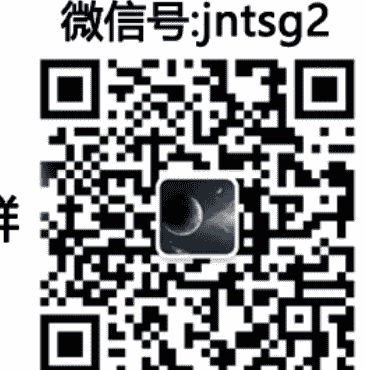

## 灵哥星球 250425 问精汇总

灵哥：
蔚来大涨，四月第三周数据上了五千交付，股价昨晚开涨了6%，可以重新关注了。

提问：灵哥您好，关税战要解决的话，果链会不会优先解决？

灵哥回答：肯定啊。

提问：灵哥，瑞芯微一季报收入利润增长不错，市场反应相对一般，股东环比增长了3万多，大流通股东很多在减持，尤其是国家基金连续2年在减持，筹码相对分散，公司基本面是不错的，目前亏不到10个点，能否坚持长拿？帮忙分析下拿或不拿的逻辑。谢谢。

灵哥回答：就是张太太了，你看我都是110、120清掉的，代表我当时认为差不多了，知道后来还能情绪飙升到那个样子。不是说一定会跌到110、120，就是当前的情况是正常的，等等才能知道方向，等多久我也不知道也不知道。

加微信jtsg2，免费进资料群。

提问：最近美国方向关税问题出现缓解，晚上一份《对美等关税反制关税商品排除清单》文件流传，主要包括集成电路（HS四位代码8542，进口量87亿）、血液类制品（3002、67亿）、半导体制造设备（8486、42亿）、医疗级清洗消毒装置（9018，35亿）、以及乙烯聚合物（3901、26亿）、半导体相关的检测仪器（9031，19亿）等产品。如果是这些板块会不会受影响？近这两天已经开始下跌。

灵哥回答：你要看些消息炒的，那就消息不出手。核心半导体双方互免是正常的，毕竟供应链链耦合在一起的。

提问：灵哥好，我想请教您：经历了这段时间的贸易战，站在未来5到10年的中长期维度来看，价投股的科技七巨头是否没有好的性价比？然后后关税之前您提到的我们自己的科技七姐妹会比美股七姐妹更高？

灵哥回答：是的，以前美股买七姐妹，以后靠中国科技七姐妹。而且海外溢价涨还没开始，我们预计两年时间CPI回到2次，开启新的印钞循环。

提问：灵哥好，想请教一下您怎么看每日互动的后期走势，感觉曾经用龙头概念股最近很活跃没什么动静。之前提到今年性主线还是AI+机器人，这个逻辑是否还在，根据您的一手深度信息，关税战的大背景下，可能下降的各行各行业过程是否还会重新成为爆发热点？谢谢。

灵哥回答：哑火是正常的，DS最近没有什么新闻，别每日互动。你看光线，星球可以搜索下，我当时就说光线很快回落不可能保持那个价格的。DS我听说版本本来来了，估计后面还有行情，但不可能的第一波那样的行情。

灵哥：
我明天一早福州，然后要上四天课程，这个课程叫圆泉，王侯有没有上过我不知道，刘强和奶茶是上过的，滴滴的柳青也过的，而且2017年我去夏威夷上上一阶段，同学就有几个滴滴的高管；我们后一个班是柳青去的，所以我们离开那天的早餐，正好是后一个班第一天的早餐，恰好是在食堂看到了柳青。

课程内容我不多赘说了，我以前在公众号文章也写过，你可以理解为对世界有更多的利他之心，有大爱，才能更好的和世界连接，让生命更好，让企业组织，社会都更好。

当然滴滴这些年还是挺被诟病的，所以很多事也是的确不是上个课就能改变的，还是那句话都是无法背叛自己的阶级的。

关于京东入外卖，和美团的博弈，互联网与京东，但是资本圈还是站美团的比较多，也会有很多人认为美团很难挑战美团的地面优势，算法太大了。有很多媒体的采访也谈到，如果京东补贴不跟，钱烧完了怎么办？所以肯定也有很多人是观望的，无论骑手还是商家等等。

我们的会员肯并不是人都认为是京东能成的，这个见仁见智都是很正常的。

来灵哥给大家讲故事和八卦吧。老粉丝知道奶茶妹妹是我南外的师妹，我认识她时候她还在清华读大二。那时候她是个迷茫的小生，虽然是网红，但并不自在，走在清华总有人偷偷指指点点。

所以奶茶妹妹去美国，我们不管网络上怎么说的。从心理学角度来说很好理解。去了美国后轻松多了，即使是少数中国人会认出她，总来说，她是自在的，而在纽约本身城市文化还是比较迷幻的。恰好灵哥那时候去了哥进修，而一旦去就是一年，公司交高管在管，而且那时候很多事也管了。

原因是金融危机之后全球资本市场不好。
