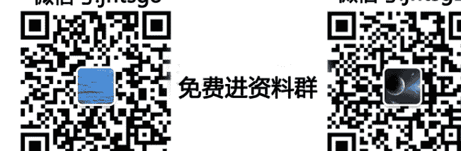

# 灵哥星球 250424问答精华汇总

微信号:jntsg8
微信号:jntsg2

灵哥：
免费进群群

美国那边一天变一天，大家感觉今美股又要妙了。其实美股昨天先高后低已经说明了情况，5400,5500那边有个压力位，破不了，并不完全是特朗普打来打去的嘴炮问题。

灵哥：
我明天到福州，周六一早开始学习课程，有福州的朋友可以简单聚，可以联系我任意微信信号。

提问：金山办在天天之下，但最新的25Q1财报来看，收入及利润增长并不高，请问目前的市值是一个好的介入时机吗？

灵哥回答：市场有些过度反应，惊弓之鸟，金山办是信创头部标的。

提问：芯原最近有大单融资买入一般来说这是什么情况，是买入信号吗

灵哥回答：AI芯片产业趋势还乖呢，着急哈。当然半导体是周期性行业，芯原前两年行业景气度影响连续亏损。这仍然是科技公司投资逻辑，不是价值型。理解这个区别就可以

加微信jntsg2，免费进群群

提问：灵哥：4月7日跌之后传股反弹快的，但这段时间显得很拉胯，绩效似乎也在预期之中，这个波还可以继续维持吗？

灵哥回答：最近不热门的个股都不好，形成指数涨个股不涨。就是虽然小米主要是做非洲，但是关税战对出海消费电子目前还是影响较大，市场情绪也不好。小米如果没有汽车是前两年只有手机估计股价是一样的胯。

提问：灵哥，关税日您觉得会在6月份之前解决呢，还是变成长期，感觉特朗普变来变去，不可信，我显然也想借此机会做一波国产替代和促进人民币全球化，但是很长的关税会不会变成鼠相争渔翁得利的局面

灵哥回答：他变来变去就是操纵股市，想让大家觉得他深不可测，但手上也有牌才行，他现在手上没牌。上次看polymarket，七月底解决概率80%，五月底解决概率40%，四月底解决概率10%。我觉得这个概率是合理的。

灵哥：
美团单量6000万，饿了吗？京东已经开始认订单破千万了。如果这个数据是真实的话，对美团还是还是大的。而且肯定也要抢饿了妈妈的单，所以饿了大概率要涨进来，外卖江湖变了。

美团问题是太黑心了，京东给出的同样商家的一东西可以比美团便宜一半。再同样的用户习惯也挡不住便宜。你要问我股价，目前京东和美团股价都受影响，但是等市场反应过来，美团影响会更大。

美团是否有应战？目前还看不出，我估计这两天京东三板斧让美团有点槽，很难出的战略但是只是要退一天，市场份额就会被蚕食。

灵哥：
微博禁言15天，我也不知道发了啥禁了，说不定是得罪美团的。

提问：灵哥，由于孩子要在9月份港大就读，医学院学生需要自己租房，去当地发现房租太贵，考虑是不是买一个小房子？请问您觉得未来香港的发展前景怎么样？香港房产目前有没有投资价值？多谢

灵哥回答：这个也要看情况吧，香港肯定也要倾斜民生的，所以怕可能不是所有房子未来都要涨，这和前景无关。坦白讲，这不仅仅是买房的问题，是孩子的自立问题。我在新加坡国立大学宿舍六七平方米的单人间住了三年，厨房卫生间都是公用的。我还要自己做兼职赚钱交房租等等。现在不是简单微信jntsg2 免费资料群群学历就能优胜了，也不是家里有钱就怎么样了，越早让小子独立自主对真实世界对他比较好。

提问：丁老师，既然《中央帝国的财政密码》作者立场不坚定，还不如《中国货币史》更好。

灵哥回答：谢谢

提问：灵哥，黄金短期内回调多少，特朗普放松和关税战信号，美联储降息，还有降息预期吗，灵哥回答：可能会3000

提问：想问一下灵哥，怎么看待公司爬梯子

灵哥回答：我们有一个上海会员周日聚，高手陈总在黄金愁了很多，这两年爆发，过去周赚了多万。但他更早的传奇经历是童装老板，最高时候赚了一百万美元，但是08年之后逐渐进入危机失败，人生最低剩下几万。22年是靠着上海还想和我见一面，感谢你。那么我们之后，随意聊聊，比如黄金，每一件成本，大家都多少钱，08年之后的一次暴跌，包括孙割怎么走出低谷。这是因为我没做过童装外贸，也不是职业玩家，我无法理解的情况是大部分人爬业都会遇到中年危机。并不代表爬业就不能优势，大家想想特别很多人看不上的中年危机，让老板做什么？在职场中人际关系都能妥当，问题在于大多数人只是半途而废，急于求成，所以无法到最后。

灵哥：
下面就是博威合金，科斯，舜宇，瑞声，这些受关税影响的出海等特朗普停止关税就会暴涨，今天科斯在大弹了。

灵哥：
这个还是我们南京人，金中学的，孙割前女友（指曹颖）之前因为爱心而出的。人都是自己的追求，比如静静很能当安静。孙割善终，天理难容。

曾颖|滕长 发文：@tenten19901107

理解她那一代高知的一些共同想象法，挺好的，活在自己的梦境中，孙割梦醒了，其他的还没醒。

孙割善终，天理难容！

非常感触在这次事件中，90%的人站在我这一边，尽管都是弱者。这是纯人性中邪不胜的力量。尽管我只是一个看上去帮不了，给不到好处的弱者。我也能理解另外10%，借着这股，想要抱紧大腿的人，你们是被溺海中的“弱者思维”所占领，渴求依附一个看起来更大的对象。我没有嫉妒，绝对没有嫉妒，这个事件中任何一方看似乎得到了他的爱情，结果比我更为圆满的女性。我有的只是可怜，谁能想到一个看起来温和妥巧、近人、毫无架子的大佬，其实是一个穷极恶之人呢。你问我人生追求什么？我只能说各有不同。在我看来，静静这类的人，她能穿越人类寿命的极限，活100年，200年，300年，她的灵魂不污。她脊梁硬朗，拥有这个时代的幸运。而那些自私自利，除了利好地产，给社会带来任何贡献，只是自己赚得满满的人，他无法获得永生。

加微信intsg2，免费进群

拿着令自己都不安的财富，没有能力驾驭，却偷生四处流窜，见之不得。这样的人，绝应该是我们这一代的精神信仰。我知道圈看向财富，评价一个人的价值本身，只看他能赚多少钱，而不是他帮助多少人。没关系，即使是在如此评价体系下，我认为利益相交的最终会因为无利可图而做乌雀。我不认为他拥有那么多的财富，我对他购买艺术品的动机颇有疑问，我怀疑他只是一个白手套。当年购买道叔app时，业内皆知根本没花多少钱，他在媒体上狂官宣自己自己了6000万。当年做数字货币项目，却连2都是什么都不懂，积累财富纯靠天地利人和侥幸。德不配位，必遭反噬。他的话大家听一点就好，相信就很慢。

最近传他爆仓，于是是非常焦虑，四处维权。我不知道消息真假，但是主流国家逐渐承认数字货币合法地位，随着美国拥抱比特币，我想其他大国开放只是时间问题。大家可以思考，这些强权大国难从二级市场购买比特币吗？我有更快速的方式。比如收缴。有生之年，我想我们都能看到一些人锒入狱，他并不是应该被膜拜的偶像，只是一个焦虑的待捕之囚。希望他这几年，能尽物质之福、美人之乐。

我，只想成为这个世界上，另一个静静。那个我从小立志成为的人。年轻时会走些弯路，但好在一切还能从头再来。不要替我惋惜，我懂怎么和他一样钱，但我不想。

# 25年4月10日

相关的回复

无产阶级尚 @ xiaiaohe...4月12日

回复@tenten19901107

孙割善终，天理难容！

| 免费 | 扫码加入 知识TOP 免费资源群 每日免费高价值资源 搜索服务 |
| 价值 | 热门付费文章 | 各行行业报告 |
| 及时 | 精选图资源 | 副业赚钱方法 |
| 关注 | 职场实用资源 | AI财经自媒体 |

分享资料仅供个人学习，请及时删除，勿请传播

微信jntsg2，免费资料群
