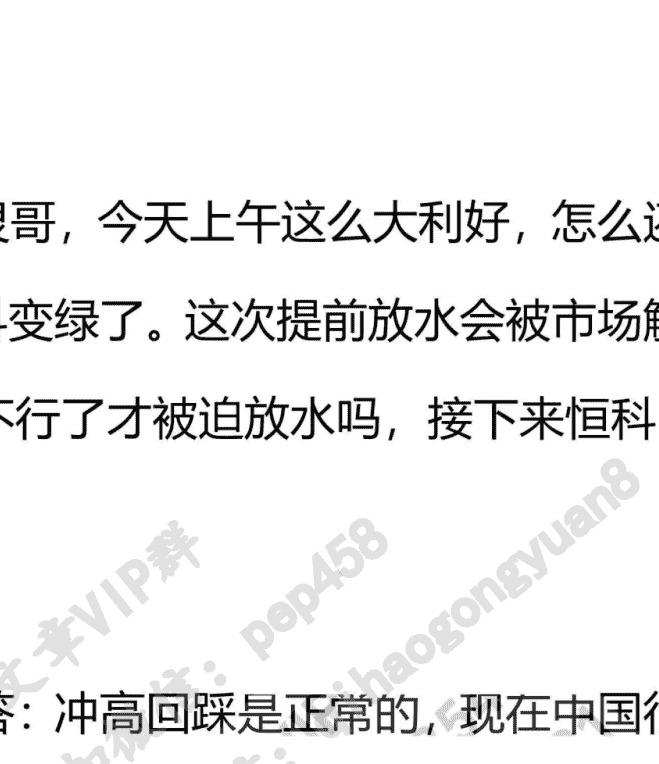

# 灵哥星球250507问答精华汇总

灵哥：

今天军工大涨，包括成飞、沈飞，还有我们星球分享过的无人机公司航天彩虹，以及制导公司雷电微力等。有人问我是不是军的DS时刻来了，这个我觉得不能太乐观了。

华为mate60，924，还有DS都是全球级别的大事件，巴基斯坦捍卫印度六个战机比不上。而且军工业是发达国家的命门财富，海外媒体也会拼命隐藏。军外销长期看好，但这次的事件对军工短期正面影响不会太久，有筹码的可以随时下车。

印巴应该不会太升级成为全面战争，或者战争完全升级，对中国不利。现在主要矛盾是欧亚大陆一致对美，亚洲不要乱乱，当前的表面的和谐和策略。美以希望的，恰好是我们反对的。既然我们枪在手，船靠炮利，反而是有克制的主动权。

提问：为了维持美元汇率，香港已经售出了1100亿的港币，不能让美元跌破7.75的位置，所以香港金管局必须买入美元，卖出港币，香港正在用“自残”式操作美元霸权。这场赌场用人血汗钱堆砌的汇率保卫战，究竟是在守护国际金融中心地位，还是在给美元霸权当人肉盾牌。有人怒斥香港加微信：pep458 备用：qihaogongyuan8 已成华尔街提款机，有人力挺汇率稳定是金融生命线，更有人质问为何不用人民币挂钩？灵哥，您怎么看？

灵哥回答：他们都觉得自己是大聪明的，国家为何不选他们当金管局长？委屈他们了。

提问：请问灵哥如何看待巴菲特大规模持有现金，他是为未来一两年爆发世界金融危机做准备吗？如果相信爆发，我们普通人应该怎么操作？

> 灵哥回答：拿中国核心资产，现在只有中国能保护我们的财富，还有就是黄金。比特币不是黄金，和黄金地位没法比。

提问：灵哥，依此看原油维持下行趋势？重构供应格局？

OPEC+突然宣布增产，众所周知沙特的石油开成本很低，低于十美元，但由于其有众多爷爷要养，众多基建项目要投入，其财政均衡要油价在80美元一桶。现在突然宣布增产，找了个伊拉克不听话的理由，实际上就是冲特朗普基本盘岩油红杆成的。美国页岩油的开采成本很高加上金融杆成本，普通要60到65美元成本一桶。所以油价在破60，美页汽油只能停产，这样就被挤出市场，沙特俄罗斯等扩大市场份额。

灵哥回答：一定啊，就是用来割别人夺筹码的。中美现在开始谈了，如果有好结果，市场说翻脸就翻脸。特朗普只是哑鸭嘴嘴，他在国内搞些韭菜，最终中国无论谈出任何结果他都会赢了。

提问：灵哥，今天上午这么大利好，怎么还是跳了，恒恒变绿了？这次提前放会被市场解读为中国经济不行了才被迫放水吗，接下来恒恒怎么走？

灵哥回答：冲高回踩是正常的，现在中国很多短线资本好的不学，都学了老的预期玩法，买预期现实，以前A股没这套的。这就是人类博弈啊，熵增，人类越来越精明，其实就是博弈本质在不断增加。普通散户要博弈成功，中国智慧哲学是王道，给大家六个字戒定慧，信德行。

# 灵哥：

大家分享一个顶级的博弈，不是为了最后赢。

在古代中，我们为了最后。。。人游戏，最高的玩法，，，，，，，，，，，，，，，，。是弱。，大家都说自己是好人，只要稍有，老大就会被修理。对于大多数来说，一旦发现老大处于弱势，杀手就会跳出来，老大宣布自己是好人，为了最后。。

，，，，，，，为了最后。我们和美国就是这样的，很多事情还在维持平衡，目的都是为了最后的一击。日韩东南亚欧陆等其实对美不满很久了，没有哪个国家是愿意被美国这样殖民地支配的，特别是已经到钱的国家，没有谁把利益吐出来。只是谁不能当大哥而已。至于对于这些美国盟友，或者西方意识形态这些，在真正的历史规律面前看来不值一文。人类社会从未离开过本质和猴辈统治没有差别。推倒王者屠血的感情和实际的利益大于上经营的东西。
