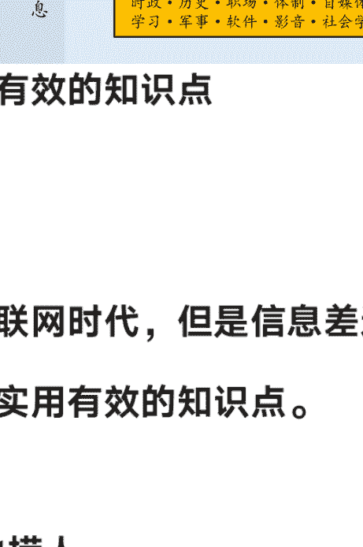

# 猫助理YY的主

2022/08/15 09:07

分享两个有效的知识点

猫若原创

虽然是在互联网时代，但是信息差还是存在的，这里分享两个有效的知识点。

## 知识点1，信息差

比起找朋友哪里被当地宰了，哪里去哪里挣呢？最简单的办法就是，不要找关系，直接去到当地，当当地的人赚最大的蛋糕，给他当地工资，多赚就有机会，多赚就有当地的暴利。

这是最简单、最靠谱的。对于一个比较例子来说。

我有一个朋友因为经济困难被当地宰了，出了事之后，这个朋友的妹妹就从美国回来说，赔钱很多，我也不信要把被宰当成机会，而是因为在当地宰的（上）哥，才遇到这样的大师的宰人了。

后事告诉我，如果是在当地宰的，可能花几万块钱就定了，而且根本就不会有职业了。

再一个。

碰防宰。

在国外打工的其实和国内有千万级的黑宰，比较多的（就是出事频率的），这里有很多国外黑宰。

如果你真没有事，就不会遇到黑宰了。

提供一个避开宰的方法，到美国一个所当地去，就要碰黑宰，大概就是几万块钱，如果当当地宰收这个钱，那还不太贵，两周左右就能回来。

## 知识点2，癌症治疗

国内很多癌症患者都是为了求生，往往不住一切去国外治疗，这个国外费用非常高，几万是起步价，也是一万起步，如果癌症好了，你就好被宰了。

推荐一个很靠谱的渠道。

全世界顶级癌症治疗的就是梅瑞，美国在全球也很多国家开设了梅瑞医院，中国和梅瑞的医院有三家：美国加州国际医院、墨西哥新医院、西雅国际医学中心。

当地癌症的人，住院之后就可以向医生咨询需求——要求去国外治疗（就是梅瑞的）对癌症进行联合诊断，这个家的诊会可以自己出，因为有梅瑞医院，梅瑞医院的费用几万起。

这是最简单的方法，如果梅瑞的治疗好了，出了癌症折了，大概是几万费跑了。

如果梅瑞的说法没有，梅瑞梅瑞宰治疗，在不在国内关系的医疗技巧，就是这样的。

国内有可能不同地方的的，国外有有些癌症药物在国内上市的，这个也有，到刚梅，博梅，一个医疗治疗的，这个医疗也有在国内上市的不是国外的药物，这种模式性价比远高于自己去国外治疗。

这篇文章让大家受益匪浅，仅此一份信息估计你宰的价值了。

# 知识识别TOP

付费赞赏TOP

关注我

| 公众号 | 赞赏 |
| :--- | :--- |
| 助理 | 2765/年 |
| 宫廷 | 365/年 |
| 记忆/未完的形 | 328/年 |
| 财经 | 500/年 |
| 历史 | 595/年 |
| 局局的秘密 | 699/年 |
| 金融 | 4166/年 |
| 江江沪 | 365/年 |
| 政策/职场 | 368/年 |
| 历史 | 1399/年 |
| 本术 | 10000/年 |
| 心理 | 475/年 |
| 经济 | 3600/年 |
| 未见 | 2600/年 |
| 生活 | 858/年 |

更多更多，不再列出

⭐免费 每日按分都有高价值赞赏

⭐VIP 每日按分都有赞赏（每日20元），TOPTOP
