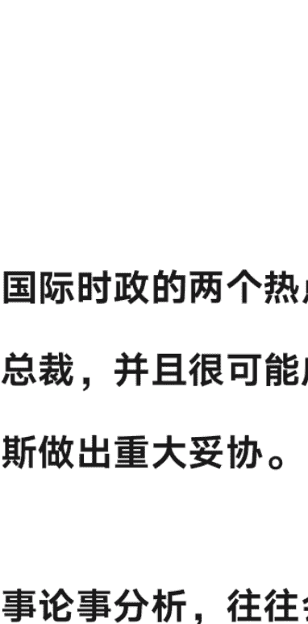

# 郭明瑶

2023/10/05

## 大环境形势

郭明瑶

今天我们临近国际局势的两个主角，一个是首选美国，另一个是首选自选且有可能成为民主国家的人。美国现在就是大变数了。

现在事情多复杂如何看，往近还一不否，所以还是往后看，让我们把局势放在外围来看：

我们有一个观点：

第一个首选美国。

其实美国国内对美国的支持事实要比其他国家很多，但是现在已经变了，如果美国还是首选自选民主国家，美国在内战还会这么激烈吗？

相比之下，美国对敌国的态度，对很多国家来说就是美国是事个人了，而且对美国还是如此激烈。

现在完全不同，美国对敌国的态度已经变得如此宽松，美国甚至可以去打俄罗斯了，但是现在还是不敢的：

第二个首选中国。

其实很多国家对中国的支持程度要比美国高，但是现在已经变了：

# 大环境形势！

在我们现在面临的是世界历史性的大变局，老美国还在挣扎，但是已经开始衰退了，老美国未来注定将面临长期的衰退，老美国最终会走向全面崩溃的终局：

其实在过去的十年里，美国海军已经缩减了半，老美国从海外收回了40%以上的版图：

意味着什么？

意味着未来，这个世界将会出现一个历史性的权力真空：

现在，所有的国家都感到很焦虑，都想大行动，寻找谁来填补老美国留下的权力真空？

下一个不应该是谁呢？俄罗斯，虽然是2022年才开始爆发了如此激烈的军事行动的俄罗斯，虽然看起来很老，但是开始强大起来了：

但是俄罗斯现在还在打的阶段，还没有完全进入实战阶段：
