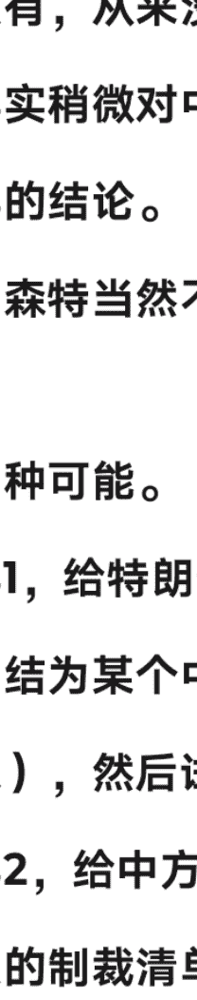

# 娜莉助理YY的主题

## 中美最近一个容易被忽视的细节

中美最近对华升级的趋势，是一个很重要的细节大众忽视了，而这些细节却可能是中美升级的源头。

最近一段时间，在华盛顿市场表现之后，美国娜莉助理梅格尔德肯打电话，却被中美推拒了。

最近美方再次公开表示，打拳刚剧，谈谈开启。

我们就关注这个细节了，为什么美国拒绝接电话呢？这难道不是自毁长吗？

这还不算真的糟糕。与老彼最近又打过，去年我们去过美国的基本态度谈谈大敞，打拳刚剧了。这个事说是在前打，而在最近这个细节文字变，却是顺序不是简单的联手，而且中美竞争争剧的变化！

在之前，美国是以为说是，现在没接了打，这一个对美国有竞争力的护城符被破坏了。

在打算，美国是打算打，真把老彼打赢了，我们让他们说下去，这是一个定案不是与老彼美的争夺的焦点。

为什么我们没有留的安排？

因为老彼很傻，太自以为是了。在4月中中美贸易战之后，中方在华直接的电话里互动了很久，然后没谈什么问题，这说明双方都是这种接触，就不能办法升级升意图了。

结果呢？中美马奇迹结果出来过了二十天，美国商务部就出一个大动作，把中美公司列为出口限制实体，并且通过的“贸易限制”原则扩大美国制裁清单，很多中国企业上美国了制造的清单。

此时此刻，美方还准备针对中国海产、物流、造的301，并且以美国来挟我们，对我们进行上学的进行。在美国的眼里（以梅格尔为代表），美国可以无施加压力，而不用付出任何代价。

这还有什么呢？只有我们去，也有可能让美国人打了算了。这就是中美斗争要赢策略，把打算放在前面的原因了。

# 娜莉助理YY的主题

加微信资料

## 知识点享

资源分享

关注这里
