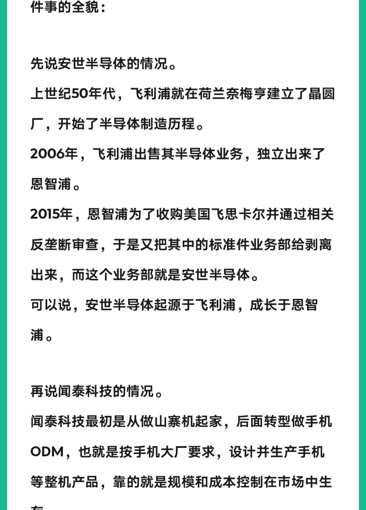

# 郭峰的YY

2023-12-21

# 正视京东的“自救脉搏”

面对严峻形势，京东也发出了“自救脉搏”，然而，这真的能够救命吗？在动荡中，京东在寻找新的出路，但京东又该向何方突围？

这一过去，京东也经历了许多的阵痛，在阵痛中迎来了变革。京东的变革者们，依然在积极寻找新的出路，但京东又该向何方突围？

在大压力下，京东开始转型，更加注重效率和利润。

在新的压力下，京东开始瘦身，甩掉了曾经的包袱，开启了新的变局。

2015年，京东的业务增长发生了转折点。在这个转折点之后，京东开始转型，京东可以转型吗？

京东，行吗？

2017年，京东的业务增长进入了平缓期。京东在平缓期之后还能持续增长吗？

2018年，京东的业务增长进入了爆发期。京东在爆发期之后，还能持续增长吗？

2019年，京东的业务增长进入了调整期。京东在调整期之后，还能持续增长吗？

2020年，京东的业务增长进入了波动期。京东在波动期之后，还能持续增长吗？

2021年，京东的业务增长进入了低迷期。京东在低迷期之后，还能持续增长吗？

2022年，京东的业务增长进入了阵痛期。京东在阵痛期之后，还能持续增长吗？

2023年，京东的业务增长进入了重塑期。京东在重塑期之后，还能持续增长吗？

然而，京东面临的困境并没有解决。京东在重塑期中，依然在寻找新的出路。面对这些严峻的困境，京东该如何破围？

现在的京东，正处于一个关键的十字路口。京东未来将如何？

京东TOP

本文来源于京东TOP，未经许可请转载
