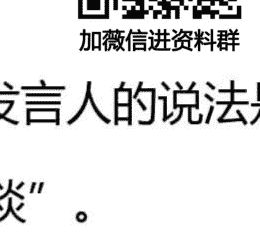

# 猫哥星球 251029：德国外交取消访华

2025年10月24日，德国外交部长瓦德普尔，宣布“推迟”访华行程，其实，就是取消。此事，在西方论场引发的波澜，不小。

对于取消的原因，德国外交部发言人的说法是“目前未能在中国安排足够的会议”。

难受听听，就是除了王毅答应礼性会面，其他人，没人想见他，这样访华的意义就不大了。那么，咱们为什么没人想见他？

直接原因，有两个。

## 第一，瓦德普尔的言论，不太友好。

早在今年8月，他就亚洲之旅中，批评我们“在台海以及东海和南海采取日益咄逼人的立场”，并称“或多或少公开威胁单方面改变现状，并改变边界以利于自身”。

访华前，瓦德普尔又表示，“如果自由流通当暴力冲突而不再可能，将对世界许多地区的繁荣影响，德国将保持一个中国政策不动摇，但必须避免暴力改变现状”。

这话的意思，不是要求台海永久保持现状？

对此，外交发言人郭嘉昆指出，“只维护台海现状，却说反对台独，这是对台独活动的纵容支持，将对台海和平稳定造成严重冲击”。

一边对华不友好，另一边声称希望说服中方放松关键矿产出口限制，其实就是稀土。

他的代表团名单里，特意把德国稀土进口商Noble Elements 的总经理给带上了。代表团名单里，还有德国汽车工业协会主席德尔加·穆勒。

穆勒的作用，和我们商讨“安世”供应链的问题，毕竟“安世”的产品，被不少德国汽车采用，一下子断供，可能会打乱生产。

“安世”最大的芯片生产基地在德国汉堡，国内境内工厂主要是封测。没有封测，供应链中中断，生产再多的芯片也没用了。

态度差，还希望我们能在稀土和“安世”问题上让步，就像在说“你跪下，我求你个事”。

王毅愿意礼貌性见一下，算给面子了，其他人不想见纯属表情之中。

## 第二，访问的取消，可能与“安世”事件有关。

荷兰政府抢劫“安世”，使得我们把愤怒的目光，投向了荷兰，却忽略了一个关键细节。

涉事的“安世”高管有三名，分别是：
- 荷兰人鲁本·利希滕贝格（首席法务官）
- 德国人斯特凡·蒂尔格（首席财务官）
- 德国人阿希姆·肯佩（首席运营官）

三个董事人士，有两个是德国人，难保德国政府和事情没有联系。要知道，荷兰和德国的关系不是一般的密切，荷兰在经济上高度融入了“德国经济圈”。

除了荷兰，“德国经济圈”的成员还包括森堡、奥地利和丹麦，荷兰陆军第13旅，甚至并入了德国第10装甲师，接受德国的指挥。

这种情况下，德国如果让荷兰点坏事，自己当炮友，测试一下我们的态度和反击的强度，并非可能的。

侧面证据，便是“安世”事件发生后，下萨克斯州经济部长长斯文·舒尔茨等多名基民盟的地方诸侯，表态支持荷兰政府的流氓行为。

# 默茨政府呢？

虽然没正式表态，但对于地方诸侯的言行不加阻止，本身就是一种态度。

当然，我们对德国态度发生变化的更重要原因，是大环境发生了变化。

以前，我们积极联结德国，为此不惜输送各种利益，有时候德国恶心一下我们，我们也会赌个笑脸，背后是看中了德国作为欧盟联盟核心的地位。

一旦美国和欧盟抱团，我们真的压力山大。而拉住德国，能在很大程度上拉住欧盟。只要他们不联合起来，我们给我们一些好处是值得的。

在特朗普第二任期开启后，欧美关系的裂痕，西方阵营的内耗，已经十分明朗。

特朗普和欧盟，在整个欧洲掀起了“大战”，各自希望扶自己的势力：
- 罗马尼亚总统选举，特朗普支持极右的西豪，欧盟支持极左的尼索尔·丹；
- 阿尔巴尼亚议会选举，特朗普支持极右的民主党，欧盟支持极左的社会党；
- 波兰总选举，特朗普支持极右的纳夫罗茨基，欧盟支持极左的恰斯科夫斯基；
- 葡萄议会选举，特朗普支持右翼的“够了”党，欧盟支持建制派；
- 在德国，特朗普支持极右的选择党，欧盟和德国政府则试图将选择党排除在政府之外。

最夸张的当属今年2月的“慕尼黑峰会”，万斯在开幕式上骂了欧盟一顿，惹得会议主席霍伊根斯伤心（建制派）当场落泪。

至于双方在关税、产业、乌克兰等议题上的歧，就是明着的。过去的十年，西方阵营内部从未出现过如此大规模的分歧和内耗。

我们最担心的事情——美联一致对付中国，短期内很难发生，起码特朗普任期内不用想。

这种情况下，中国虽然还有必要拉扯欧洲，分担特朗普的火力输出，但拉扯的价码肯定会下降，毕竟你们都团结起来了。

那么，原先给欧洲的许多好处，就不会再给，原先对欧洲的忍让态度也不会再忍让。而是，我们对德国可能变得不再客气的根本原因。

瓦德普尔没有意识到时代变了，还试图用过去的办法 PUA 中国，那就别来了。

虽然网上一些人埋怨“战狼”行为，但作为一个经常逛外网的人，我是很赞成给他们一点颜色显目瞎的，因为西方人的逻辑完全是强盗。

比如，红豆论坛欧洲版（相当于西方知乎），还有一些西方主流媒体网站的评论，在评论“安世”事件时，最常见的态度就是“中国人”。
