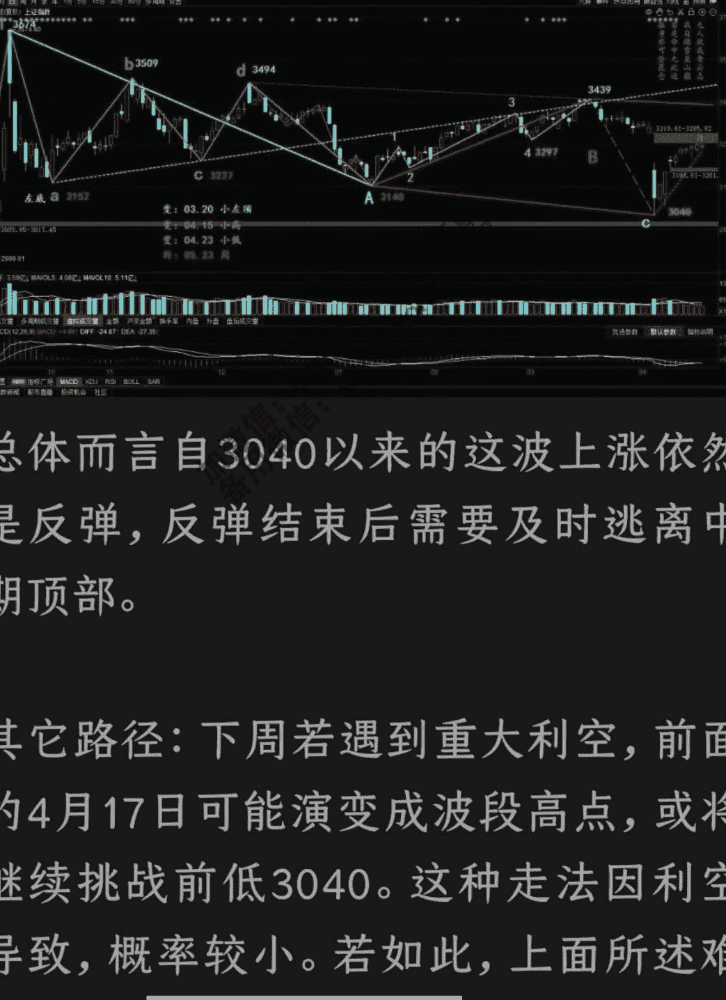
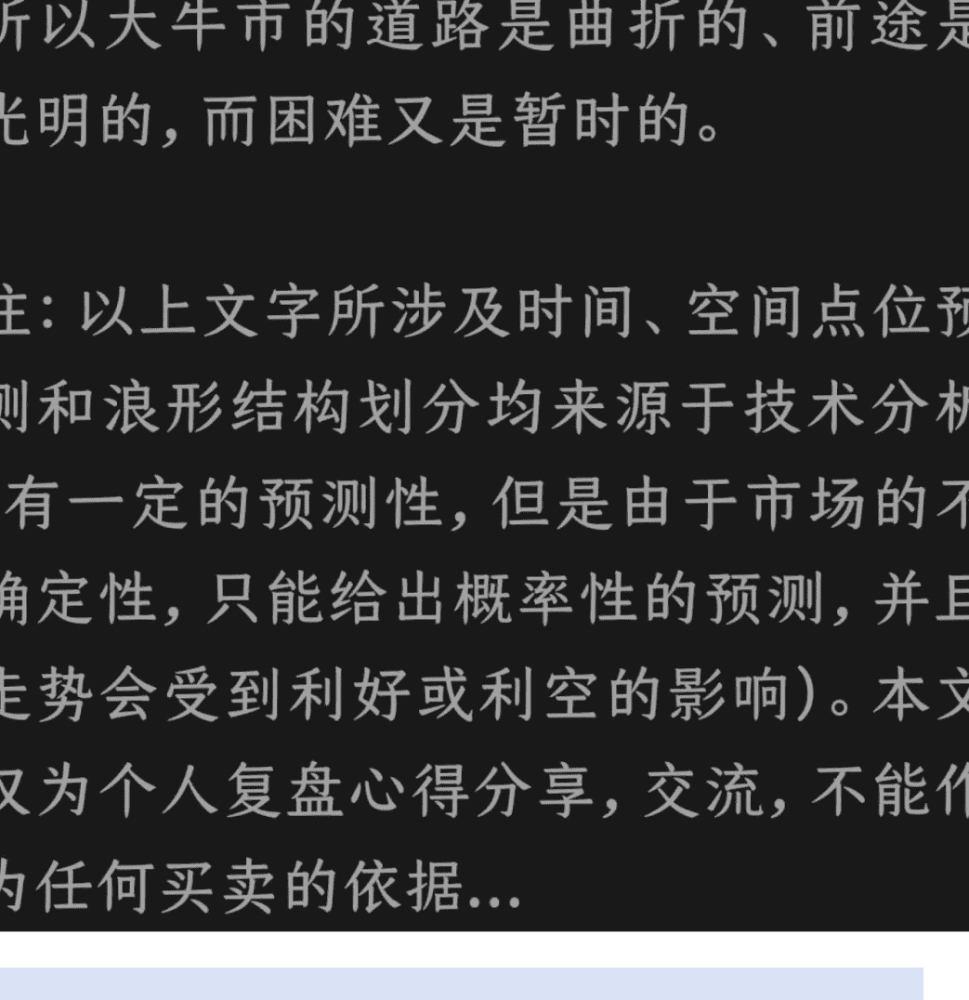

# 短期和中期的运行轨迹 4.20

前言

很多绝学并不适合分享，更适合圈内交流，深度了认知，对于市场的规律和内在的运行规律，那么就可以一反反三，推出未知的东西。

只想得到答案，对技术不感兴趣、无意深层阅读的读者，请慎仔细！

本文包含以下几点的运行轨迹：
1. 下周的运行轨迹。
2. 中期的运行轨迹。
3. 最佳机会

上周大盘反弹，连续了5个交易日，却是还要持续震荡。可以理解为内场资金的震荡，那么程度也较低。

小级别60分钟，可以见到某某别的形成A类运行。目前面（3040-3439）的0.618附近有3258.b处的阻力，同时会受到趋势线C的双重压力。感指指数在这里先等4个B回荡，然后迎C上行机会会比较好。

下周若下跌，回点在4月23日附近，产生小小的概率较大（较难回抽3186-3201），再次上涨；第一目标是回补3319缺口，第二个目标将高3439。

中期运行轨迹：3浪(abc)或5浪上涨到月中旬。目前面（3140-3439）构成的波形成A~B反弹（红色线段形成所示），中期大概低于3439点附近，之后至少还会形成第三个中期部（变形B反后的c浪），最后并将开始上升。

整体而言而3040的这次上涨依然是反弹，反弹结束后需要远离中顶部区域。

其它路径：下周若遇到大利，前面的4月17日可能变成涨高点，或将继续回抽3040。若走此失败逻辑概率较高，上述预测，将成立。

在板块方面，3040波可以定义为防御性的形态或超级级别的反弹，并且持续性较弱。建议谨慎的读者，在此期间可以低吸高卖长形态，在到达变形B反后的c此处再跟进大级别的横筑。

大亚里跌后调整的过程非常长，首先是2019年3340-3258附近，并且形成四边形B底反弹，然后到c底部。期间反弹宽幅震荡了2个交易日，最后并开始第三浪上涨。

注：以上文章所涉及趋势和空间结构均来源于技术分析（有一定的确定性），但是由于市场的不确定性，只能给出概率性的预测，并且受到各种因素影响，存在出错的风险。本文仅为个人复盘之分享，不能作为任何投资的依据。
