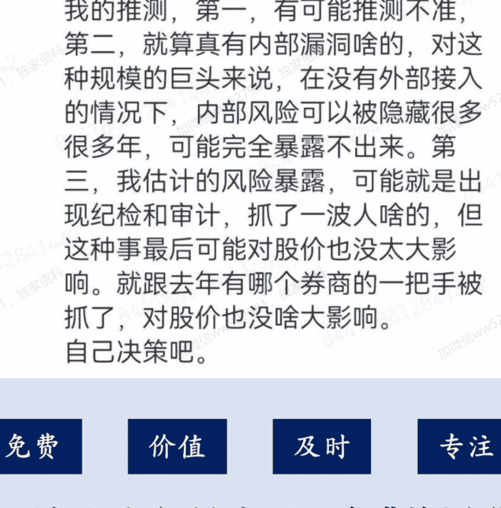
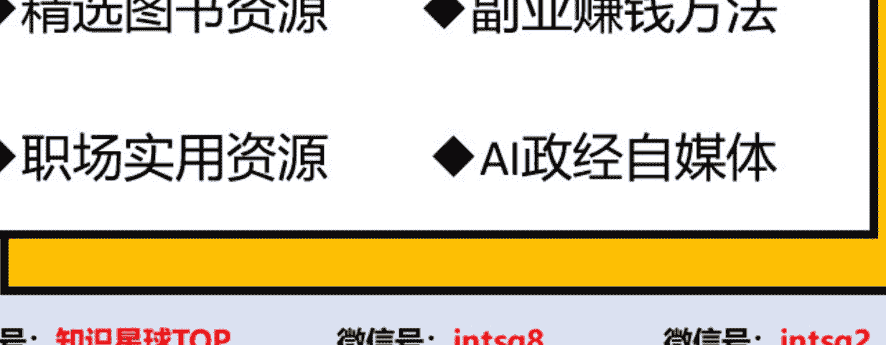

# 大户助理-今天的主题

2025/5/8 07:10

- 有 100位朋友发表了观点和态度

时间线 2025.5.8
珍老师评论回复

中行有风险吗？

可爱的哥们直接按键2就能识别二维码哈，右上角三道杠可以看到的到期时间，到期90天就可以忽略了。

# 股票讨论：各位朋友，看了老师的最新策略后，有点担心行情了，是不是应该换掉股票了？请请教。

也不至于，毕竟大瘦的骆驼比马。
中行有关没有内部风险，这只是我推测的，可能有推测的，如果没有内部漏洞的，对这种规模的模型来说，在没有内部暴露的情况下，内部风险可能就隐藏很多年后，才完全暴露出来。我估计的风险，可能就是现在行情时，抓了一波跌的，这种事最后可能对股票影响也太大了，去年有哪个券商的被一手抓了，对股价也没大影响。
自己决策：

## 免费 | 知识 | 闲 | 时

扫入 知识星球TOP 免费资源群

- 每日免费获取优质资源
- 提供各类资源深度搜索

- 热门文章
- 各行每日报告
- 精选图资源
- 副业赚钱方法
- 职场实用资源
- AI政策自媒体

分享资料仅供个人学习，请勿转线，勿用于传播

来自 珍大户的经济圈

珍大户 创建 73000+ 人都在这里交流

知识星球
