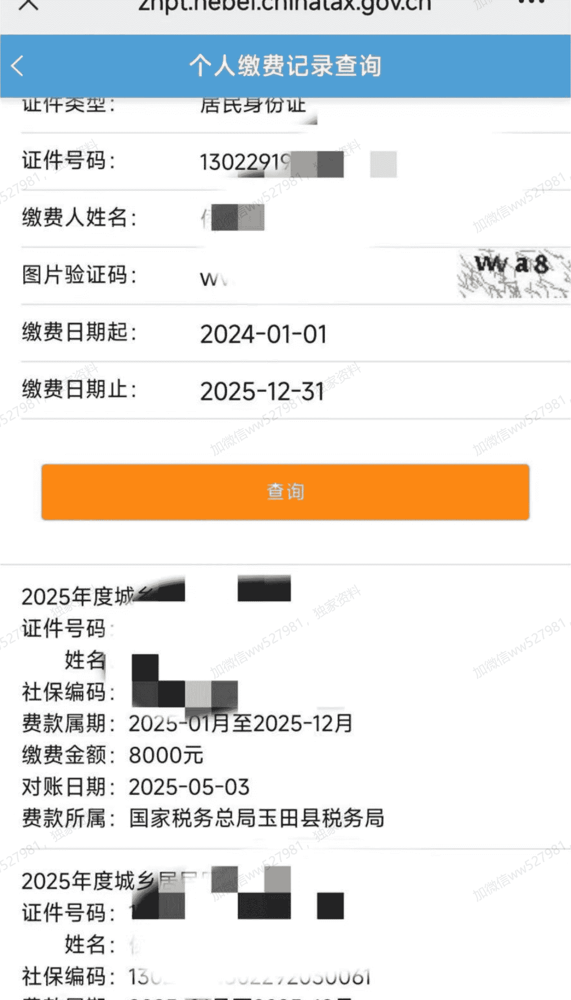

# 大师龙龙志的主题

2025/05/10 17

- 有 10 位朋友发表了观点和态度

## 河北的养老保险

前奎章通过老师的养老保险补缴就是国家福利上的会议结论，让我开始考虑如何让父母60岁后也可以多缴一些养老费用。

同时也参与河北的友缴

- 目前我省可以交养老保险集中补缴政策。
- 每年最多可以交8000元，对孩子可以资助800元，就是一年1.6万。
- 三、1-10月可以缴当年的费用。

### 果断行动

- 前、奎章已经给爸爸父母交了8000元
- 等待再去税务局（或者其他机构）给爸爸补缴16000

## #城乡居民养老保险#前奎章看了了...

| 年度 | 证件号码 | 姓名 | 社保编码 | 缴费周期 | 缴费金额 | 对期间 | 缴费所属 |
| :--- | :--- | :--- | :--- | :--- | :--- | :--- | :--- |
| 2025年度城乡居民 | 12 | | | 2025-01至2025-12 | 8000元 | 2025-05-03 | 国家税务总局玉县税务局 |
| 2024年度城乡居民 | 13 | 李 | 14 | 2024-01至2024-12 | 200元 | 2024-08-03 | 国家税务总局玉县税务局 |
| 2025年度城乡居民 | 1n | 李 | 15 | 2025-01至2025-12 | 430元 | 2024-11-10 | 国家税务总局玉县税务局 |

| 年度 | 证件号码 | 姓名 | 社保编码 | 缴费周期 | 缴费金额 | 对期间 | 缴费所属 |
| :--- | :--- | :--- | :--- | :--- | :--- | :--- | :--- |
| 2025年度城乡居民 | | 李 | 15 | 2025-01至2025-12 | 40元 | 2024-11-08 | 国家税务总局玉县税务局 |

| 价值 | 免费 | 专享 |
| :--- | :--- | :--- |

扫码加入智慧资源TOP 免费资源圈
- 每日免费获取价值资源
- 可提供各类资源对接服务

- 热门文档付费资源
- 各行业报告下载
- 精选分类资源
- 学业理财平台
- AI改变财经媒体

公众号：智慧资源TOP 插件：piximg2

分享资料仅供个人学习，请勿外传，如需咨询
