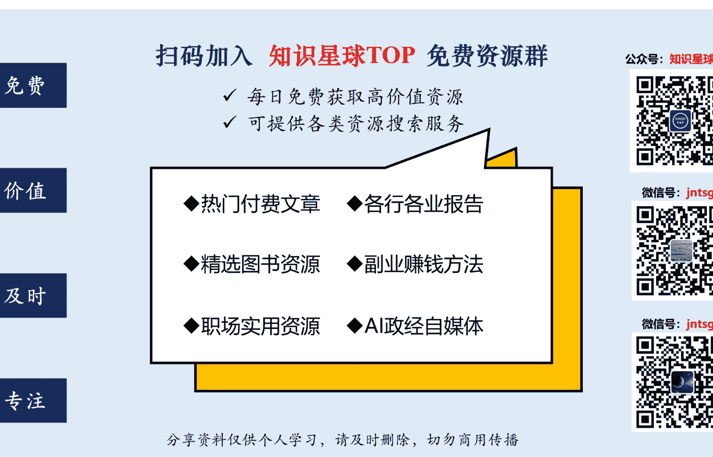

# 珍大户的主题

2025/5/22 12:50

有 10 位朋友发表了观点和态度

【信息积累0029】<广州小学报名数据>

网上看到的数据，2025年广州市小学生报名的数据。

按照25年7岁入学计算，n出生年份应该是2018年。

人口高峰是2016年，2018年还没怎么出生大幅下降。

真正大幅减少的影响还开始出来呢。2022-2023年。

所以，学区房什么的，n真的不用再留意了。

| 区域 | 学校 | 招生人数 | 招生人数 | 已报名 | 超额情况 |
| :--- | :--- | :--- | :--- | :--- | :--- |
| 广州区 | 南河 | 23 | 1035 | 1044 | 9 |
| 番禺市 | 天河 | 12 | 540 | 546 | 6 |
| 华南区 | 小学 | 9 | 405 | 353 | -52 |
| 天河区 | | 17 | 765 | 749 | -16 |
| 海育 | 育穗国际小学 | 8 | 360 | 346 | -14 |
| 明 | | 4 | 630 | 568 | -62 |
| 五 | | 8 | 360 | 417 | -57 |
| 留 | | | 6 | 270 | 297 | 27 |
| 洲湖 | 4 | 630 | 588 | -42 |
| 天河三区 | | 8 | 360 | 253 | -107 |
| 东湖区 | | 13 | 585 | 462 | -123 |
| 小光 | | 14 | 630 | 573 | -57 |
| 铁区 | | 12 | 540 | 549 | 9 |
| 山东湖区 | | 10 | 450 | 430 | -120 |
| 越秀 | | 8 | 360 | 301 | -139 |
| 文湖区 | | 6 | 270 | 249 | -21 |
| 荔锦区 | | 9 | 405 | 331 | -74 |
| 西湖区 | | 12 | 540 | 413 | -127 |
| 林云区 | | 6 | 270 | 278 | 8 |
| 广东市国际中学 | | 8 | 360 | 331 | -29 |
| 中关区 | 南湖小学 | 14 | 630 | 854 | 224 |
| 蓝湖 | | 8 | 360 | 356 | -4 |
| 铁石小学 | | 4 | 180 | 205 | 25 |
| 黄埔 | | 16 | 720 | 490 | -230 |
| 玉岗小学（学区） | | 9 | 405 | 346 | -59 |
| 嘉湖中小学 | | 6 | 270 | 200 | -70 |
| 海淀 | | 4 | 180 | 152 | -28 |
| 湖区 | 东山学校 | | | | | |

关注二维码 知识锦源 免费资源领
关注每日获取高价值资讯
可提供更多服务服务
•热门付费文章 •各行业报告
•精选干货书籍 •职场进方法
•实用工具 •AI直自媒体
关注二维码查看原文
知识锦源
