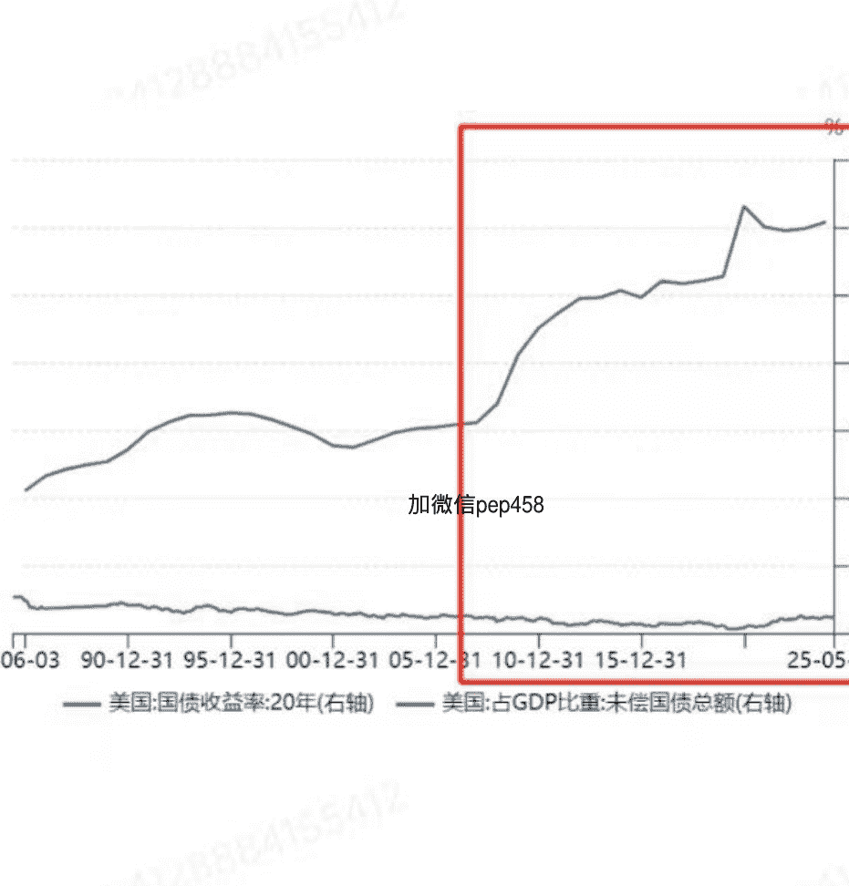
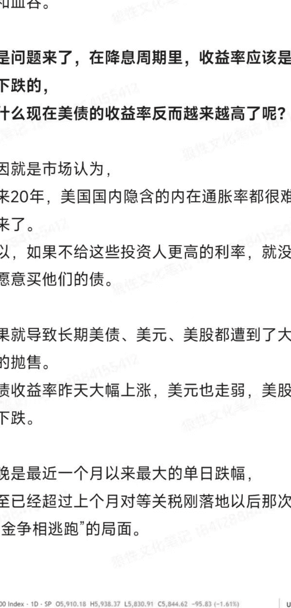
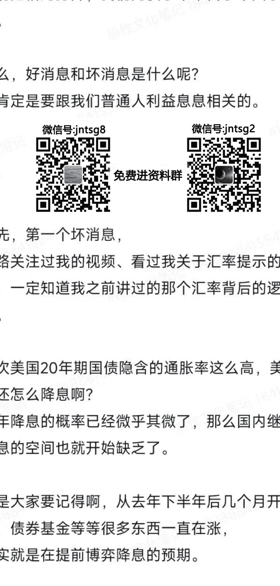

# 【视频第259】美股三兄弟

# 中国资产暴涨

作者：投资的君

2025年05月22日 22:09

美股三兄弟2023年暴涨，他们带来了新的热闹和新环境。5%是以来最大暴涨……

这就是现在最常的一样了。

美股三兄弟，他们又带来了新的热闹和新环境。

毕竟2020年初美股的暴涨。

结果还是惨极了，美股遭遇了集体性回调，股价跌了5%。

从2007年以来，还没有出现过如此高的利率。

但是美国相比，我们要知道，美国的债务已经翻了数倍了。

中国债务相比当年的90亿美元，现在已经变成了7600亿美元，增长了约4倍。

这么高的利率，让美国债滚起来，真的是在打肺炎和苦寒。

但是现在，在降息预期，收益应该是不会下跌的。

因为通胀了，美国国内的通胀都涨下来了。

为什么下跌了？

如果不开始下跌，投资者的信心就没有了，就没有人来买股票了。

结果就跌了美股，美股也跌了大跌的。

美股在暴涨之后，美元也崩了，股市也崩了。

毕竟又是一个我们最大的暴涨日。

那到底跌了，是不是已经开始坏掉了？

如果是好说的，老股民的哥们早就出肉了。

不是的。

我们把胆都扛住了，股民不卖肉就不会亏肉。

好消息和好环境是什么？
