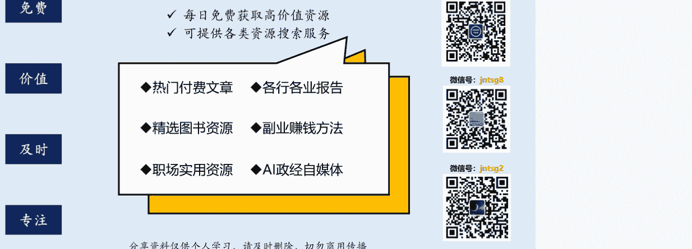

# 珍大户的主题

2025/5/27 20:55

有 10 朋友发表了观点和态度

<自媒体集体反指指标>

回忆起来，从年初到现在，我感觉我在小红书上刷过三波散户集体看某些东西的现象：

第一次是年初1月份的时候，系统推出无数换美买美债基金或者纳指基金；

第二次是黄金高点，国内800元每克的时候，小红书上一搜买黄金，看涨到1000甚至一万的帖子，时间主要集中在4月21日前后。

第三次是美股热度最大的那几天（注：原文“美京东东”应为“美股”，此处OCR误识别），貌似就是4月底5月初的时候，小红书上刷出来的基本都是解读美国财报，说美团的增长多少好，抄美团的帖子。

我现在不敢定是不是我的账号有问题？
所以就想问问大家见过这三次景象？

如果有的话，那感觉集体反指指标还是挺明显的。

来自 珍大户的经济圈
珍大户 创造7400+人在这里交流

