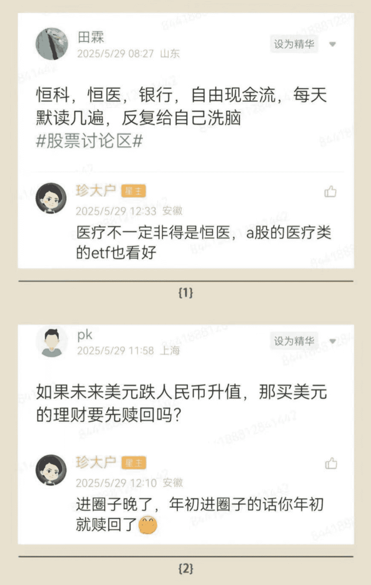
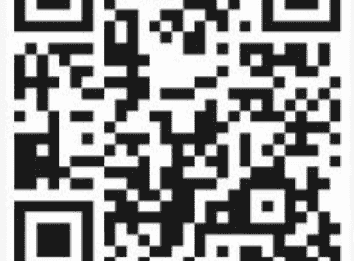
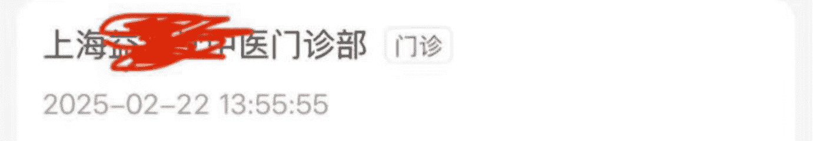
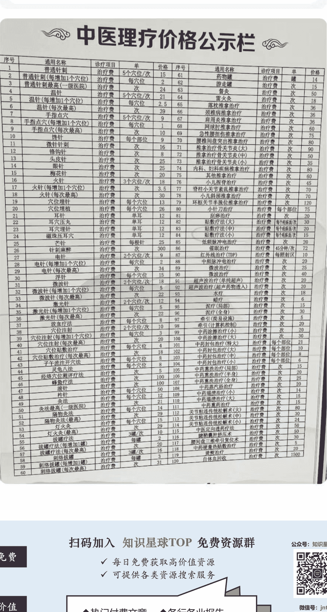

# 大户助理-大可的主题

2025/5/29 12:46
微信信号:jntsg2
免费进资料群

时间线 2025.05.29

珍老师评论区回复

- 1.医疗一定非得是恒枢。
- 2.美元理财要先赎回吗？
#珍老师评论#

恒科，恒枢，银行，自由现金流，每天默默读几遍，反复给自己洗脑
#股票讨论区#

医疗一定非得是恒枢，A股的医疗类的ETF也好看

如果未来美元跌人民币升值，那买美元的理财要先赎回吗？

进圈子晚了，年初进圈子的话你年初就赎回了

来自珍大户的经济圈
珍大户 创建74000+人都在这里交流

微信扫码查看原文

# 微信:jsgt8
# 微信:jsgt2

免费领取资料

看到回友问如何找医保定的中医生，我来教教大家：

打开医保【门诊]-[医保点】，找一个靠谱的医生就可以，需要看医保就找中医生的。一般要去【线下挂号】-面诊】-前台/微信可以直接预约-【中药很好后最好快递报销到家里

医生可以根据医保建议的，也可以说你的需求：需要另外开销，灭菌最多一次可以报销的，这样一次就可以在微信和医生的范围内，因为有写的话可能就不可能都报了。

上海的方便的不用拿医保卡，直接打开手机的码就能报销

而且上海医保可以报销80% 【个人医保每年缴1000元】【个人医保余额800元】

如果你的医保没缴，就会从医保报销80%，剩下的四分之一由你自己报销。如果医保里没钱了，你就得自己自己。

我认为是非常舒服，在外面挂号一次起要160元，去中医门诊一次只要40元

推荐的医生去我去的是师傅张，但是每个都很专业，老的中医可以推的，推了根据你的情况免费报销，在上海这样一次可以少300元。太划算了！附一张我之前的收费情况

## 医保使用记录查询

上海 · 全市 2025年 -

| 日期 | 目 | 总费用 | 现金 | 基金 | 个人销 |
| :--- | :--- | :--- | :--- | :--- | :--- |
| 2025-03-08 10:05:39 | 上海市中医门诊 门诊 | 878.19 元 | 14.00 元 | 691.36 元 | 172.83 元 |
| 2025-03-08 10:57:39 | 上海市中医门诊 门诊 | 9.00 元 | 5.00 元 | 7.20 元 | 1.80 元 |
| 2025-02-22 13:55:65 | 上海市中医门诊 门诊 | 1315.80 元 | 5.00 元 | 1048.64 元 | 262.16 元 |

## 中医药价格公示

加入微信 领取免费资源
✔ 更多资料免费领取
✔ 可获得更多优质服务

# 知识星球
