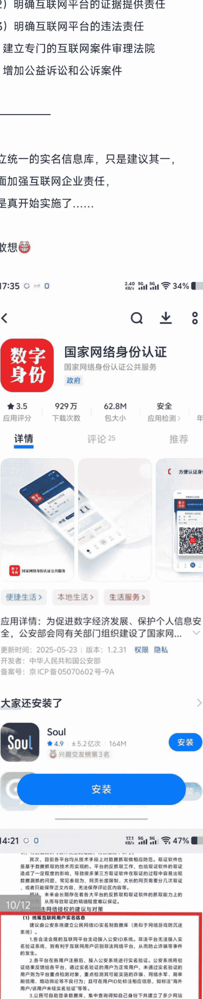

# 大户助理-大可的主题

2025/5/30 08:34

* 有 10 朋友发表了观点和态度

时间线 2025.05.30

珍老师评论区回复

江苏省城市足球联赛，会有更多的衍生市场。

#珍老师挺好#

应了大户说的，2025年5月10日江苏省城市足球联赛，简称苏超联赛，开始起来了，看门票有意思。

| 苏超联赛各市场门票价格 |
| 球队 | 看台类型 | 价格 | 备注 |
| --- | --- | --- | --- |
| 1 江苏 | 普通座 | 100 | |
| 2 南宁 | 普通座 | 100 | |
| 3 武锡 | 普通座 | 100 | |
| 4 常州 | 普通座 | 100 | |
| 5 梅州 | 普通座 | 100 | |
| 6 扬州 | 普通座 | 100 | |
| 7  南通 | 普通座 | 100 | |
| 8 淮淮 | 普通座 | 100 | |
| 9 苏州 | 普通座 | 100 | |
| 10 镇江 | 普通座 | 100 | |
| 11 嘉定 | 普通座 | 100 | |
| 12 泉州 | 普通座 | 100 | |
| 13 贵阳 | 普通座 | 100 | |
| | 贵座 | 200 | |

有意思，活动举办的越好，对人群渗透率越高，然后踢足球的小朋友也会越来越多了，各种衍生的市场就要多起来了。

来自珍大户的经济圈

珍大户 创建74000+ 人都在在这里交流

# 廖的主题

2023/05/20 14:15

【电子子0984】国家电子身份证证件

前几天闲的时候，发现国家可以办电子身份证了，然后在我的APP里搜索公安的业务插件，还发现用国家电子身份证登录这个APP电子认证。这个APP电子挺好用的，并且公安的业务插件已经可以动用了，说明里已经测试过了。

记得2022的时候，我当时心里很无奈，后来又结合了自己的总结，觉得很多可以改进的地方，现在想写了一篇很长的字和大家交流，建议从逻辑上改进：

> “要建立一个通用实人身份认证的，由国家公安机关来维护，各地公安机关提供用户数据，各把数据接入国家数据库，用来实认证。公安、公民税务等可以这样做，这样的效率就会很快了。”

（结论：三条建议）

考虑到要到国家层面由法改革来进行，建议先由各地公安机关负责自己的情况试点，然后尝试一次试点，之后再逐步实施，整个过程需要两三年时间。

我是所信的，我现在提出的这些建议，和三年前我的建议是否是一样的，有正反的吧。

现在目前这些地方还没做，但是可以做。等过了这个三年，就可以由国家来做了，这样可以降低身份冒用的风险。

这样建立一个通用实人身份认证的数据库，方便公安维护就行了。

不想想

大家要看了

目录：

- 当前电子身份行为类型及风险分析
1. 身份识别问题
  (1) 仿冒
  (2) 冒用
  (3) 人身身份
4. 社会安全

- 2. 法律问题解决中的存在问题和解决原则
(1) 明确规定的责任
(2) 建立多方机制
