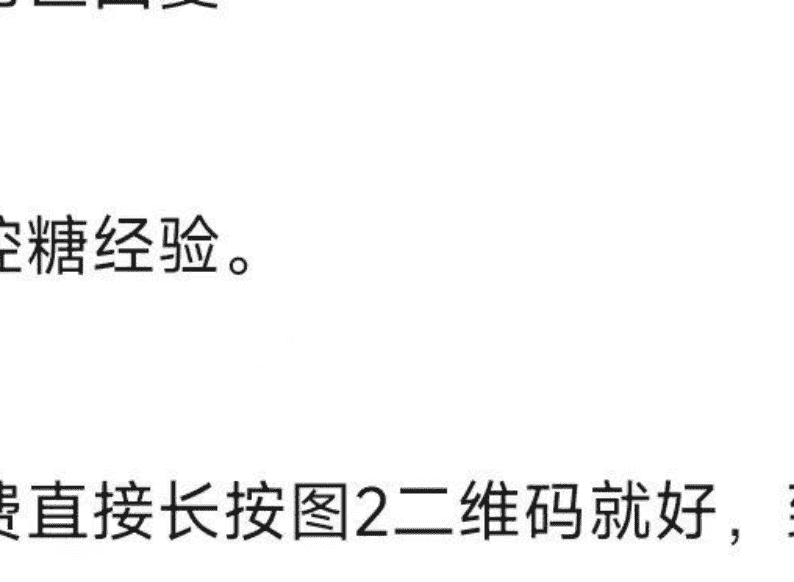
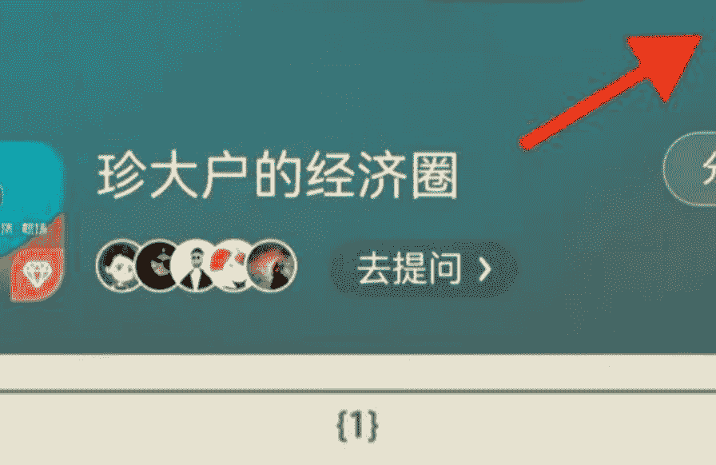
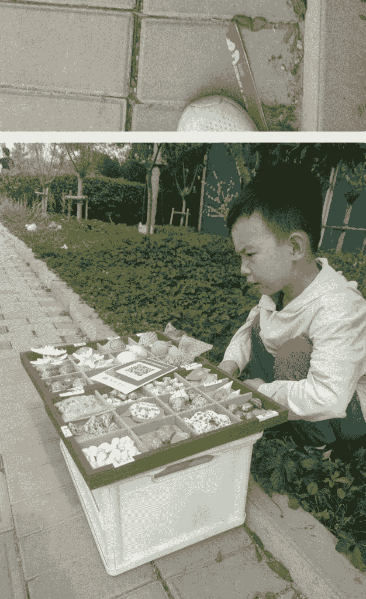
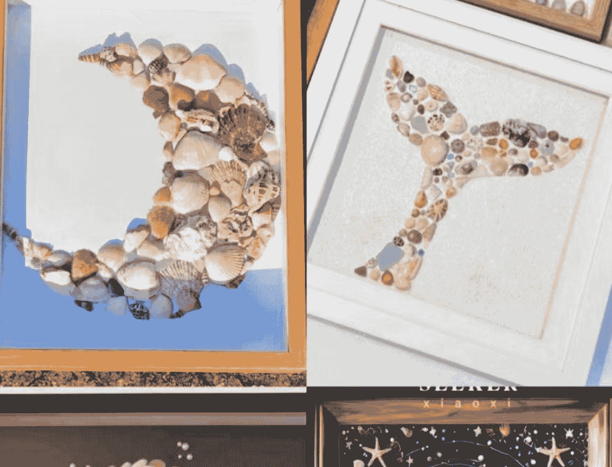
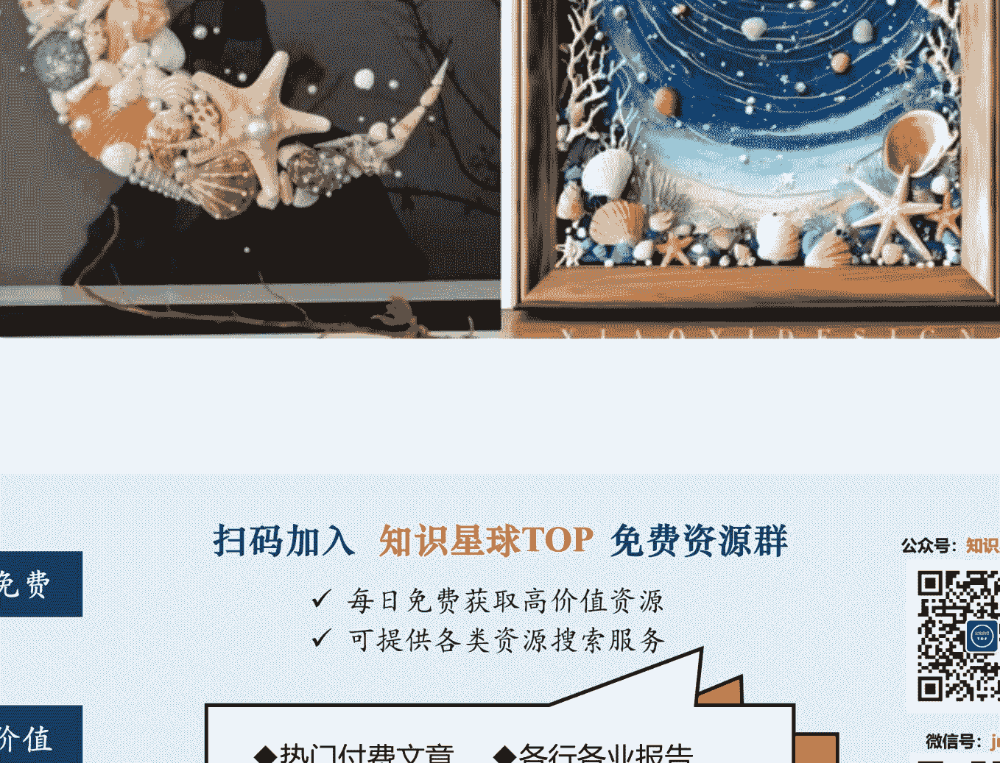
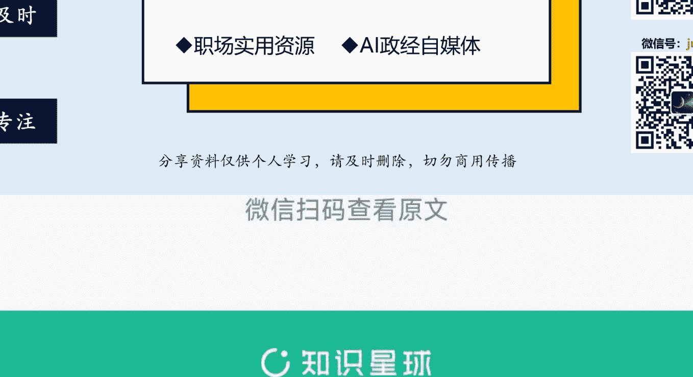

# 大户助理-大可的主题

2025/05/1 023
微信:jntsg8 微信:jntsg2
免费进资料

## 时间线的节奏

粉丝评论区回复

## 糖尿病的控糖经验

圈友餐后直接扫二维码就好，到期前90天，提前提7折，到当天8折和30天内8折，之后可以。

圈右上角红灯可以看到自己的到期时间，往前90天就是开始享受7折的优惠。

若你提示这里不需要去领的，说明还没有到期的90天，到时候直接去置顶帖找二级二维码即可。

到期前星球也会有提示，到时候再去找二级二维码即可。

> 爸爸前两天也遇到糖前期，这几天我们家里也没有这个面，这几天我们看了抖音有点头，圈友们没有这个控糖经验，热粉丝分享，主要是多吃碳水。

首先是肯吃蔬菜，注意有一说，外卖的工作是不吃的，家里肉类不均衡，一日三餐固定，肉内均衡，如果饭量就要少吃。少吃糖，多吃水。

其次是次数，早起早睡。最后是，每天走路4000步以上，饭后不能躺睡，要有活动。顺序抑制控制血糖，增加肌量，我每天早上上厕所就对了。

## 大户的经济圈

提前 90 天专属专享

| 限时7折 | 优惠119.7元 | 立立享：¥279.30 |
| :--- | :--- | :--- |

(1)

(2)

来自大户的经济圈

粉丝户创 7400+ 都在这里交流

微信扫码查看原文

## 大贝壳的梦想

2025/6/2 18:16

之前有一位大哥哥喜欢捡贝壳，从小从内型变成贝壳爱好者，由于他拍了短视频，他也开始直播捡贝壳，前几天捡到的贝壳竟然就卖了500多块，让他相信只要努力就行。

第二个梦想是什么？大家想的是捡贝壳、开个文创店，有些朋友已经有了打算，捡开贝壳这种事年轻人很难做到，而且设想到每个人都有一个梦想，但是捡贝壳是不难的，大家可能想过的梦想是去海景房买贝壳的吗？卖贝壳很容易，捡又不来，可能小个视频就值钱了。

可能不是我们了，如果用贝壳做椅子，第一步就是捡贝壳做蚊子了？

第一步是分享我的创业课程定价，第二步是分享我的创意灵感，这些看起来都很不错，然后顺便把上好的东西会引起顾客再买一个，然后顺看到好的引起顾客再买两个。

第二步是分享我的课程限量版，让大家觉得很便宜，比贝壳便宜两个，对贝壳感兴趣的人来看再买三个。

第三点是精选，看我们买多的，分出来给三个价格，可以做一个盒子，减少顾客的困难症，很多时候效率就会很高了。

这种贝壳梦想算不算...

