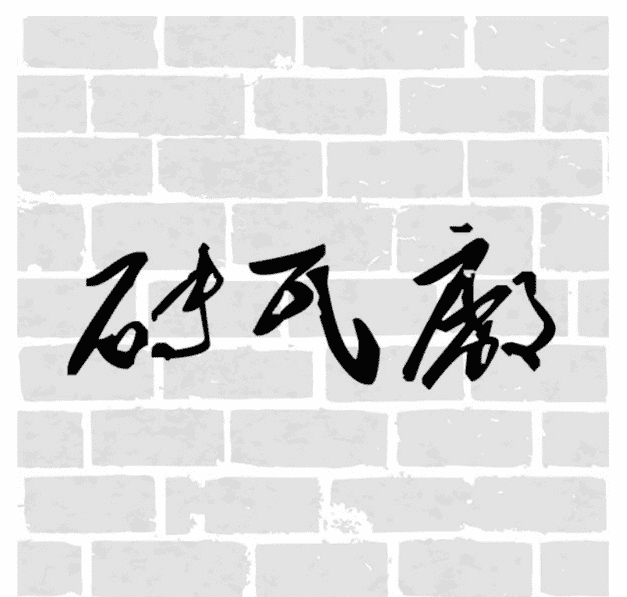

# 砖厂子报

Zhan Chang Zao Bao

微信:jntsg8

微信:jntsg2

2025.06.21

免费进资料群

# 第 486 篇：卷是必由之之路

加微信jntsg2，进阶资料分享群

## 关于汽车行业的卷，戴老板的文章《60天账期》，四个争议问题和解释》的评论区有这样一则留言：

fuyou 湖南 13小时前 回复
现在就是上桌的太太多了，必须有人下桌。而且还要巨头下桌。

ryh6681 广东 13小时前 回复
若干年前在做审计的时候，有些主机厂给供应商的验收时点是线上，进了三方库不算，从三方库拉进车间不算，上流水线才算，所以以报表日供应商的存货会有一部分实际是在生产车间的，但当时虽然账期长，但好收的是现钱和银行存款。

文章里说：新技术取代老技术的过程中，大部分都会经历规模扩张-价格战-整合出清的过程。从目前的进展来看，国内新能源车产业，恐怕正处于出清的周期。

人都想成为价格战的幸存者，自然就会表现出“一切替代”。而在整合出清的过程中，规模优势往往至关重要的筹码。

然而新能源车快速增长后，国内汽车市场的参与者迅速增加，但市场规模却增长多少。相比十年前，前五大车企业的市场份额从74%下降到55%，市场格局迅速分散。说白了就是蛋糕变大了一点，分蛋糕的人却来了不少。

每个人都想把隔壁的人挤出去，价格战就会适时爆发。车企的销售变难了，公司的经营恶化了，供应商就得体谅下游的难处了。

体现在财务上，比亚迪的存货周转天数（原材料变成车的时间）和应收账款周转天数（经销商回款的时间）越来越短。过去五年，两者分别缩短了 50 天和103 天。

与之对应，同样的五年周期里，比亚迪应付账款周转天数延长了45天。

总结起来是：主机厂利用优势地位——压缩下游经销商的账期（自己回款快），增加供应商的账期（付钱慢），来形成财务优势——用来越越激烈的研发、打价格战竞争，准备弹药。

T1 供应商也好，T2，T3也好，除了极少部分的强势供应链外（如比亚迪和森萨因为账期产生的摩擦），成为供应商的前提条件，就是——和主机厂一道应对越来越激烈的竞争。

需要应对现状，目前这个现状，正是财务上的配合，是经销商的高库存和供应商的长期待账期。

由于供应链他们如何办，是精简裁员、控制成本、提高生产效率，那是供应链完成主机厂 KPI 上的具体方式方法。

大家可以看看国内空气悬挂龙头孔辉科技的郭川，写的这封公开信：

## 我有一个梦想
I have a dream

—— 如今中国汽车产业

我们有一个梦想，万在中国汽车产业，龙头企业和大型供应链企业均有社会责任，他们价值创造准确、社会责任感明确，不以牺牲短期换取长期发展；那时企业将是资源匮乏并竞争无效的行业，因为它们是行业的建设者和客户，而不是行业的助者或破坏者！

我们有一个梦想，万在中国汽车产业有双重巅峰，彼此信任，互信可见，如今无异可否，唯有“情感”可信。“合作企业将建立这个基本运行并焕新世界！长期发展和利润增长将不再是追赶型的企业！他们有足够的资源进行研发和可以持续发展！

我们有一个梦想，万在中国汽车产业，我们将技术标准从高向提升供应商，对我们的项目，技术必须把产品质量放在首要位置，此时价格将适用！有一天，低价竞争者将被彻底淘汰，也可能无法进入供应商名单。

我们有一个梦想，万有供应商对自己的产品质量的检验可以相互对接，并在开发后一个月内交货，且是稳固的一种方式！

我们有一个梦想，万有企业对自己的真实战略将对对方完全透明，双方每年可以齐无误地向对方所有的设计计划，并共享管理探讨、共同同化；双方每年必须遵循价格标准，双方仍然将处于同一水平；通过过程更具成本优势获得的少数优势将导向对方，双方的共赢！

其梦想虽很远，它们并非天方夜谭，我们梦想，一直是一个多世纪以来传统的强国产业的真实情况。中国汽车行业需要高质量需要智能化的产品，但同样需要让人信赖的龙头企业形象和稳健的产业产生！企业应该有梦想，有生之年梦想可以真！

> 孔辉科技董事长
2025年6月1日画下心愿

## 孔辉科技的爆发，和理想 L 系列是同频的。

万介绍这家公司：看他们做减震器，想到了孔辉科技这家公司，吞下了原本属于大陆、威巴克的空气的市场。还得自主品牌争气，在市场上足够打，才有了这些配套。

2024年只要一个孔辉科技活下来并壮大，才有溢价，品牌、市场、法务、设计等岗位。主流消费品：电子产品、文娱，慢慢国产占王后，我国经济底，就有护城河。

这种技术含量的明星公司面临困境，更是其它中小供应商面临困境。即：高投入，低净利润。

反应在公司经营上就是：低净利润（如前两年员工待遇最低的），却是比亚迪、长城、奇瑞以及卯足劲，同时利后，取得阶段性成果。非常重要的因素是：对于如此巨大的产业链，计划用二十年的时间走完欧美的路，日韩企业半多世纪的路。机会窗口实在太短了，竞争激烈，亦是无法回避的。

从好的方面看：激烈的竞争，造成优质的企业在中国大陆这市场上生存下来的，去国际市场，轻快许多。类似于运动员训练年后，一旦解放，健步飞。大家关注国内车企的话，会发现我们现在基本上是全覆盖了。以及，需要像华为、理想、小米、小米余承东、雷军领导力，让最难的高端系列，有了中国车企和供应商的影子。

# L8 L9 M8 小米和各种瓦解了许多 BBA 的市场。我们会看到最近几年，许多传统强势品牌的价格跳水。今年，三十万左右能够落地。还有比亚迪之外，10-15 万区间，三款车值得关注：零跑、吉利、小鹏，他们的出海，会吃掉大量的卡罗拉市场。等到那个时候，国内的新能源汽车格局应该稳固——内部竞争缓、外部市场的拓展，整个产业链利润率回升：从供应链到员工，日子应该好过一些。狂一点，站在未来的视角，再来看如今的卷，味道就不同了。最后再聊一点：问界、蔚来、理想长时间被部分人嘲是小康、江淮、力帆换汤不药。实则是消费者用钞票投票，才有了今天的局面。经常开 BBA 的群友应该知道：奔驰的动力肉、宝马的烧机油、漏水、奥迪的随内饰、天窗漏雨……这些问题，几十年了，他们坚持不改。跟提陪好几朋友，去 BBA 的 4S 店，也试驾了问界、理想，看了整个交付流程。只能说：BBA 们到了现在，某些臭毛病坚持不改。不得不不说，互人的价值底线，更高。而随着变速箱、发动机优势的存在，国内汽车下底盘技术、在三电、内饰上卷一卷，在外观上发挥才。五年后，年轻一代消费者的心中，豪华品牌就不再是蓝天白云了，而是他们出生以来就很熟悉的软硬件一起定义的。毫无疑问，国内汽车能做到遥遥领先。写到这里，想到了很老很老的一篇文章，题目叫——荣姐写的《车轮上的国运》。里面有一些细节，很有意思：徐建一当上集团董事长后提出“不愿一切干自主”，为昔日的国产红旗投入了上百研发资金，结果主打的红旗H7上市后，一年卖出几千辆，对标的奥迪A4、A6，简直是个笑话。研发资金有没有变成海南的房子不知道，但是一汽修起了气派的厂长，而且徐建一对自己的别墅不满意，砸掉了上百万元。很多年前，一汽集团门口常驻大量等待疏通关系的人。由于上有政策垄断保护，下有品牌优势，合资车在中国汽车市场横霸多赢，拿到合资车的经销权，相当于拿到了印钞机，有的经销商为了拿到一份4S店经销权，专门店组建十几个人的专业团队对口攻。最难拿到的奥迪经销权，“通关”保底依据说是1000万，而且光花钱不行，还得看关系硬不硬。以前南地区的奥迪销售被一个吕江奔驰的公司长期垄断，当地汽车经销商不服气，想尽各种办法，却是插不进。悄融出逃，华晨。
