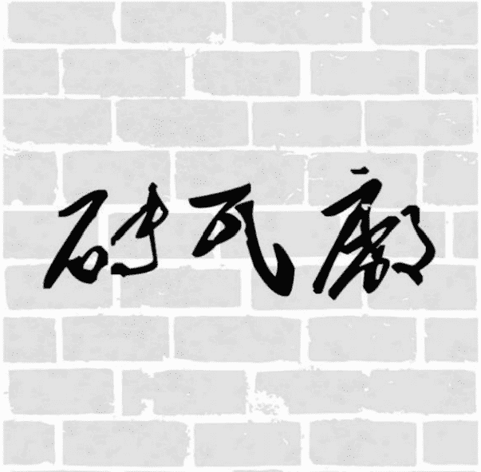
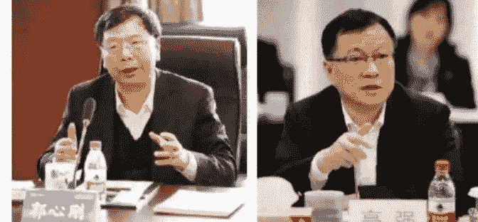

# 石五家

Zhuang Chang Zao Bao

2025.05.06

# 第478篇：所谓刺激经济，就是找富人借钱，给政府去花

加微信公众号jntsg2，免费进资料群

宁南山前段时间写了一篇文章——《我问网友如何能刺激内需消费，得到了上千条回复》。

此文和多数政策的出发点是一致的，重点是两个词：分配，刺激。

文章提到的农村养老金、育儿补贴的问题：属于切蛋糕。

这里多分一点，那里就会少分一点。

当然，我个人是坚定支持涨农村养老金，降公务员、事业单位、国企央企退休职工养老金的。

# 加班回到家，我的社保在蹦起舞，不知道我颓起

舞起的时候，有没有人能加班？

后面宁山提到的，多属于是——刺激。

刺激的意思就是昨天说的：找富人借钱，然后再借给特定的群体去消费。

找富人借钱的方式有：发行国债等。

借给特定的群体消费贷款方式：专项债等。

还包括一种方式：政府找富人借钱，直接补贴终端消费，如国补。

这步棋要走通，必须是——终端消费带来的税收等增量，可以覆盖国补的成本。

再下面，宁南山提到低密度社区，就属于——增加优质供给的范畴了。

这个虽然好，但在中国的土地上，有着政治副作用。

我们可以设想下：不调节，不刺激，会怎样？

或者可以这样想：谁才是刺激的第一欲望人？

肯定不是咱们。

直接讲就是：经济刺激，是统治阶层维持运转的财政方法。

他们是在不愿意自我革命的前提下的，折中之态。

再举例子：房价再崩60、70%，几个底层人会在乎？

真就会对他们的就业产业剧烈的影响？怕是教科书的内容，让很多人觉得如此的吧。

我又有几个资产，在不动产上面？且特么还是自住。

那些说不动产大崩溃，受影响最大的，永远是底层。

我一律认为，是利益相关者。或者被教育得如此了。

当然，他们大概率是有产者，是这个社会的规则制定者。

只是在这件事上，他们说的，可能不那么算数了。

不动产关系了太多事情了，它不死掉，其它领域的改革，无从谈起。

它不崩掉。

# 什么金融改革，什么地方财政改革，都不可能的。

但它死掉，很多操刀改革的人，也要换一波了。

但绝对不会是，地产死掉，底层人就会受多影响。武汉房价崩了有30%+，还好。

搞个腰斩，受影响大的，是信托，是平安们。是顶层和政府的财富。

不是底层的。也可能带来金融秩序的重洗。

# 深蓝财经

5-2915:03 来自微博网页版

# 什么情况，四大行浙江分行一把手全部落马

同特征：信贷审批权成为贷款审批、矿产开发等方面暴露在任期间违规审批丰。

没有地产的彻底倒掉，一切无从谈起。
