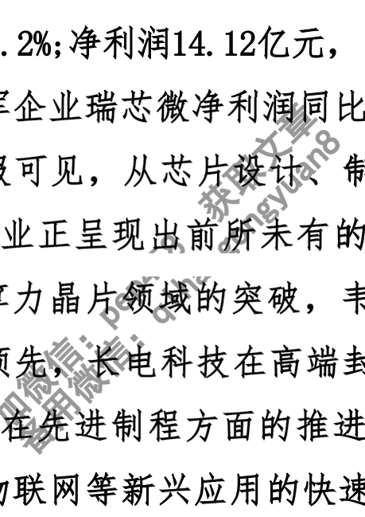

## 米联储闻20250422——白浪如山那可渡

昨晚美股继续迎来史诗级的巨幅震荡，与此同时，黄金接近疯狂的涨幅。可以说黄金实现全球性现货交易以来，这段时间的黄金波动已经是创纪录的，说明眼下市场对于美国自身主权信用的不确定性已经到了不理性的阶段。实际上黄金如此高位既不符合兔子的利益，也不符合美国的利益，现如今中美对抗，双方的货币都在同时走弱，大量的避险资金冲进黄金来博弈对抗加剧，中美都是要走债务经济路线的大国，短期分歧导致大家相互相对眼，但是从长期来看，不管是中美分出胜负，还是中美实现私下勾兑，都不会延续黄金的涨势。从目前的情况来看，这种暂时的缓和可能就在不远处了。

最近，国产芯片企业连续发布年报，开始迎来爆发式增长，多家龙头企业不仅在技术上取得突破，更在业绩上呈现惊人增长，从AI算力芯片到智能终端解决方案，再到先进封装技术，国产芯片产业链正呈现出前所未有的协同效应。作为这一波增长浪潮中的佼佼者，AI芯片龙头寒武纪作为常年的亏损专业户，竟然出现正增长，而且不增长则，一增长就是爆发式增长，2024年总营收达11.74亿元，同比增长65.56%，虽然全年仍录得4.52亿元净损，但第四季度已成功扭亏为盈，实现2.72亿元净利润。随着中美关系一步步加剧，今年的年报估计会相当亮眼，更令人惊喜的是，2025年一季度，寒武纪营收已经飙升至11.11亿元，接近去年全年总营收，同比暴增4230.22%，利润增长3.55亿元，显示其盈利能力的持续。这一惊人增长主要得益于AI应用的快速落地。寒武纪的云端产品线全年营收增长12倍，其智能处理器IP产品已被集成于超过1台智能终端设备中。

这也从一个侧面说明黄仁勋坐不住了，要亲自在大陆来穿西装见老了。同样表现优秀的还有图像传感器领域的领军企业韦尔股份。该公司2024年财报显示，全年营收突破257.31亿元，同比增长22.41%；净利润更猛增498.11%至33.23亿元。这一亮眼成绩的背后，是其图像传感器解决方案业务191.90亿元的营收贡献，占公司总收入的74.76%。韦尔股份主要是智能手机和汽车市场的双线突破。在智能手机领域，其1.2um5000万像素的高端图像传感器OV50H凭借优异性能，推动该业务收入同比增长26.01%。全球领先的集成电路封测企业长电科技2024年营收达359.6亿元，同比增长21.2%；第四季度营收首次突破百亿大关，达109.8亿元。长电科技在高性能计算系统封测解决方案方面已具备量产能力，运算电子业务收入同比增长38.1%。在汽车电子领域，其ADAS传感器和电气化解决方案收入同比增长20.5%，显示出在高端应用市场的持续突破。中芯国际2024年销售收入创下578亿元的历史新高，同比增长27.7%。其中，12英寸晶圆管收占比提升至77.3%，中芯最近在公开场合表示，兔子必须先推进20纳米以上半导体的国产化。

在细分领域，澜起科技和瑞芯微的表现同样可圈可点。专注于数据处理及互连芯片设计的澜起科技2024年营收36.9亿元，同比增长59.2%；净利润14.12亿元，同比大增213.1%。AIT芯片领军企业瑞芯微净利润增长341.01%。各企业财报可见，从芯片设计到制造到封装测试，兔子半导体企业正呈现出前所未有的协同发展态势。

寒武纪在AI算力芯片领域的突破，韦尔股份在图像传感器市场的领先，长电科技在高端封测领域的进展，以及中芯国际在先进制程方面的推进，随着国内AI智能汽车、物联网等新兴应用的快速发展，加上国内巨大的市场空间和美国禁售空出来的市场份额，让国产芯片企业凭借技术创新和产业链协同优势从无到有，从零到一，继而进入爆发式快速发展期。这个趋势去年底已见曙倪，现在往回看，今年初DeepSeek出现。

出现，不过是吹响了在高端制造、尖端科技领域的集结号，随之而来的是大量科技成果的喷涌和商业落地，甚至快速盈利的节奏。随着中美今年进入高强度对抗阶段，国家可以顺势为国产芯片的打开更大的政策空间，将美国芯片企业彻底挡在兔子市场之外，所以黄仁勋是真的着急，毕竟颈以兔子目前的AI产业规模，未来的增长相当可怕。加上DeepSeek在兔子全速全面落地，已经始终免费开源的操作，英伟达要为DeepSeek打造专用芯片，就肯定不是做善事。

所以，现在川普还要继续拜登的操作，进一步严控具有战略重要性的芯片出口到兔子可能不仅不会打到围堵兔子的目的，反而将全球市场拱手送给兔子。从零到一很难，但是兔子一旦实现了零的突破，对于芯片行业来说，就意味着价格的大幅震荡，对于目前成本高企的美国芯片行业来说，将是史诗级别的灾难，就如同C919一旦经过市场检验，一定会引起全球大飞机产业带来大幅震动一样。我这次在广州线下活动的感受就是，在兔子，在当下，做生意，做事情太容易了，什么资源都是触手可及，一个微信就能搞定，而且成本相当可控，这样的兔子，不好搞呵一番事业，是对不起自己的。

英伟达和AMD这个星期都不约而同的通知监管机构，预计美国针对向兔子出口半导体的新许可要求，将给公司带来财务损失。面对兔子芯片企业这样的报告和业绩，巨头都会瑟发抖，毕竟利润是如此诱人，这些年轻的小懒们已经饥饿多年，他们对胜利的愿望，对于利润的贪婪，刺激了他们在自己的领域疯狂进步。

（注：此处后续大量重复及乱码，已根据语义清理核心逻辑）

### 扫码加入知识星球TOP 免费资源群
- 每日免费获取有价值资源
- 可提供各类资源搜索服务

| 热门付费文章 | 各行业报告 |
| :--- | :--- |
| 精选图书资源 | 副业赚钱方法 |
| 职场实用资源 | AI政经自媒体 |

公众号:知识星球TOP 微信号:jntsg8 微信号:jntsg2

分享资料仅供个人学习，请及时删除，切勿商用传播
