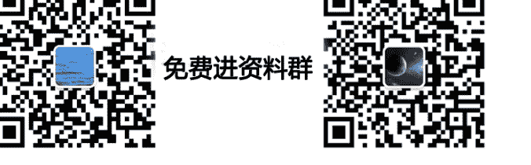
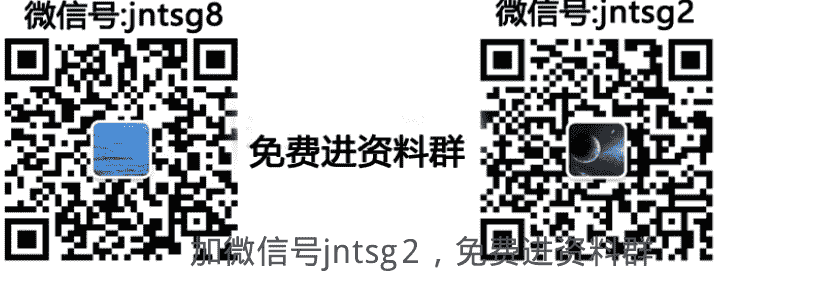
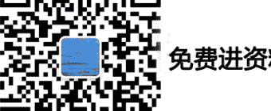

## 米联储闽20250528——巨强未衔海水

今天，有人提起浙江金融反腐的事情，最近一波人下马，这里面两年前做过浙江副省长的金融干部朱从褚下马开始，就经风雨欲来，巡视这次坐阵浙江，显然是带着任务来打扫房间的。朱是跟哥哥搭过班子的人，去年，2021年被带走的前浙商银行副行长张磊被移交司法机关，才掏出一段往事。2015年，他在浙商银行做副行长的时候，设计了一个百亿元的融资方案给姚振华输血130亿去搏万，这场当年着名的万大大战从没介绍过，只知道深圳国资做了一个亿千亿的公司，而张磊就是朱从褚的老乡，还是朱把他推荐去浙商银行，所以这一轮浙江金融系统的清理可能有助于我们把十年前的一些事情盘清楚楚楚，等我慢慢收集信息慢慢来盘。只说大江大河之下，都是大鱼，有时候在水底都闹腾了，浮出水面的不过是几个泡泡。

加微信号jnts2，免费进资料群

相比于兔子政治游戏的体面，川总的政治游戏就简单很多，对哈佛一击不中，川普再次加码，这一下子将棒子砸向所有留学生，要求分布在全球的美国使领馆暂停为学生和交流访问学者申请签证安排面谈，这一下子打得各个倒吸一口凉气。你不听话，我让你的留学生签证都拿不到，不但暂停面谈，还安排对社交媒体进行审查。这让想要到美国留学的人都倒吸一口凉气，谁知道要查什么，查到什么程度，这完全是随他高兴，一小心顺便找个借口留下签证的黑记录，川普可能会下台，但这个入境处的黑记录可能伴随你一生，这意味着对很多人来说，只要川普在美国当总统，都要尽量避免来美国。这对于非常依赖留学生金流的美国大学们来说，简直是要了老命了，不得不承认，川总这一把底抽薪，不仅断了哈佛试图通过法律战逼退川普的念想，还让美国所有大学都面临哈佛一样的困境，更让全世界各国在美国留学的国际学生和家长们都如临深渊。

要知道培养一个留学生，很多家庭从从小上国际学校，几乎都是百万级别的投入，十年以上的耕耘，到临门这一脚，被这样卡着，真是欲哭无泪了。现在这个操作，连留学中介都不知道该怎么粉饰太平了。

微信号:jntsg8
微信号:jntsg2

免费进资料群

按卢比奥的说法，川总并不是不给留学签证，而是要对所有申请到美国留学的国际学生接受社交媒体审查。为了实施这一审查，指示全球各地美国使馆暂停为学生和交流访问学者签证申请者安排新的面谈，此前已经预约好的签证面试仍然可以进行。现有的有不少美国学校已经放假，很多大中小学生已经回了自己的国家。另外绝大部分有意留学的高中毕业生，已经走完申请流程拿到入学资格，正计划申请预约申请赴美签证。

加微信jntsg2，免费进资料群

新禁令一下，国际学生是否还能拿到回美签证继续学业，或者是否还能拿到签证到美国留学，都是未知数。即使这次变更解开了，谁知道下次折腾啥时候，一不小心留学生贵族变学术难民。实话的，这些留学生家长想要杀掉川普的心已经比民主党更强烈了。

微信号:jntsg8
微信号:jntsg2

免费进资料群

根据美国移民和海关执法局4月10日披露的数据，川总自今年1月20日上台以来，至少有4736名国际学生的签证被终止。这背后就是近5000个家庭的高额投入水漂。虽然目前有超过10万名国际学生被撤销不到0.5%，特别是被撤销签证的国际学生中，印度学生约占50%，兔子学生约占14%。这种趋势不减，还有很多学生需要完成学业，估计还要长时间。

加微信jntsg2，免费进资料群

除了签证，川总通过冻结联邦资金，也让大学出现各种问题。不少学校削减了奖学金甚至直接砍掉录取名单。麻省理工学院发言人上周披露，计划在2025年减少7000名研究生，由于川总的操作，赴美留学这件事就变得尴尬异常困难。自疫情以来，赴美留学生人数已从2019年的37万降至现在的27万，减少了十万人。

微信号:jntsg8
微信号:jntsg2

免费资料群

对美国来说，留学生一直是一场学养的好事。每年有超过10万外国学生在美国读大学，对美国经济贡献百亿美元，还贡献智力和源源不断的顶尖人才。可以说，优质高等教育是美国常年利于不败的法宝，也是美国难以超越的软实力。美国教育部与国际教育协会（IIE）2024年的报告显示，2023-2024学年，全美各地就读的国际学生超过50万，占学生总数比例达到37%。此外，纽约大学、伊利诺伊立大学、加州大学伯克莱等大学国际生数量超过4万，外国学生支付的学费达本土学生的1.5倍。2023年，国际学生对美国经济的贡献超过500亿美元，其中大部分是学费以及住宿、交通和购物等费用。在所有留学生中，占比54%的印度和兔子学生大多数都读理工科。

微信号jntsg2，免费进资料群

对于美国的科技业务，其中攻读电子工程、电脑和资讯科学的全日制研究生中，约70%是国际学生，可以说这些人都是美国科技技术领先全球的中坚力量。每年约14000名国际学生在美国完成理工科博士学位，另有3500名博士后从事相关领域的研究。这些学生和研究者，每年对美国GDP的贡献在12225美元到13568美元之间。而当他们完成学业、开始工作后，给美国经济带来的贡献进一步增大，产生高达409亿美元的动力附加值，占美国GDP比例高达1.9%。可以说，美国享誉世界的美国梦通过这些国际学生源源不绝地为美国提供动力，让世界顶尖人才始终把美国当作人类文明的高地，顶尖人才的必选之地。

微信号:jntsg8
微信号:jntsg2

免费资料群

加微信信号jntsg2

这个我们觉得最难攻克的美国软堡垒，竟然被川总东一榔头西一棒槌砸得乱七八糟。甚至有美国藤校的招生老师对申请者直言，现在学校乱七八糟的，真不知道该怎么操作，情况几乎每天都在变化，根本不是学校可以说了算的。说真的，还真有点美国文革那味了。今天白宫发言人更是直接在记者会上说，美国不需要那么多哈佛毕业生，而是更多的水管工、电工，照这么发展下去，文化人就要成为原罪了。

微信号:jntsg8
免费进资料群

除了继续折腾美国高校，川总最近还做了一件事引起引起高度重视，就是日本制铁收购美国钢铁的收购案被川普政府通过了。在当选上任之前，川普在公开场合一直表示美国钢铁不能卖给日本公司，民主党的拜登在最后时刻也否决了这一议案。我相信此时日本政府也知道，拜登时间不多了。

加微信信号jntsg2，免费进资料群

日本制铁收购美国钢铁的收购案被川普政府通过了。美国媒体预计美国政府将获得钢铁公司黄金股权，这项安排将赋予美国政府对特定决策的否决权。日本制铁收购美国钢铁的收购案被川普政府通过了，美国媒体预计美国政府将获得钢铁公司黄金股权，这项安排将赋予美国政府对特定决策的否决权。

美国现在要重建军工，依靠自己的钱和人把钢铁业扶植起来几乎不可能，而日本同样有一颗军野心，两者可谓是一拍即合，日美在钢铁领域的合作将延伸到造船业，甚至航天领域。川普现在插科打诨的胡搞瞎搞，其实就是超级的中场休息，真正做的就是不断搅浑让你无法布局，从而为美国恢复工业实力争取尽可能长的窗口期。最近日本唯一的甲师团举行70周年阅兵，密密麻麻的机械化装备鱼贯而出，号称不事军事的小日本可没少些东西，美国是不是已经默许日本准备控枪出阵了，最近舆论老是在宣传日本要发生大地震，我看大地震未必，日本在海底搞什么大地震验得动山摇是有可能的。
