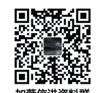

## 米联储闻251022——半导体呼鹰出鞘（荷兰撞到了中国的枪口上）

你好，我是米糕！

会议进入第三天，明天就闭幕了，小道满天飞，尤其是一些截图，大家不信谣不传谣，不要在群里传这些截图，轻则封号，重则封群。人事也是最敏感之事，今年除了十五五规划，确实是承上启下之年，今年有些不同寻常的人事安排，其影响必然在四中全会有所交代。9名军内高级干部落马，这件事在党内其实是一句风轻云云的异常正常，但现在的大环境决定了，内部矛盾不是主要矛盾，外部矛盾才是根本，所以大家静静等结果就好，不要在群里讨论，避免被封群。

在四会前夕，97岁的朱总用自己又刷新了一下存在感，清华大学经济管理学院顾问委员会2025年会议上周在北京举行，这是委员会成立以来的第26次年度会议。97岁的朱总委托清华大学校长对顾问委员会表达了感谢，苹果CEO库克、集团总裁陆辉、马赛地集团董事主席康林松、盈利拓展集团创始人李泽熵、百度创始人李彦彦、腾讯公司主要创始人马化腾等。大家是否记得，就在清华大学这个会议后，出现了一条新闻：美国用某境外品牌手机网络攻击中国时，这个境外品牌手机是谁不言而喻，这个境外品牌手机的CEO还是清华大学经管顾问委员会的主席，这个由朱总信誉背书的机构主席在维护国家安全的典型案例中扮演了比较尴尬的角色，里面的勾心角是不言而喻。攻击授时中心这个事并不是最近发生的，却偏偏在朱总刚存在感之后爆发，早已退休多年高的朱总每年经管顾问委员会开会都要曝光一下自己活着，大家的心思都明白的。

朱是清华经管学院院院长、顾问委员会创始主席，这些年，朱缺席了2021年百年党庆、二十大开幕式及2025年九三阅兵等重要活动，却又通过这种方式表达自己还活着。这次顾问门会前，和副总理前一天也在钓鱼台会见了这些顾问代表，晚上，现任王主席宴待了委员们，当时出席的还有小川、楼建伟和郭乐润。去年，是在10月中旬召开的，当时就不露面的96岁朱，也利用了这次会议又旋了一下存在感，辟谣了当时网间说他身体不佳的消息。而去年前，是丁总理在京钓鱼台国宾馆见了顾问委员会委员代表，当时的儿子朱云来也出席了相关活动。朱总最后一次露脸是在2020年10月，当时网络流传人员为朱庆祝生日。

去年和今年都用同样的方式存在，意味着有人还真的需要这块老牌牌。

五道口金融曾是非常重要的一股力量，这些年内外压力之下却日益萎缩。中金、中信这些微大本营，也屡屡被名。之所以有所收敛不是其他，而是外援这些不给力了。过去他们也以资本代理人自居，想要将中国企业家团结在一起，对抗社会主义制度与资本的天然矛盾，结果从中被勒索、为彼所制，孟舟被拘禁，再到TikTok被强卖，很多中国企业也看白了那句“资本无国界”都是骗话，别说企业家有国籍，企业一样有国籍，资本更是妥协的。如果说过去还有种借口为西方发达国家的操作找借口，这次荷兰对安世半导体直接接手抢夺的操作，充分证明了一个真理：如果没有国家暴力的背书，什么企业，企业都是宰羊的，不管你是CEO，在国家面前，理性的地方都没有。企业家不但有国家，还要比别人更爱国，才能守住自己的钱。相比于发达国家的抢，中国政府真心算客气了。

10月初，荷兰政府一张白纸黑字的文件，就对安世半导体的核心资产、知识产权实施了锁定。从时间节点来看，这一系列操作像一场精心策划的掠夺：美国和荷兰在芯片出口领域配合。就在荷兰采取行动之前，美国政府刚发布出口管制规则，将安世列入实体清单，追加出口力度。

根据华尔街日报的一份会议录显示，安世高管曾在周日与投资者的会议中直言，荷兰政府指令是以美国新规为准，是为了夺取控制权。说白了，就是抢。这个时候指望一个企业能在国家的对抗中占便宜？根本不可能。最后还是国家出手，实际上企业和国家是深度捆绑的共同体，这一轮中美对抗将事实彻底展现了：不管你是什么体量的企业，只要你的所有者是中国，都是都是。

安世半导体位于荷兰，其前身为英飞半导体的一个部门，2017年独立运营。2024年，安世半导体营收规模大，约占全球六分之一。荷兰经济事务部在一份声明中申明，这是国政府首次启用《商品供应法》（Goods Availability Act），该法律旨在应对战时时期发生的事件，授予政府在战时状态接管特定企业的权力。即紧急情况下，安世生产的产品（成品及半成品）可能无法供应相关产品适用于欧洲汽车行业和消费电子领域的芯片。荷兰方面强调，政府指令是以保障供应链安全为由，但指令范围之广、限制之严，远超常规管控，对一家正常经营的企业实施了严格管制。

荷兰政府指出，以国家安全为由，是地缘政治偏见的过度干预。安世对这种针对中国企业的霸凌表示强烈抗议。荷兰政府这次引用冷战时期的法律，暂停安世实际控制人的职务，剥夺其投票权，并将安世持有的许多股权托管交给第三方。这相当于安世失去了对荷兰总部的控制，安世最终决策层失去了代表权。在安世的整体业务部署中，荷兰总部是最重要的研发和设计中心，德国和英国是制造中心，中国东莞、马来西亚、菲律宾是组装和测试基地。荷兰的操作不仅让安世失去了研发设计中心，德国和英国的制造中心也将失去控制。这是一场赤裸裸的抢夺。荷兰之所以这样做，必然是美国的。2024年12月，美国将安世列入制裁清单，然后多次要求荷兰政府限制安世子公司。年6月12日，美国商务官员与荷兰外交举行会议，要求更换安世负责人。这一事件也充分说明，根本不存在什么是商业信誉，资本主义构造的信誉体系就是一个谎言。

安世半导体并不是尖端技术的代表，而是致力于常规芯片设计和生产，以高效的工艺流程取胜。美国之所以连这种半导体公司都要制裁，是因为中国已经能够突破中低端的半导体制造，真是气急败坏，吃相难看了。荷兰政府援引的是制定于1952年的《商品供应法》，该法律旨在应对战时时期发生的事件。如今突然被用来针对中国企业，本质是配合美国行事，可见荷兰为了配合美国也是拼尽全力，才从纸堆里找到这个条款，本质就是赤裸裸的掠夺。

荷兰的操作当年加拿大配合美国扣孟舟一样，影响非常恶劣。荷兰做了一个很坏的榜样，如果各国如此积极配合美国来打压中国企业，必然是没完了。中国政府不可能坐视不管。作为反制，中国商务部已迅速出口控制措施，禁止所有中国公司及其分包出口在中国生产的特定部件和子组件。这一最大的受害者是欧洲的汽车生产厂家。中国东莞承担着安世半导体全球70%的最终产品货量。这些晶圆和封装里，有不少为欧洲定制的。所以，荷兰政府在做这件事之前根本没有考虑过后果，荷兰这草班子有多草台可知。

10月16日，欧洲汽车制造商威胁到荷兰：若安世继续缺货，欧洲车线将在周内停产。库存充足的用于电动车窗、雨刷、电源管理的成熟程芯片只剩3周全量，法拉利、福特欧、现代欧洲全部受影响。
