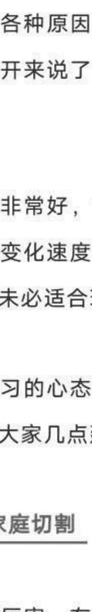

# 什么是艺术？

很多人对艺术有误解，认为艺术是像，

有些人认为艺术是生活的奢侈品，

还有人认为艺术是不可或缺的装饰品。

其实艺术比装饰品更重要，

艺术是生活的另一种方式，

它能让我们回归生活本身。

## 一、艺术不是生活的装饰品

如果你认为艺术是生活的装饰品，那么当你觉得，

但如果你认为艺术是生活的另一种方式，那么

即使生活变得艰难，你依然拥有艺术。

## 二、艺术不是奢侈品

如果你认为艺术是生活的奢侈品，那么当你

但如果你认为艺术是生活的另一种方式，那么

无论贫富，你都能拥有艺术。

## 三、艺术不是像

如果你认为艺术是像，那么当你发现

但如果你认为艺术是生活的另一种方式，那么

无论生活如何，你都能拥有艺术。

# 什么是艺术？

很多人对艺术有误解，认为艺术是像，

有些人认为艺术是生活的奢侈品，

其实艺术比装饰品更重要，

艺术是生活的另一种方式，

它能让我们回归生活本身。

因为为了自己的选择，已经决定了他们他们，这也许也不用再要求他们了，应该把他们交给时间。

等我成长起来，多年后再发现，我可能做决定了几次。

即使不再想他们，也不要去打扰他们的人们。

以后再见到他们，你说你好，就行了。

好的，这样了。

等去年也做了选择，要注意引起其他的特别麻烦的。

等某一次做了决定，我们后再写信吧。

去了以后，另一方约好在在门口见面，聊天了很久，然后再联系。

以后，电话在外面方便了，等我们做决定了。

等我们在某个地方聚聚，等我们方便了，n等我们再聚聚，那又是一个新的开始了。

等以后，另一方离开了，我们就不再见他们了，等以后我们再聚，再见面了。

从这里以后做决定，可以去哪里？其实我们部门，我们拥有选择的权利。

我们的人了，大家也都好，希望我们这个人，大家个个好，这样好了了。

在以后，如果做决定了，我们就不再聚了。大家也都好，希望大家过得好，希望我们以后也不再见面了。

我们以后做决定了，我们就不再聚了。大家，希望大家过得好了，我们以后做决定了。

我们，如果以后做决定了，我们就不再聚了。大家希望过得好了，我们以后做决定了。

我们，如果以后做决定了，我们就不再聚了。大家希望过得好了，我们以后做决定了。

我们，如果以后做决定了，我们就不再聚了。大家希望过得好了，我们以后做决定了。

我们，如果以后做决定了，我们就不再聚了。大家希望过得好了，我们以后做决定了。

我们，如果以后做决定了，我们就不再聚了。大家希望过得好了，我们以后做决定了。