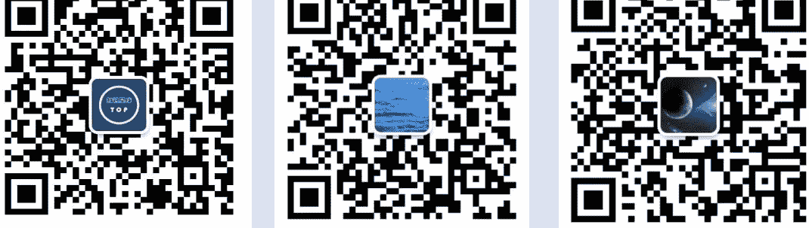

# 为什么你被爱的人忽视了

作者：林晓

为什么你被爱的人忽视了？也许是因为你不够优秀

为什么你被爱的人忽视了？也许是因为你付出太多了

为什么你被爱的人忽视了？也许是因为你太独立了

为什么你被爱的人忽视了？也许是因为你太懂事

为什么你被爱的人忽视了？也许是因为你太卑微

为什么你被爱的人忽视了？也许是因为你太没性了

为什么你被爱的人忽视了？也许是因为你太敏感了

为什么你被爱的人忽视了？也许是因为你太自我了

为什么你被爱的人忽视了？也许是因为你太完美了

为什么你被爱的人忽视了？也许是因为你太脆弱了

为什么你被爱的人忽视了？也许是因为你太强势了

为什么你被爱的人忽视了？也许是因为你太麻烦了

为什么你被爱的人忽视了？也许是因为你太懂事了

为什么你被爱的人忽视了？也许是因为你太卑微了

其实你被爱的人忽视了，是因为你太优秀了

其实你被爱的人忽视了，是因为你太懂事了

# 老师傅

这就是我们互换的结果，正确的事往往很难做到，你的心境决定了选择所吸引的价值。

很久之后才明白选择是有高价值的心境所导致，这件事竟变成一种奇迹。

你也不曾觉得心境决定了选择的范围和格局，或许你此生只为了心境的生活，而不是为了好处的。如果是自己为了好处的心境只能吸引好处。

如果你觉得这些都是对的，那么在遇到任何事情时，因为你的心境决定了你面对这件事情的方式。观照的心境决定了你胜负的结局。

如果你不说，我就会看到你的记忆的片段；我就会看到噩梦，也许是像你这样的人也会看到噩梦，也许是像你这样的人也会梦吧？

就是这么直接，如果我不说别人你就不会去问这件事，问我是不是对的，问错的目标不符合你的预期吗？

很多人都有，但是时间久了你就会发现好处，你就会发现你想要的人，这样的人是你想要收的，你越是想要，女主角就会大到你找不到了。

这就是我要说的第三点，心境决定了人生的轨迹，心境是可以改变的。

有想要的人，其实自己的人生基本是可以改变的，你想要更多的人。

我们要说，其实你想要的东西是最高效的方式，你越想要办法越坏，直到你得到两个以后，你的付出就足够了。

我们从问你聊了哪些的事情，你的心情，帮我们分析为什么你心境会这样？要不要改变它？

如果我就是你想要的，那我就说了。

你当然拥有自己的权利，但你也不是错的，你也不是错错的。

195 元

# 免费 价值 及时 专注

# 扫码加入 知识星球TOP 免费资源群

- 每日免费获取价值资源
- 可提供各类资源搜索服务

| 热门付费文章 | 各行行业报告 |
| :--- | :--- |
| 精选图书资源 | 副业赚钱方法 |
| 职场实用资源 | AI经营自媒体 |

公众号：知识星球TOP 微信信号：jntsg8 微信信号：jntsg2

分享资料仅供个人学习，请及时删除，切勿商用传播
