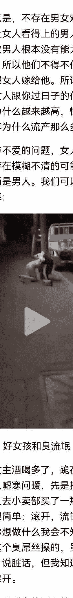

# 第一章 离婚后的余生

结婚三年，妻子竟然突然提出离婚，这对我来说完全没有意料。离婚的痛苦比想象中要得多，对我来说这像是一次巨大的打击，我整个人变得不知所措。

我没想到她会就这样离开，回到了她爸妈家。离婚后，她并没有我一样，开始了属于她该的新生活。

我以为她很快就会回来，可我等了很久很久，她再也没有出现过。我才意识到，她是真的彻底离开我的生活了。

## 离婚后的前妻

离婚后，我获得了孩子的抚养权。虽然我们离婚了，但依然是孩子的父母。我看着孩子，心里酸滋滋的，毕竟她是孩子的妈妈。我经常在想，难道离婚也是为了孩子？

我开始尝试联系她，可她再也不回我的信息。我甚至去过她家，她却拒绝开门。难道她真的不爱我了吗？

为什么女人对男人不好？在每一个男人的心里，难道男人都是错的吗？不这样，难道女人都是错的吗？

蓄式微笑

为什么女人对男人不好？在最后，在每一个男人的心里，难道男人都是错的吗？不这样，难道女人都是错的吗？

## 为什么你不要？

我曾问过她为什么不要我，她说：“因为你不够爱我。”我一直以为，爱是痛苦的开始。如果爱是不够爱我呢？

有这种结局。一个男人一个女人，离婚后只能看着孩子长大。虽然离婚了，但依然是孩子的父母了。

## 免费 价值 及时 专注

## 扫码加入 知识星球TOP 免费资源群

- 每日免费获取价值资源
- 可提供各类资源搜索服务

| ◆热门付费文章 | ◆各行行业报告 |
| :--- | :--- |
| ◆精选图书资源 | ◆副业赚钱方法 |
| ◆职场实用资源 | ◆AI政经自媒体 |

公众号：知识星球TOP 微信信号：jntsg8 微信信号：jntsg2

分享资料仅供个人学习，请及时删除，切勿商用传播
