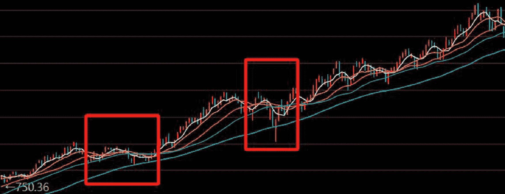

北交所调差不多了吧

15:13

加微信进资料群

观海

创业板可参考历史走势，也是回调到60日均线加仓

观海

一丹青

观海

主板是以时间空间方式完成调整，下个月60日均线3900点，还怎么跌？

主板是以时间空间方式完成调整，下个月60日均线3900点，还怎么跌？

是调整结束了吗

主板也就是不会大跌了

不是预测明天高点吗?你怎么看的？预测。

听不懂

反正高低低吸

意思是：这波调整最大到60日均线

主板不跌双创可以跌呀，拉银行权重股不就可以了？

一丹青

反正高抛低吸

一丹青

观海

意思是：这波调整最大到60日均线

吴吴

主板不跌双创可以跌呀，银行权重股就不可以了

小黑

听观大信号就行，少操作

观海

现在还没触到60日均线，所以明天高点后还有一波回调

日月生

这个月60日均线都快3800

观海：意思是：这波调整最大到60日均线

日月生

下个月预计抬升到3900了

观海

这是技术分析，股市走势因素很多，这是其中的一个

观海

荷兰做出一个重要决定
10月20日，荷兰宣布暂停与美国的情报共享，荷兰方面给出的理由是担心特朗普侵犯“人权”和“协助俄罗斯”。

## 知识星球TOP资源分享群

添加微信；n免费入群

微信:top28688

| 序号 | 公号/星球/社群 | 原价 | 领域 |
|---|---|---|---|
| 1 | 生财有木 | 2765/年 | 副业，搞钱 |
| 2 | 众宗众吃瓜群 | 365/年 | 时政，历史 |
| 3 | 记忆获裁/碧树西风 | 365/年 | 成长 |
| 4 | 欧洲金轨 | 328/年 | 时政，历史 |
| 5 | 卢克青云会 | 699/年 | 时政，社会 |
| 6 | 体制内主任 | 599/年 | 体制，职场 |
| 7 | 局外人的视角 | 669/年 | 金融，时政 |
| 8 | 泽澎异迁 | 4166/年 | 财富，成长 |
| 9 | 守夜人总司令 | 599/年 | 时政，经济 |
| 10 | 江宁知府 | 365/年 | 时政，国际 |
| 11 | 政堂/顾子明 | 568/年 | 时政，经济 |
| 12 | 唐书院 | 1399/年 | 金融，财富 |
| 13 | 大树乡村 | 199/年 | 时政，成长 |
| 14 | 水库欧大 | 10000/年 | 房产，经济 |
| 15 | 洪灏宏观策略 | 4376/年 | 经济，搞钱 |
| 16 | 金政通鉴/北海南山 | 4576/年 | 股票，行研 |
| 17 | 猫哥的世界 | 299/年 | 时政，社会 |
| 18 | 飞龙弋 | 3600/年 | 股市，经济 |
| 19 | 米联诸见闻 | 599/年 | 经济，金融 |
| 20 | 茶茶财经财经 | 330/年 | 房产，股票 |
| 21 | 赢在八小时之外 | 365/年 | 成长，职场 |

......
更多资源，不再列举

+图书、报告、课程等各类高价值资源

- 免费群 每日分享所有资源（日均20+），75/年
- VIP群 每日享所有资源，n赠送付费资源集合，市场价数万元
