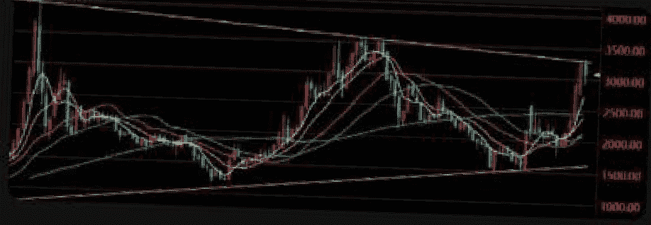
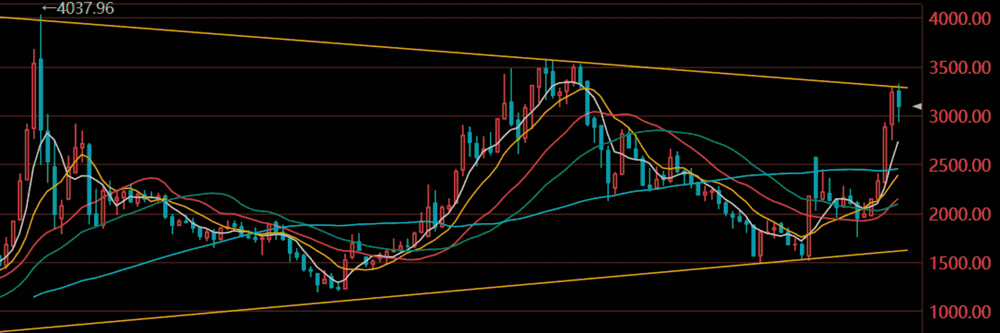
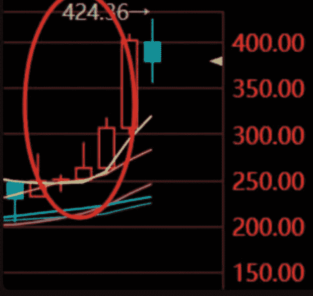

# 观海

别忘了我预测的22号高点

## 观海### 学习时报：努力稳股市让老百姓的消费底气更足

学习时报 10分钟前 约7分钟

科技革命爆发，如何把握产业增长红利？

股市是经济发展的晴雨表，关乎亿万家庭的财富增长与消费底气。今年3月，中共中央办公厅、国务院办公厅印发《提振消费专项行动方案》强调，“多措并举稳股市，加强战略力量储备和稳定机制建设”，凸显稳股市在拓宽城乡居民财产性收入渠道、夯实老百姓消费底气的重要性。

邓贺方

@观海 观大怎么看 拉券商

通常重要会议期间都有稳股市举措，机构大户有不愿意找麻烦，不会主动卖出

观海

券商预测过了，这里不讲了

观海下午大盘整体以回落调整为主

通常重要会议期间都有稳股市举措，机构大户有不愿意找麻烦，不会主动卖出

券商预测过了，这里不讲了

下午大盘整体以回落调整为主

观大，券商etf也到60日线了，布局要等大盘底再入手手吗

观海：券商预测过了，这里不讲了

大盘逼近前期高点了，重要会议期间稳定股市，大涨大跌都不允许的

所以，前期高点附近，还会回调的

观海

所以，前期高点附近，还会回调的

观海

两创处于B反中，反弹后会持续探底

## 观海### 创业板

# 观海

# 小鱼

观大，之前说过新能源储能电池是核心科技，宁德德作为创业板权重，能不能单独测测一个，看看跟创业板整体指数走势的契合程度？

13:27

# 观海

# 观海

还用测啥啊，都是5根阳线，本月阴线，

主线还是科技，不过，很多科技股炒高了，需要调整一段时间时间

观海

对付荷兰这种小国，有一百种方法……

观海

600745 闻泰科技
1.71 3.79 +9.99%

观海

16号群内提示大盘短期有创新高的能力，创业板和科创板只是一个B浪反弹，反弹后继续探底。

观海

主板短期有创新高的能力，两创前期涨幅过大，需要休整一些日子

下个月60日均线就到3900点了，这波预测是下跌到60日均线，不是某个点位，很多人搞不清楚

观大认为什么时候加仓合适？👊

磨刀霍霍

那就老实等着吧

同问

农行又新高了

| R 601288 农业银行 | |
| 7.86 ⭐ 0.11 +1.42% | 国有 |
| H: 5.760 (+1.95%) | |
| 我国大型有商业银行之一 | |
| 明细 | 资金 财务 |
| 买卖五档(手) | |

观海

# 农行又新高了

观海

画线工具 >> R 601288 农业银行
7.86 0.11 +1.42%
7.89 -> 7.80
国有
H股: 5.760 (+1.95%)
我国大型国有商业银行之一
明细 资金 财务
买卖五档（手）

观海

预测的明天高点还没验证呢，
万一预测错了呢？

# 知识星球TOP

添加微信
资源分享群
免费入群

微信:top28688

| 序号 | 公号/星球/社群 | 原价 | 领域 |
|---|---|---|---|
| 1 | 生财有木 | 2765/年 | 副业，搞钱 |
| 2 | 众宗众吃瓜群 | 365/年 | 时政，历史 |
| 3 | 记忆巷/袭树西风 | 365/年 | 成长 |
| 4 | 欧洲金轨 | 328/年 | 时政，历史 |
| 5 | 卢克文青云会 | 699/年 | 时政，社会 |
| 6 | 体制内主任 | 599/年 | 体制内，职场 |
| 7 | 格外人的视界 | 669/年 | 金融，时政 |
| 8 | 溯泽异迁 | 4166/年 | 财富，成长 |
| 9 | 守夜人司令 | 599/年 | 时政，经济 |
| 10 | 江宁知府 | 365/年 | 时政，国际 |
| 11 | 政事堂/顾子明 | 568/年 | 时政，经济 |
| 12 | 唐书 | 1399/年 | 金融，财富 |
| 13 | 大树乡村谈 | 199/年 | 时政，成长 |
| 14 | 水库欧大 | 10000/年 | 房产，经济 |
| 15 | 洪灏宏观策略 | 4376/年 | 经济，搞钱 |
| 16 | 金政通鉴/北海南山 | 4576/年 | 股票，行研 |
| 17 | 猫哥的世界 | 299/年 | 时政，社会 |
| 18 | 飞龙沃 | 3600/年 | 股市，经济 |
| 19 | 米联诸见闻 | 599/年 | 经济，金融 |
| 20 | 茶茶财经圈 | 330/年 | 房产，股票 |
| 21 | 赢在八小时之外 | 365/年 | 成长，职场 |
