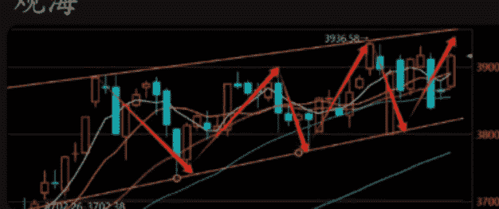

# 群公告

[File] 股市行情推演.docx123.docx

21号大盘: 预判今天继续震荡反弹，明天本周高点。
综合分析: 预测本轮行情 10 号上午高点（实际 9 号高点），预测上周 13 号是极佳的控仓时机，预判 22 号这个高点没有好的建议，因为下周出现重要时间点，可能就要进入买入时间点了。

。。。。

22 号大盘，冲高回落的趋势。
预判上午反弹震荡，下午震荡调整。

了解更多

# 观海

特普称将于明年初访问中国

2025年10月21日 15:26 来源: 中国新闻网 185人评论

18:54

# 观海

高盛指出，镓、石墨、钴和钨是最受到出口限制影响的关键矿物。镓用于耐高温的镓磁体，是航空航天和国防工业的重要特材料；而钴和钨的供应中断也可能对全球GDP 造成冲击。

# 观海

> 给西方国家去产能🤡

19:34

# 观海

# 观海

“Eureka”与群里其他人不是朋友关系，请注意隐私安全

20:01

feel
预示后面会大涨

Alex
刚三个低点，这是要突破了么

20:09

Andey
一直在减仓，不是明天大跌吗？

观海
预测明天高点，从哪里看到到明天大跌的？

邓贺方
23号大跌？

观海: 预测明天高点，从哪里看到明天大跌的？

邓贺方
开完会

# 知识星球TOP

添加微信；资源分享群免费入群

微信:top28688

| 序号 | 公号/星球/社群 | 原价 | 领域 |
|---|---|---|---|
| 1 | 生财有木 | 2765/年 | 副业，搞钱 |
| 2 | 众宗众吃瓜群 | 365/年 | 时政，历史 |
| 3 | 记忆苍/땡树西风 | 365/年 | 成长 |
| 4 | 欧洲金轨 | 328/年 | 时政，历史 |
| 5 | 卢克文青云会 | 699/年 | 时政，社会 |
| 6 | 体制内主任 | 599/年 | 体制，职场 |
| 7 | 局外人的视角 | 669/年 | 金融，时政 |
| 8 | 泽沛异迁 | 4166/年 | 财富，成长 |
| 9 | 守夜人总司令 | 599/年 | 时政，经济 |
| 10 | 江宁知府 | 365/年 | 时政，国际 |
| 11 | 政堂/顾子明 | 568/年 | 时政，经济 |
| 12 | 唐书院 | 1399/年 | 金融，财富 |
| 13 | 大树乡村谈 | 199/年 | 时政，成长 |
| 14 | 水库联大 | 10000/年 | 房产，经济 |
| 15 | 洪灏宏观策略 | 4376/年 | 经济，搞钱 |
| 16 | 金政通鉴/北海南山 | 4576/年 | 股票，行情 |
| 17 | 猫哥的世界 | 299/年 | 时政，社会 |
| 18 | 飞龙弋 | 3600/年 | 股市，经济 |
| 19 | 米联诸见闻 | 599/年 | 经济，金融 |
| 20 | 茶茶财经院 | 330/年 | 房产，股票 |
| 21 | 赢在八小时之外 | 365/年 | 成长，职场 |

...... 更多资源，不再列举

+ 图书、报告、课程等各类高价值资源

- 免费群 每日分享数字资源
- VIP群 每日享所有资源（日均20+），75/年
- 赠送付费资源合集，市场价数万元
