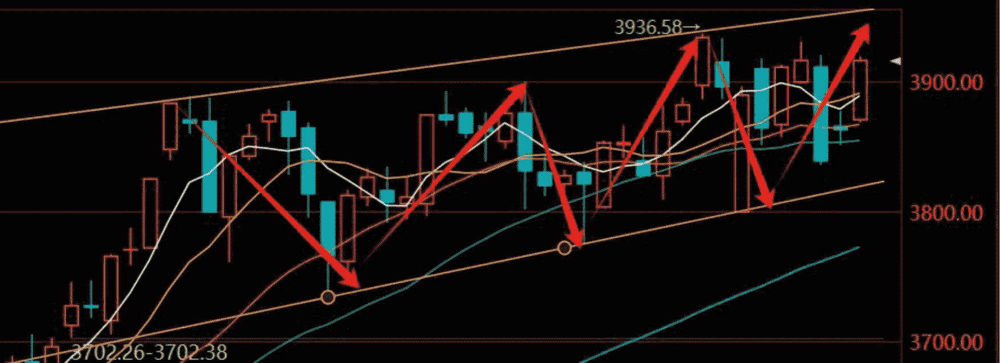
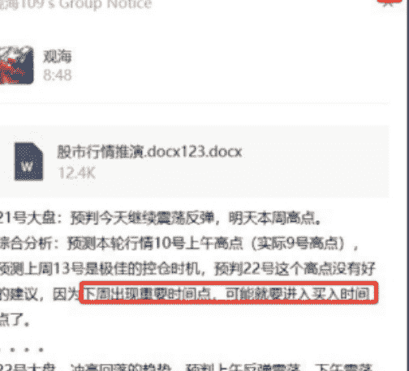
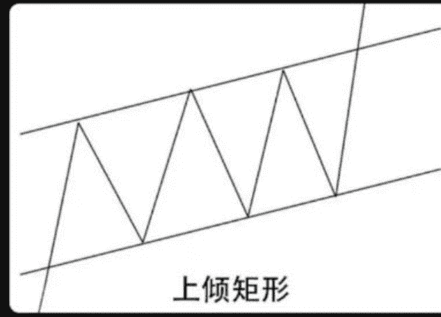
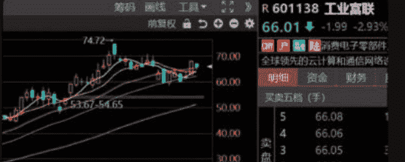
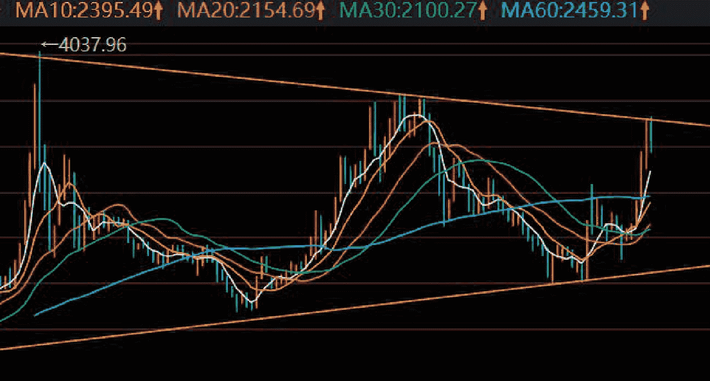
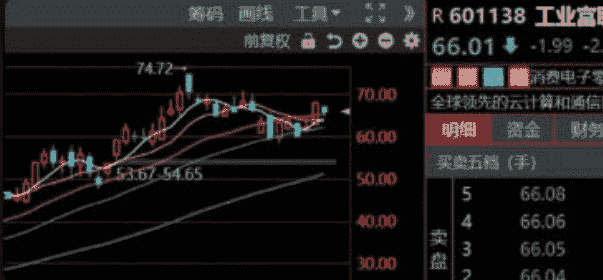
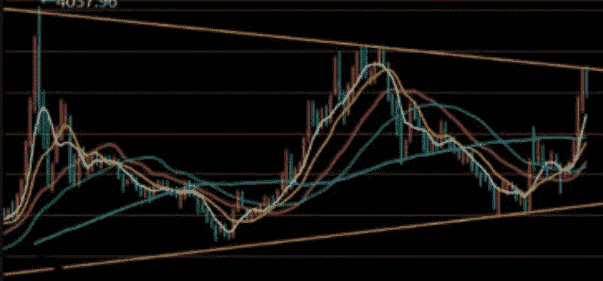
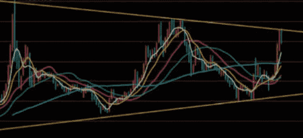

邓贺方

开完会

观海

下个月60日均线都3900点了，能跌哪里去？

## 观海

- 花湖对价转为看涨，未来三个月内跌至4000美元
高市早当选日本首相
欧洲对乌克兰蓄意拟定12个俄乌和计划
外媒：方便上周末向美方重申全面控制
俄巴斯斯坦中两国方就安半导体等问题交流意见
见文旅部：2025年前三季度国内居民出游人次同比同比增长18.0%

观海

6. 文化和旅游部发布2025年前三季度国内旅游市场数据情况，根据国内居民出游抽样调查统计结果，2025年前三季度，国内居民出游人次49.98万人，比上同期增加7.61%，同比增长18.0%。
7. 从全球投资者的总体配置来看，中国股票资产的仓位仍然处于较低水平。投资者对中国资产的改进预期维持将是势所趋。

## 梁先乐

> 昨天是不是提前一天见高点了
啊

## 梁先乐

> 或者明天高点

## 日月生

> 今天是交割日，也砸了

## shuer223

```
群聊
昨日黄金基金回调，创12年来最大单日跌
今日行情走软，电子手机板块跌3%
白酒板块表现良好，海康电子涨3%，医药板块持续低迷，中信股份跌5%，含医药板块无止跌 | 点击查看更多
```

## 观海

群公告
[File]股市行情推演.docx123.

## 群公告

[File] 股市行情推演.docx123.docx

21号大盘：预判今天继续震荡反弹，明天本周高点。

综合分析：预测本轮行情10号上午高点（实际9号高点），预测上周13号是极佳的控仓机会，预测22号这个高点没有好的建议，因为下周出现重要时间节点，可能就要进入买入时间点了。

22号大盘，冲高回落的趋势。预判上午反弹震荡，下午震荡调整。

再次体会到了“逃顶要快半拍，抄底要慢半拍”这句话的分量了，因为到了时间点，遇到了到了突发利空或利多，顶部和底部就会提前或延后。所以，本周预测22号上午高点的预判又提前了半天。

了解更多

观海

还有人记得我预测的11月俄乌停战吗？当时在群里说过

观海

预测今天上午反震荡，变成了上午低开反震荡了，这样今天就难有高点了

嫡山南

观海：还有人记得我预测的11月俄乌停战吗？当时在群里说过

空白

那今天适合出门吗？

mojin

记得

观海：还有人记得我预测的11月俄乌停战吗？当时在群里说过

观海

观海

观海109s Group Notice

股市行情预测.123.docx

21日：预测今天上午高上反震荡，明天低开。
分析：根据本周行情，上午高开（周五高点）没有回的。
建议：上周三是最佳时机，周二这两个点不要入场了。

22日：关注，冷却后回调，周二上午震荡，下周观察。

mojin

## 记得

观海：还有人记得我预测的11月俄乌停战吗？当时在群里说过的

观海

## 我们下周抄底,

观海



A.H

## 证券也等到下周吧

乐活

## 俄乌战争，大A跌
战争结束，大A跌
观海
俄乌战会影响黄金走势
sophie77 @观海 收到
空白

## 黄金横

## 俄乌战争，大A跌
战争结束，大A跌
观海
俄乌战会影响黄金走势
@观海 收到
空白

## 想买会多久

这样高点会不会往后延续？
观海：预测今天上午反弹，变成了低开反弹了，这样今天难有…
俄乌战后，战略会转移到亚太地区，所以抓紧机会，以后什么情况
不知道还是重新开始
观海：预测今天上午反弹，变成了低开反弹了，这样今天难有…

从特朗普出的条件看，大A跌都不是问题，关键是美国谈判，很容易成交，所以下周就要上仓位了，空仓都不可取

大A跌

如果没有利空低开，开盘冲高了
今天有仓位是逢高吗
这种都是自己决定的
空白：今天有仓位是逢高吗
不过周五跌了，因为会议结束机构可以卖了
两创高位要减仓，周五冲回落趋势
机构又开始买了？
上周跌提示本周还有高点，现在处于这个高点附近，然后回调下周底

这种都是自己决定的
空白：今天有仓位是逢高吗
不过周五跌了，因为会议结束机构可以卖了
周五冲回落趋势
机构又开始买了？
上周跌提示本周还有高点，现在处于这个高点附近，然后回调下周底
早晚要突破的，下轨是加仓的好机会


早晚要突破的，下轨是加仓的好机会



观海，下周方向还是证券吧？
我让大家买
本轮牛市主线是科技，目前处于回调中
回调结束后，还是要往死里干

回调结束后，还是要要死里干
科技股至少一个月

农业银行，不知道如何形容
券商还有50%的上涨机会吗
观海
券商是攻4000点的主力，现在处于“围城”阶段，还没攻城
中美马上要贸易谈判了，现在哪让券商搅局
下一波目标在4300附近
4300后面调整吗？

观海
券商是攻4000点的主力，现在处于“围城”阶段，还没攻城

岳麓
观海
中美马上要贸易谈判了，现在哪让券商搅局
观海
下一波目标位在4300附近

梁先乐
4300后面调整吗?

观海
哪一直涨的
下周加科技，还是双创吗?
茫茫毫无头绪T.T

观海
本牛市主线科技，目前处于调整中
调整结束后，还是要死里冲
科技股至少一个月

## 观海

主板上仓位，两创还得调，各个指数见顶时间不一致

## 观海

两创涨时，主板一直在横盘

不是券商金融的话，到时上主板的科技股？
各行业的核心科技股
大佬们多多点拨一下
工业富联算么🤔
通信ETF横盘2个月了，2天反弹了10个点。后面可以选么？
我觉得算
走出思维沼泽：工业富联算么🤔
工业富联是一直好的票不是
@观海
股市是动态的，现在还早
退潮后才能看到那条鱼

## 观海

股市是动态的，现在还早

## 观海

退潮后才能看到那条鱼

微信pe458

## 一朵小黄花

特变电工 能源大佬

## 观海

今天开始“退潮”。

一朵小黄花
特变电工 能源大佬
观海
今天开始“退潮”。

一朵小黄花
易中胜 宁寒
上证50
沪深300？

观海
每个股走的形态不一样，拿“富联”来说，调到30日均线就开始开始涨了，有的股调到60日线，有的股调到5日线，都有自己的





## 观海



## 日月生

资金开始北交所


## 观海

创业板指数要调整到60日均线


## 花王


## 花王

大部分在主板，科技，调整很久了


## 观海


## 观海



## 观海


## 观海

创业板，自己看
MA10:2395.49↑ MA20:2154.69↑ MA30:2100.27↑



观海
煤炭没涨，在群里说过的，每年的四季度都有一波上涨，如果提前潜伏这个就不赚了
前日子预测了证券一年走势，发号了，如果没有好的标的，提前潜伏就是对了，得等涨后再追？

## 观海

Steven
话说这个是月线的60日均线吗？


观海
这是月线划线，上看轨下轨的
节前多次提示创业板到顶了，就是这图

## 知识星球

添加微信
资源分享群
免费入群

微信:top28688

| 序号 | 公号/星球/社群 | 原价 | 领域 |
| :--- | :--- | :--- | :--- |
| 1 | 生财有木 | 2765/年 | 副业，搞钱 |
| 2 | 众宗吃瓜群 | 365/年 | 时政，历史 |
| 3 | 记忆Legacy/剪树风 | 365/年 | 成长 |
| 4 | 欧洲金轨 | 328/年 | 时政，历史 |
| 5 | 卢克文青云会 | 699/年 | 时政，社会 |
| 6 | 体制内主任 | 599/年 | 体制，职场 |
| 7 | 局外人的视界 | 669/年 | 金融，时政 |
| 8 | 溯泽异贷 | 4166/年 | 财富，成长 |
| 9 | 宁夜人总司令 | 599/年 | 时政，经济 |
| 10 | 江宁知府 | 365/年 | 时政，国际 |
| 11 | 政堂/顾子明 | 568/年 | 时政，经济 |
| 12 | 唐书院 | 1399/年 | 金融，财富 |
| 13 | 大树乡谈 | 199/年 | 时政，成长 |
| 14 | 水库联大 | 10000/年 | 房产，经济 |
| 15 | 洪灏宏观策略 | 4376/年 | 经济，搞钱 |
| 16 | 金通鉴/北海南山 | 4576/年 | 股票，行研 |
| 17 | 猫哥的世界 | 299/年 | 时政，社会 |
| 18 | 飞龙龙 | 3600/年 | 股市，经济 |
| 19 | 米联诸见闻 | 599/年 | 经济，金融 |
| 20 | 茶茶财经院 | 330/年 | 房产，股票 |
| 21 | 赢在八小时之外 | 365/年 | 成长，职场 |
