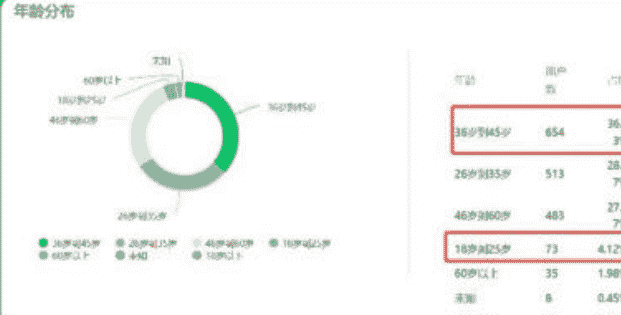
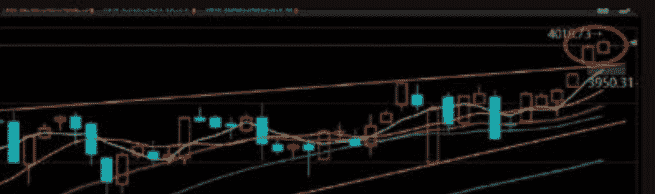

@观海 观大，你现在有几成仓位呀

问这种就不大礼貌了。

180%，前面说过，只是回调 1-2 天，我硬抗一下。

观大满仓了。

预计回调到多少?

不是大的波段回调，没必要为那点蝇头小利进进出出。

老股民在 4000 点以上几乎 没几个挣钱的，现在新老股民都在一个起跑线上。

观海：说话间，股指 4000 点了。。

妮娃娃.念母：啥时候回调啊😂

黄炜：他 7 月份说买没涨的科创。

观海：这还是在打压金融的情况下，理论上突破 4000 点后目标位在 5000 点以上，设立极端行情下别爆仓拿到 5000 点即可。

# 观海
看我公众号这个统计数字

# 观海

# 观海
36-45这个最具炒股能力的人群占比还不如小孩子。

# 观海
这个群体就是牛马，被房债套牢了。

观海：小年轻为啥比主力群占比高呢？因为他爹妈妈没套牢。

梁先乐：来股市解套房贷。

梁先乐：贷中贷。

"阿里"撤回了一条条消息。

阿里：剧本中的中场大戏从今天开始上演。😊

观海：前几年买房的人，类似炒股上杠杆股票套牢的那批人，已经有 00 后父母给的钱炒股了。10 后也有了，只不过不是自己的账户，我儿子的同学生物课都在交易，还嘘嘘他也开了个模拟账户🤣这话就是为了收割韭菜准备的。

梁先乐：4000次以上的交易，老韭菜了，4000次以上的韭菜。从政策上能看出国家认识股市的重要性了，一轮牛市难免。如果下午能回调，明天回踩就是大概率。

从政策上能看出国家认识到股市的重要性了，一轮牛市难免。

Steven：@观海 观大 周三还会回踩吗？

如果下午能回调，明天回踩就是大概率。下一个阻力位是4100点，理想的走势是回踩一下再涨。

@观海 这轮到4300 左右，会有大四浪调整吗？

阿里：尽可能的盘中做T，降成本。正T，倒T都要做。这对技术要求很高。防止出现 150 点阴线。

观海：高层确认中国领导人 10月30日-11月1日出席韩国。。。。

观海：30日是周四，上涨概率很高的。

花雨【精情寻】：整周都在涨？

司睿1319：明天是九重阳节哇。

妮娃娃.念母：150点阴线？

阿里：尽可能的盘中做T，降成本。正T，倒T都要做。这对技术要求很高。防止…

阿里：未来，说的是以后。别当真@妮娃娃.念母。

观海：高层确认中国领导人 10月30-11月1日出席韩国。。。

观海：30日是周四，上涨概率很高。

花王【精情亨】：整周都在涨？

司睿1319：明天是九九重阳节。

妮娃娃娃.念母：150点阴线？

阿里：尽可能的盘中做T，降成本。正T，倒T都要做。这对技术要求很高。防止…

阿里：未来，说的是以后。别当真@妮娃娃娃.念母。

妮娃娃娃.念母：150点阴线？

观海：点位仅参考，走一步看一步，不能死板@翔宇上涨途中中央在众多阳线中的一根阴线而已。

观海：周三如果走成了高点，那么回踩就在周四五，反正后面都有一个回踩。

观海：

花王【猜情孚】：下午已经开始调整？

观海：突破后会吸引技术派资金入場。

# 基本符合走势

观海 8:23
股市行情推演.docx124.docx 999.5K
28号大盘:上午反弹震荡，午盘后所有回落调整。

自得：@观海 现在补仓还是明天补？谢谢。

"观海"邀请了 "欢欢"加入了群聊。
"欢欢"与群里其他人都不是朋友关系，请注意隐私安全。

观海：@自得 参考这个预测补仓。

观海：

# 知识星球
添加微信
资源分享
免费群
微信:top2868

| 序号 | 公号/星球/社群 | 原价 | 领域 |
| :--- | :--- | :--- | :--- |
| 1 | 生财有木 | 2765/年 | 副业，搞钱 |
| 2 | 众宗吃瓜 | 365/年 | 时政，历史 |
| 3 | 记忆巷/裁风 | 365/年 | 成长 |
| 4 | 欧洲金轨 | 328/年 | 时政，历史 |
| 5 | 卢克青会 | 699/年 | 时政，社会 |
| 6 | 体制内主任 | 599/年 | 体制，职场 |
| 7 | 局外人的视界 | 669/年 | 金融，时政 |
| 8 | 溯泽异昂 | 4166/年 | 财富，成长 |
| 9 | 宁夜人总司令 | 599/年 | 时政，经济 |
| 10 | 江宁知府 | 365/年 | 时政，国际 |
| 11 | 政事堂/顾子明 | 568/年 | 时政，经济 |
| 12 | 唐书院 | 1399/年 | 金融，财富 |
| 13 | 大树乡谈 | 199/年 | 时政，成长 |
| 14 | 水库联大 | 10000/年 | 房产，经济 |
| 15 | 洪灏宏观策略 | 4376/年 | 经济，搞钱 |
| 16 | 金企通鉴/北海南山 | 4576/年 | 股票，行研 |
| 17 | 猫哥的世界 | 299/年 | 时政，社会 |
| 18 | 飞浪龙 | 3600/年 | 股市，经济 |
| 19 | 米联诸见闻 | 599/年 | 经济，金融 |
| 20 | 茶茶财经院 | 330/年 | 房产，股票 |
| 21 | 赢在八小时之外 | 365/年 | 成长，职场 |

...... 更多资源，不再列举

+   * 免费群 每日分享份资源
* VIP群 每日享所有资源（日均20+），75/年
  赠送付费资源集合，市场价数万元
