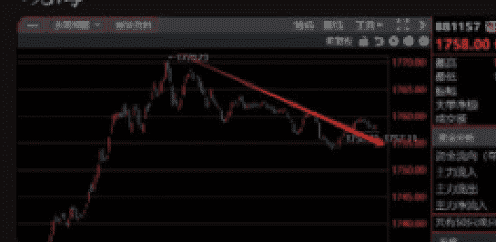

# 观海

买一个等于买这 10 只证券股

# 观海

| 中证全指证券公司ETF 512880 GUOTAI | | |
| 最新动态 | 基金概况 | 基金 |
| 收益率 | 0.55 | |
| 股票类型次数 | 2085 | |
| 大重仓股 | | |
| 2025-09-30 | | |
| 股票名称 | 股票代码 | 持有量(万股) |
| 东方财富 | 300059 | 32670.32 |
| 中信证券 | 600030 | 25222.61 |
| 国泰海通 | 601211 | 29198.80 |
| 华泰证券 | 601688 | 13092.72 |
| 广发证券 | 000776 | 7628.07 |
| 招商证券 | 600999 | 9590.01 |
| 东方证券 | 600958 | 13514.51 |
| 申万宏源 | 000166 | 23296.58 |
| 华业证券 | 001377 | 17855.88 |
| 中金公司 | 601995 | 3020.98 |

加微信进资料群

非

- 美方行程：美国总统特朗普于10月24日启程开展亚洲访问，先后访问马来西亚、日本，10月29日抵达韩国，计划30日与中方领导人会晤后，当天返回美国。

特朗普明天就回美国了，会谈时间判断不长，应该是叙叙旧旧，约定年初访问中国

# 观海

30 日凌晨公布降息，概率为97.3%，特朗普明天下午赶回美国，这就决定了中美会谈安排排在明天上午，两大利好都集中在明天上午出现。。。。

# 花王【猜情寻】

利好出尽是利空？

# 花王【猜情寻】

现在都给人搞的心慌意慌

# 观海

持股不动，忽略回调，等待消息引爆市场

# 花王【猜情寻】

我还想加仓🦀

还没回调呢，主板拉证券，回调也跌不了多少

观海：还没回调呢，主板拉证券，回调也跌不了多少

就是明后两天回调吗

周末语音没听吧，所有技术图形都支持突破上涨了，不会有大的回调了，29号预判有一个突破后的回踩，但30日又有两大利好支持。。

# 观海

现在是指数慢牛，行业板块轮着涨，别追高，要低吸潜伏核心板块等轮动，或者分歧调整时低吸、一致拉升高抛。

前段时间发的那那篇预测创业板跟证券，后面都有大行情的

科创需要回调

😊很多人没看@观海

我也没懂

以为科创和创业板都回调

证券，创业板和科创板未来一年走势，这篇预测里每月走势都有预测的，看不懂就看每月涨跌

那篇文章纯粹用五行预测的，如果结合技术图形分析一直，准确率就高一些

科创不涨我猜测可能芯片半导体成分股占比高有关

那篇文章纯粹用五行预测的，如果结合技术图形分析一直，准确率就高一些些。

科创不涨我猜可能芯片半导体成分股占比高有关

反推，中美会达成贸易协议

芯片半导体不行吗？

观海：科创不涨我猜可能芯片半导体成分股占比高有关

明天中美首脑会谈，看今天芯片半导体走势即可

我们抢购美国大，延件看到

观海

观海

证券下午处于回调

观海

# 知识星球

添加微信；免费入群

微信:top2868

| 序号 | 公号/星球/社群 | 原价 | 领域 |
|---|---|---|---|
| 1 | 生财有木 | 275/年 | 副业，搞钱 |
| 2 | 众宗吃瓜 | 365/年 | 时政，历史 |
| 3 | 毅树西风 | 365/年 | 成长 |
| 4 | 欧洲金轨 | 328/年 | 时政，历史 |
| 5 | 卢克文青会 | 699/年 | 时政，社会 |
| 6 | 体制内 | 599/年 | 体制，职场 |
| 7 | 局外人的视角 | 669/年 | 金融，时政 |
| 8 | 溯泽异贷 | 4166/年 | 财富，成长 |
| 9 | 宁夜总司令 | 599/年 | 时政，经济 |
| 10 | 江宁知府 | 365/年 | 时政，国际 |
| 11 | 政事堂/顾子明 | 568/年 | 时政，经济 |
| 12 | 唐书院 | 1399/年 | 金融，财富 |
| 13 | 大树乡村 | 199/年 | 时政，成长 |
| 14 | 水库欧大 | 10000/年 | 房产，经济 |
| 15 | 洪灏宏观策略 | 4376/年 | 经济，搞钱 |
| 16 | 金企通鉴/北海南山 | 4576/年 | 股票，行行 |
| 17 | 猫哥的世界 | 299/年 | 时政，社会 |
| 18 | 飞浪龙 | 3600/年 | 股市，经济 |
| 19 | 米联诸见闻 | 599/年 | 经济，金融 |
| 20 | 茶茶财经圈 | 330/年 | 房产，股票 |
| 21 | 赢在八小时之外 | 365/年 | 成长，职场 |

......
更多资源，不再列举

+   - 免费群 每日分享数字资源
- VIP群 每日分享所有资源（日均20+），75/年
- 赠送付费资源集合，市场价数万元
