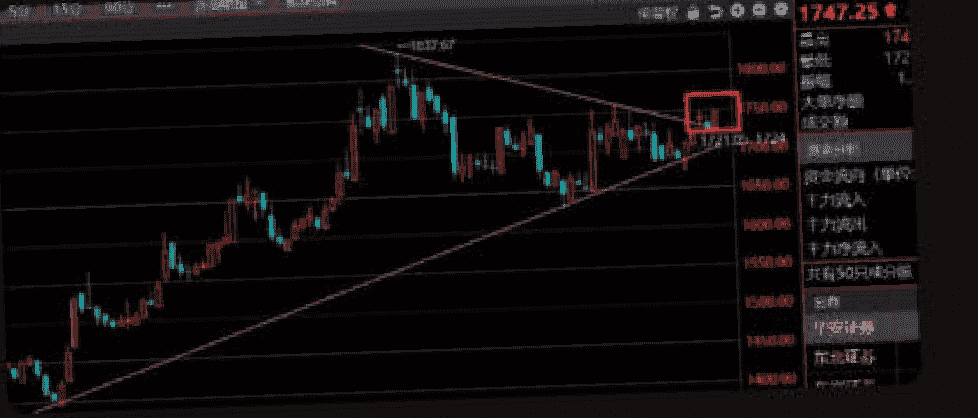
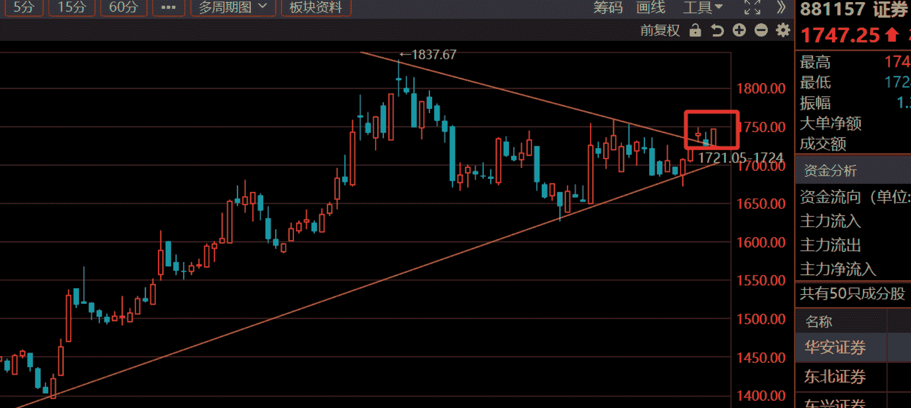
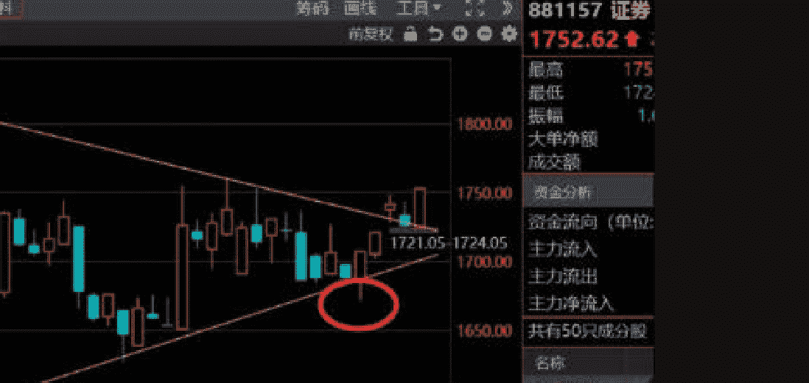

# 此图都能看懂吧？每天发一次

令狐掰zane

拉证券啦😅😊

司睿1319

通过证券控盘啊

司睿1319

他一发力轻松过4000

观海

看看预测里给出的预测图，再对比一下今天给出的图

观海

# 我是在往下突破时融资买的，
当天就在群里告诉大家了

观海

# 观海

在大盘趋势趋向好的情况下，敢于反向操作，如果死板向下突破卖出就大错特错了

观海
如果是大盘顶部，某个股向上突破，大概率就是假突破，这个时候就不能加仓

# 知识星球TOP

添加微信；
免费入群

微信:top28688

| 序号 | 公号/星球/社群 | 原价 | 领域 |
| --- | --- | --- | --- |
| 1 | 生财有木 | 2765/年 | 副业，搞钱 |
| 2 | 众宗众吃瓜群 | 365/年 | 时政，历史 |
| 3 | 记忆巷/袭树西风 | 365/年 | 成长 |
| 4 | 欧洲金轨 | 328/年 | 时政，历史 |
| 5 | 卢克文青云会 | 699/年 | 时政，社会 |
| 6 | 体制内主任 | 599/年 | 体制，职场 |
| 7 | 局外人的视界 | 669/年 | 金融，时政 |
| 8 | 溯泽异诠 | 4166/年 | 财富，成长 |
| 9 | 守夜人总司令 | 599/年 | 时政，经济 |
| 10 | 江宁知府 | 365/篇 | 时政，国际 |
| 11 | 政堂/顾子明 | 568/年 | 时政，经济 |
| 12 | 唐书 | 1399/年 | 金融，财富 |
| 13 | 大树乡谈 | 199/年 | 时政，成长 |
| 14 | 水库欧大 | 10000/元 | 房产，经济 |
| 15 | 洪巅的宏策略 | 4376/年 | 经济，搞钱 |
| 16 | 金通鉴/北海南山 | 4576/年 | 股票，行研 |
| 17 | 猫哥的世界 | 299/年 | 时政，社会 |
| 18 | 飞龙弋 | 3600/年 | 股市，经济 |
| 19 | 米联储见闻 | 599/年 | 经济，金融 |
| 20 | 茶茶财经 | 330/年 | 房产，股票 |
| 21 | 赢在八小时之外 | 365/年 | 成长，职场 |

...... 更多资源，不再列举

+ 图书、报告、课程等各类高价值资源

+ ★ 免费群 每日分享优质资源

+ ★ VIP群 每日享所有资源（日均20+），75/年
赠送付费资源合集，市场原价万
