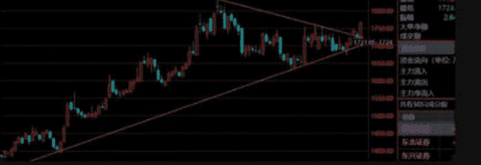
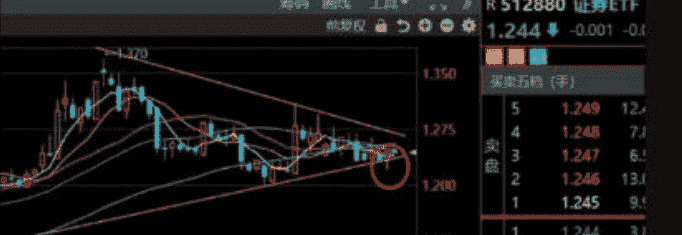
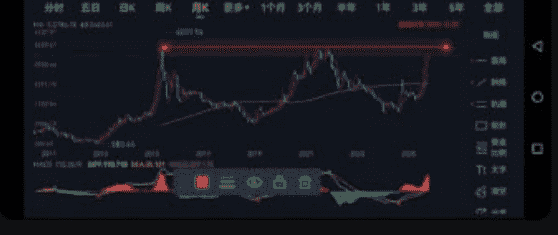
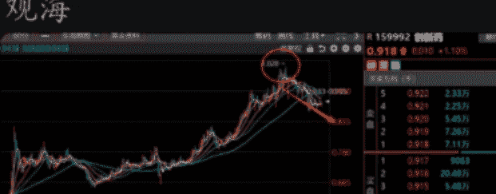

观海

上周群询问大家仓位，让仓位低的加仓

观海

观海109(188)

加微信进资料群

30%的周线加仓，已经到了离仓边缘了，未预期要离场Alex

观海

# 上周我买证券后发在群里的图，再对对比一下今天

观海

观海

清晨

# 突破了

梁先乐

梁先乐

# 创业板到这里又是阻力

观海

炒股抄的是概率，不是涨幅；既然赢率高，即使涨幅不大也不买这个赢率高的

在 23号之前，群里都知道我没融资买入的，前两个月，我在群里说过我没融资的

券商相当于过去去 3500 点的位置，明显低估，又是高增长，普遍业绩增长 50% 以上

是哦

差 500 点涨幅哦

科技股收益高，但涨幅过大，我可不敢融资买

如果证券有收益 50% 的预期，两创有收益 100% 的预期，我是宁愿买证券的

融资首先考虑的是风险

实在找不出低风险板块了

上个牛市买的是银行，更保守

昨天 16:27

@姜淳 已财富自由了不一样

明天买证券ETF

@云海 是的，观大现在以稳为为主

买科技就要做好回撤的准备

跟上

我们可以适当胆大一些。

好的科技股涨幅100%以上了，回调50%也是可能的，但券商不可能能跌50%，因为没怎么长，所以风险不大

买入前要做最坏的打算

首先考虑的不是钱，考虑的是万一亏了如何应对

今天最炸的消息必须是北交所，董事长明确表态要深化新板块改革，还会加快推出北证50ETF——这可是普通散户的福音

北京证监局：联合市金融办等单位出台了《北京市推动长期资金入市的实施意见》

怎么讲?

云海：今天最炸的消息必须是北交所，董事长明确表态要深化新板块改革，还会...

北证垃圾股居多，闹不好就踩雷，以后直接买北证50ETF

北证垃圾股居多，闹不好就踩雷，以后直接买北证50ETF

场外基金可以吗

前几年新股中签北交所一只股，开盘就比发行价低20%，直接让我拉黑北交所，再没碰过

et就是基金啊

观大，请问一下您怎么看创新药？这个算是科技里面的吗？感觉现在在回调到位了

同问。我在港股创新药赔了10个点，很犹豫走不走？

：观大，请问一下您怎么看创新药？这个算是科技里面的吗？感觉现在在回调…

创新药属于泛科技范，美国限制创新药进口

观海

创新药属于泛科技赛道，美国限制创新药进口

"kathy" 撤回了一条消息

kathy

同问，我想进点港股创新药ETF，拿不准。

观海

上半年创新药大涨过，下半年新入场的资金就愿意去拍轿

云海

但下半年跌幅较大

观海

很明显见顶下跌

观海

9月初见顶，回调时间还不够

观海

就怕买入这种，上涨时没赶上，下跌时赶上了

观海

就怕买入这种，上涨时没赶上，下跌时赶上了

观海

为了避免买科技股出现类似情况，我才去买的证券，其实科技才是主线，但我没把握

小黑

观大，黄金现在是不是也是类似这种情况

观海：就怕买入这种，上涨时没赶上，下跌时赶上了

观海

黄金也是

观海

但黄金受多方面影响，不确定因素更多，万一哪天某个角落爆发激烈冲突，就会大涨，这些都是不可预测的

欢欢

科技可以一直持有吗？

观海

本轮牛市就是科技牛

观海

本轮牛市就是科技牛

欢欢

那就是科技行情还未结束呢

观海

牛市也回调，如果前期没挣到钱，进去就赶上上个调整，这种倒霉蛋也有

观海

我不想做倒霉蛋，宁愿在证券里躺着

今日A股大盘虽再度上攻并突破4016点整整数关口，但市场分化特征明显，下跌个股占据多数。

观海

下一个阻力位在4105点

花王【诸情】我躺着不动。略回调

观海：下一个阻力位在4105点

天行健比我预估多55个点

观海：下一个阻力位在4128附近还有空夺？

杨涛（杨涛）

@观海👍👍👍

观海

这轮上涨目标位5000点，中线持有

7:52 来源：央视客户端

云海

将支持人工智能、航天、高端装备等战略新兴产业以及未来能源、未来制造等重点领域。

都是下面人先谈好，不然会像泽斯基一样，很尴尬所以说，明天利好

观海

特朗普表示，他希望降低对华关税，彻底遏制出口。

明天可能降20%关税

Alex

那就是超预期，直接起飞？

观海：明天可能降20%关税

观海

旧社会跟洋人谈，有意思……

明年初，特朗访普华时大利，提前谈不好他不会，既然然，就能谈成

Milan洋洋拍了我，明天持仓大涨

Win

话说明下午跳水

为什么这么说

云海

因为跌难

观海

看量，只要维持万亿，就支持上行

Win

观海

大涨之后不卖，遇到小级别洗盘也不卖，直到4200-4300之后防守。

观海

关税降低，直接利好出口产业链，包括新能源中的储能、光伏等。

光伏现在又很高了，观大怎么看？

观海

提前埋伏，等消息朗后再买就晚了

云海

其实对应的是创业板ETF

观海

关税最没道理，美国不利，到我们头上，毫无道理

预测创业板继续上涨，早就发在证券创业板一年走势文中坚定扩大金融领域高水平

观大，证券补涨50%，大盘会到多少呢

创业板是不是筑双顶，然后回调调整两个月？我可没说过补涨50%预测里都有

观海

中金公司10月29日公告，2025年第三季度实现营业收入79.33亿元，同比增长74.78%；归属于上市公司股东的利润22.36亿元，同比增长254.93%；基本每股收益0.426元。前三季度实现营业收入207.61亿元，同比增长54.36%；归属于上市公司股东的利润65.67亿元，同比增长127.95%；基本每股收益1.24元。

观海

我少量持有此股，买入不多

代

证券这波的空间有多大

观海

10月29日工业富联公告，2025年第三季度实现营业收入2431.72亿元，同比增长42.81%；归属于上市公司股东的利润103.73亿元，同比增长62.04%；基本每股收益0.52元。前三季度实现营业收入6039.31亿元，同比增长38.40%；归属于上市公司股东的利润224.87亿元，同比增长48.52%；基本每股收益1.13。

观海

10月29日工业富联公告，2025年第三季度实现营业收入2431.72亿元，同比增长42.81%；归属于上市公司股东的利润103.73亿元，同比增长62.04%；基本每股收益0.52元。前三季度实现营业收入6039.31亿元，同比增长38.40%；归属于上市公司股东的利润224.87亿元，同比增长48.52%；基本每股收益1.13元。

今天看到一个数据，上证指数从3000点到4000点，各个行业贡献的指数是多少？其中半导体电子贡献了360点，银行贡献了85点，两大行业合计450点，意味着贡献了45%的涨幅

也就是说，如果扣除电子半导体+银行，A股现在还在3500点。如果你们没有这两大板块，
