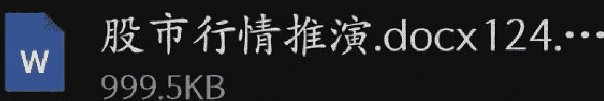

28号大盘: 上午反弹震荡，午盘后有所回落调整。

30日大盘: 上午反弹为主，会谈结果估计中午出来（会谈3个小时），利好兑现，下午大盘有所回调震荡。

## 观海

- 美联储如期降息25BP，鲍威尔直言12月降息不是板上钉钉
- 特朗普：未能协调好金正恩的会晤时间
- 美国宣布新一轮对俄制裁，重点针对两国石油公司
- 韩美达成贸易协议，韩国将对美投资3500亿美元
- 加拿大央行如期降息25个基点，同时指示将暂停降息以捍卫经济并控制通胀
- 英伟达成为首豪市值突破5万亿美元的企业
- 习近平将于当地时间10月30日在韩国苍山与美国总统特朗普举行会晤
- 央企战略性新兴产业发展专项基金启动，首期规模达510亿元

加微信进资料群

观海：10点前是美联储降息利好兑现，现在轮到“xt会”登场了。

观海：中午休市应该能传出会谈结果。

观海：会谈内容只有极少核心成员知晓。

观海：双方一登台，股指就开始拉。

观海：中午看看会不会发“特朗普痛快接受了访华邀请”。

10:54

观海：大盘震荡回调收盘，下午继续震荡反弹。

MaggieTTT：日内反序了。

苍雨：体会类似10月10日走势。

观海：不存在反序一说，就是走势被不断变化的消息影响了。

大盘震荡回调收盘，下午继续震荡反弹。

日内反序了。

会不会类似10月10日走势。

不存在反序一说，就是走势被不断变化的消息影响了。

按照国内新闻审核机制，预计中午也难有消息爆出来。

一帮老头老头老太太在唉嘘🤭