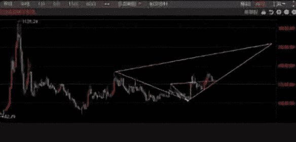
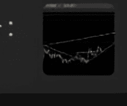

股价只要涨了几倍走上上下震荡，就是主力在出货，不能参与了。

观海：量化是大势所趋，只是交易制度还不够完善就搞量化，有过度割韭菜的嫌疑。

贝加尔湖：但他就不敢去美国。

贝加尔湖：只有中国的制度才有利于他。

观海：大陆的机构去香港市场都被挤得鼻青脸肿，离开A股什么都不是。

观海：特朗普访华前后几个月绝对是利空真空期，有利于大资金放开手脚干一票。

观海：周五保险证券松绑为市场注入活力，今日村里再提拓宽券商资本与杠杆上限，无疑为券商及互联网金融板块再添一把火。

贝加尔湖：💔

观海：周五保险证券上涨，应该是主力提前知晓利好了。

观海：券商拉升不到时间，耐心等待。

观海：

贝加尔湖：券商周五已经见底底部了吧？

观海：

观海：明年证券没大行情，只有40%-60%的幅度，想要翻倍收益，还是买科技。

# 新下发了《基金管理公司绩效考核管理指引》征求意见稿，主要有以下几个方面：

一是过去三年跑输业绩比较基准10%且利润率为负的基金经理降薪30%。基金业绩和基金经理的薪酬直接挂钩了，行业要优胜劣汰了；

二是基金公司董事长、高管等当年全部绩效薪酬应不少于30%购买本基金。这就要求基金公司的高管也要跟投自家基金，基金公司不能拿着基民的钱去做亏损的投资，高管也得跟投，这样才有利于业绩的稳定；

保险、基金、券商三大行业均有关利好消息，时间也是刚刚好。

It is noteworthy that this conclusion appears in the newly released US National Security Strategy:

*We must encourage Europe, Japan, Korea, Australia, Canada, Mexico, and other prominent nations in adopting trade policies that help rebalance China’s economy toward household consumption, because Southeast Asia, Latin America, and the Middle East alone cannot absorb China’s enormous excess capacity.*

whitehouse.gov/wp-content/up/

Google Earth

值得注意的是，这一结论出现在最新发布的美国国家安全策略中：

“我们必须鼓励欧洲、日本、韩国、澳大利亚、加拿大、墨西哥和其他主要国家采取有助于中国经济向家庭消费倾斜的贸易政策，因为东南亚、拉丁美洲和中东自身无法消化中国巨大的过剩产能。”

# 让对岸的还是为了练习

自得：攻击必须是偷袭或突袭，时间一定特别，既成事实，让世界措不及防。

观海：不可能打起来，从古至今点历史的人都明白，只要掌握了权利，只要动兵，就有失去权利的可能性，打仗是下策。

龙腾东南：孙子总结兵法的时候，欧洲人、美洲人还在茹毛舔血呢。

观海：最好的办法就是多造军舰，把台湾湾围起来，针插不进去，自然就投降了。

观海：你看香港一个火星就烧毁了几座大楼，导弹不可长眼，你打人家，人家也会报复，倒霉的还是老百姓。

观海：俄罗斯深深，人烟稀少。

观海：再说别的，只要开战，股市就会回跌停，跌到1000点都有可能。

观海：台湾也是中国人，中国人不打中国人，现在科技发达，学以色列，定点清除台独分子即可。

# 格隆汇·电报

2025-12-07 10:43 定期更新

# 机构：10月全球半导体销售额同比激增3%，总额达713亿美元

格隆汇12月7日 | 据英国半导体行业协会（SIA）的最新数据，10月全球半导体销售额同比激增33%，总额达713亿美元（约合人民币5040亿元），其中DRAM（动态随机存存储器）销售额同比开启90%。分析认为，这背后的最大助推力是，人工智能（AI）推动需求激增，大量产业转向用于AI训练的高带宽内存（HBM），导致用于标准DRAM和3D NAND的晶圆产能减少。当前全球AI基础设施建设热潮正在造成存储芯片等关键投入短缺，或将推动2026年DRAM均价持续上行。Counterpoint Research预计，先进和传统存储芯片价格将在2026年初可再次增长20%。

# 周末两件事：

1. 吴清说要加大杠杆了；
2. 基金经理的考核变化。

散户们都兴奋起来了！

# 知识星球TOP资源群

入群畅看全网付费资源

分享资源目录（部分）

| 序号 | 公号/星球/会员 | 原价 | 领域 |
| :--- | :--- | :--- | :--- |
| 1 | 生财有术 | 2765/年 | 副业·搞钱 |
| 2 | 欧洲驼 | 328/年 | |
| 3 | 悠悠私享 | 365/年 | |
| 4 | 狮子明 | 568/年 | |
| 5 | 卢克文青会 | 699/年 | |
| 6 | 政事堂 | 365/年 | 时政·经济·历史 |
| 7 | 米联闻 | 599/年 | |
| 8 | A视野 | 26/篇 | |
| 9 | 猫哥的世界 | 299/年 | |
| 10 | 宁夜总司令 | 599/年 | |
| 11 | 付购 | 1888/年 | |
| 12 | 洪澜的宏观策略 | 899/年 | |
| 13 | 金融通/北海 | 4576/年 | |
| 14 | 丁长星球 | 1599/年 | 股市·地产·趋势 |
| 15 | 茶案财经院 | 330/年 | |
| 16 | 雪花老头 | 66/篇 | |
| 17 | 飞龙弋 | 3600/年 | |
| 18 | 安民分析 | 28/篇 | |
| 19 | 水库欧大 | 6980/年 | |
| 20 | 智谷越势 | 498/年 | |
| 21 | 记忆承载/智树西风 | 365/年 | 社会·职场·成长·认知 |
| 22 | U君/赢在八小时 | 365/年 | |
| 23 | 貳掌柜（学习笔记） | 99/年 | |
| 24 | 体制内主任 | 599/年 | |
| 25 | 局外人的视野 | 669/年 | |
| 26 | 潇沫异谈 | 4166/年 | |
| 27 | 大树闲谈 | 199/年 | |
| 28 | 图书、报告等资源 | | |
| 29 | 影视、软件等资源 | | |

**VIP群：特惠88/年 + 每日分享所有资源 + 入群送资料** (原价数万元)

**免费群：可免费进群 + 每日享一部分资源**
