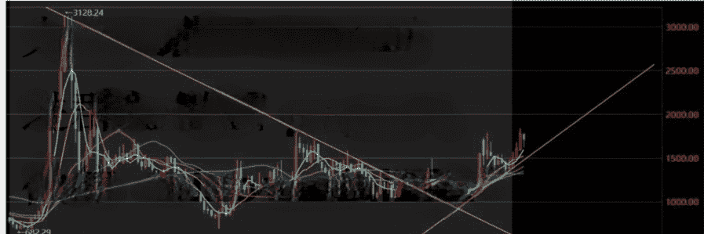
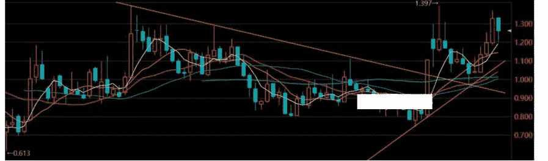

# 证券、创业板、科创板指数未来一年走势及大顶时间

三季度证券板块上涨13%，创业板上涨50%，科创板上涨49%，创业板涨幅是证券板块的3.8%。

对比一下，证明证券板块跑赢双指数。

但凡牛市，证券必涨，不然就是牛市。

从历史走势看，历次证券板块的涨幅并不比创业板小，准确的，证券板块涨幅从未被创业板小过。

今年就后悔了，股市投资活跃，证券股票业绩普遍高增长，市场表现远尽人意（对创业板和科创板而言）。

先别着急抛弃板块，从历史行情看到，2020年有过类似情况，当时证券板块创业板还涨一个季度，后续追头上来了。

类似的情况2015年也有类似情况，不同的证券板块领先一个季度，后续创业板逆头赶上来。

今年创业板三季度涨了50%，15年大牛的时候，创业板一个季度最多也就涨58%。

这个板块涨说明创业板块已经有了大牛的涨幅，有大牛的成交量，现在已处于大牛市中。

这些又决定了证券业绩都是大牛级别的！

> 如果走势复制历史，在后续行情中，证券板块某个季度涨幅应该也会出现一根或超过50%的大K线。

> 我的确很明白，大牛，证券不是从业绩出发，还是从牛市出发，都应该大涨，而且也肯定会有大行情！

我在今年7月中就开始推荐“科技”来，科技股已经规模巨大，我本人打算在接下来的行情中，在预测证券板块的时间点买入证券ETF，持有到证券板块见。

下面内容是中国传统预测方法，结合证券走势和基本面，预测从2025年10月到2026年全年的走势。

加微信top28688，进资资料群

在预测中发现，证券板块与主涨走势不同，见大顶时间要早得多，这可能与证券股行情来临，派筹活跃，持续时间较短。

重点预测：证券板块低点的月份（建议买入），主升浪持续的月份（建议持有），证券板块大顶爆发的月份（建议卖出）。

次要预测：证券板块波段调整的时间，波段底部月份，波段上涨持续的时间。

本文内容包含：证券、创业板、科创3个指数未来一年走势及大顶时间。

预测内容精炼简洁，不模棱两可（含两张证券走势图分析），没有长篇大论。

## 一、证券板块指数未来一年的走势：

上图为证券881157走势图

二图为证券ETF走势线

从图中可以看到，两张走势图虽然略有不同，但都突破了下压力线，然后完成了回撤，确认牛市行情开始。

从第一图可以看到，证券指数确实突破压力后，在今年4月完成回撤，开展了第一波上涨行情，连续4个月，在8月份看到了一个相对高点，然后9月开展回调走势，并拉出了一条均衡线。

## 加微信top28688，进资料分享群

以上是技术分析，下面是五种方法预测：

2025年的大部分时间在4月，上涨行情已确立，年底没有大的低点时间，只有相对回调调整。

五整体实证：证券指数10月调整涨势：

8月高点开展的调整涨势可能在10月结束，最低点不排除出现在11月的可能，因为这段时间内国内外大事较多，如果出现的利空，留出一个低点再拉起也是可能的。

五整体实证：证券指数11月-12月调整。2026年1月反弹。

头部：2026年1月反弹。2月后上涨加速。

头部：证券指数在4-5月出现高点。

头部：2026年1月反弹。2月后上涨加速。

头部：证券指数在4-5月出现高点。

## 二、创业板块一年的走势

2025年的大部分时间在4月，上涨行情已确立，年底没有大的低点时间，只有相对回调调整。

五整体实证：证券指数10月调整涨势：

8月高点开展的调整涨势可能在10月结束，最低点不排除出现在11月的可能，因为这段时间内国内外大事较多，如果出现的利空，留出一个低点再拉起也是可能的。

五整体实证：证券指数11月-12月调整。2026年1月反弹。

头部：2026年1月反弹。2月后上涨加速。

头部：证券指数在4-5月出现高点。

## 三、科创板块一年的走势

2025年的大部分时间在4月，上涨行情已确立，年底没有大的低点时间，只有相对回调调整。

五整体实证：证券指数10月调整涨势：

8月高点开展的调整涨势可能在10月结束，最低点不排除出现在11月的可能，因为这段时间内国内外大事较多，如果出现的利空，留出一个低点再拉起也是可能的。

## 加微信top28688，进资料群

| 序号 | 公号/星球 | 原价 | 领域 |
| --- | --- | --- | --- |
| 1 | 生财有木 | 2765/年 | 副业、搞钱 |
| 2 | 众宗吃瓜 | 365/年 | 时政、历史 |
| 3 | 聂树风 | 365/年 | 成长 |
| 4 | 欧洲金轨 | 328/年 | 时政、历史 |
| 5 | 卢克青云 | 699/年 | 时政、社会 |
| 6 | 体制内主任 | 599/年 | 体制、职场 |
| 7 | 局外人的视界 | 669/年 | 金融、时政 |
| 8 | 溯泽异迁 | 4166/年 | 财富、成长 |
| 9 | 守夜司令 | 599/年 | 时政、经济 |
| 10 | 江宁知府 | 365/年 | 时政、国际 |
| 11 | 政堂/顾子明 | 568/年 | 时政、经济 |
| 12 | 唐书 | 1399/年 | 金融、财富 |
| 13 | 大树乡谈 | 199/年 | 时政、成长 |
| 14 | 水库欧大 | 10000元 | 房产、经济 |
| 15 | 洪巅的宏观策略 | 4376/年 | 经济、搞钱 |
| 16 | 金融通鉴/北海南山 | 4576/年 | 股票、行研 |
| 17 | 猫哥的世界 | 299/年 | 时政、社会 |
| 18 | 飞浪龙 | 3600/年 | 股市、经济 |
| 19 | 米联储见闻 | 599/年 | 经济、金融 |
| 20 | 茶茶财经院 | 330/年 | 房产、股票 |
| 21 | 赢在八小时之外 | 365/年 | 成长、职场 |

...... 更多资源，不再列举

+ 图书、报告、课程等各类类高价值资源

-- 免费群 每日分享数字资源

-- VIP群 每日分享所有资源（日均20+），75/年

赠送付费资源集合，市场原价数万元
