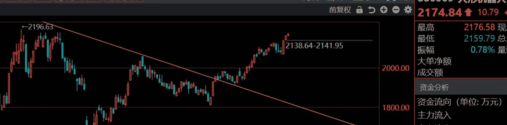

美国总统特朗普表示，将将在下周内宣布药品关税；对制药业起将征收额度较小的关税，但最终将达到250%。

- 利空创新药
- 涨跌全看特朗普
- 他随意操控股市
- 医疗器械可以碰吗
- 出口老美的都是利空
- 创新药靠老美挣钱，然后补贴国内

下周走势如果提前说的更细一点的话，大概周一探底回升，周二震荡，周三冲高回落，周四震荡到周五高收。

大盘3636点见顶的回调，外加外围回调带来的恐慌情绪，周一指数低开。正所谓行情在犹豫中继续前进，事实上上周五指数虽然下跌，个股在连续走弱已经轻率先走强，今天早盘消化一下外围不利的因素后，将触底反弹。

5号大盘：上午震荡反弹，下午调整震荡。如果上午提前调整，下午就会出现反弹，灵活把握。

6号大盘：上午有冲高，午盘震荡回调。反弹受阻，注意风险。

了解更多

# 世界机器人大会将开幕

中报业绩 绩优概念股出炉

 宏观 特朗普宣布将对进口药品征收“小额关税”

8月8日，2025世界机器人大会将在北京经济技术开发区北人亦创国际会展中心启幕。据悉，将有100余款新品在大会上首发亮相，数量是去年的近2倍。

雅下水电熄火，追热点很容易套牢

银行只是反弹，不会有新高

# 知识星球TOP

# 添加微信 付费资源分享群 免费入群

微信: jtsq2

| 序号 | 公号/星球/社群 | 原价 | 领域 |
| :--- | :--- | :--- | :--- |
| 1 | 生财有术 | 2765/年 | 副业，搞钱 |
| 2 | 宗容吃瓜付 | 365/年 | 时政，历史 |
| 3 | 记忆承载/莉树西风 | 365元/年 | 成长，搞钱 |
| 4 | 欧洲金角 | 328元/年 | 时政，历史 |
| 5 | 虎文青云会 | 699/年 | 时政，社会 |
| 6 | 体制内主任 | 599/年 | 体制；职场 |
| 7 | 外人的视野 | 669元/年 | 金融，时政 |
| 8 | 濑泽并谈 | 4166/年 | 财富，成长 |
| 9 | 守夜人司令 | 599/年 | 时政，经济 |
| 10 | 江宁知府 | 365/篇 | 时政，国际 |
| 11 | 政堂/顾子明 | 568/年 | 时政，经济 |
| 12 | 唐书院 | 1399/篇 | 金融，财富 |
| 13 | 大树乡浅 | 199/年 | 时政，成长 |
| 14 | 水库欧大 | 1000/元 | 房产，经济 |
| 15 | 洪渠的宏观策略 | 4376/年 | 经济，搞钱 |
| 16 | 金政通鉴/北南山 | 4576/年 | 股票，研行 |
| 17 | 猫哥的世界 | 299/年 | 时政，社会 |
| 18 | 飞鹰 | 3600/年 | 股市，经济 |
| 19 | 米联储见闻 | 599/年 | 经济，金融 |
| 20 | 鉴茶经院 | 330/年 | 房产，股票 |
| 21 | 赢在八小时之外 | 365元/年 | 成长，职场 |

... 更多资源，不再列举 +图书、报告、课程等各类高价值资源

- 免费群 每日分享数份资源
- VIP群 每日分享所有资源（日均20+），75/年

# TOP资源 TOP社群
