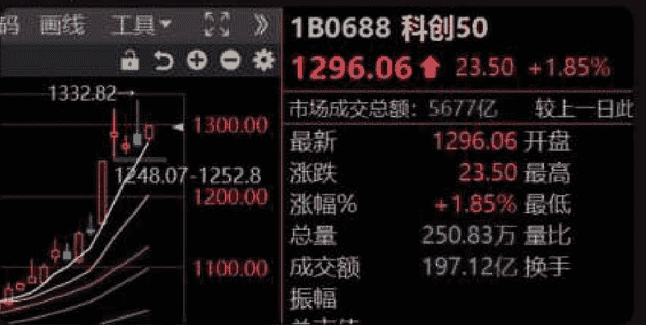
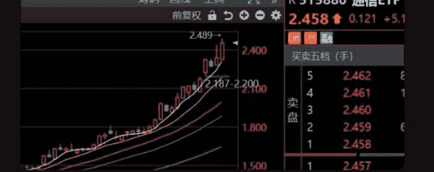
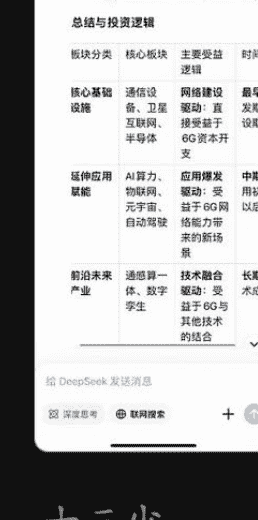

# 群公告

[File] 股市行情推演.docx116.docx
26日可关注中线走势图中的上3910点和下6124-5178下压线3918点的位置，这两个点都是重要阻力位，预判大盘会在此遇阻回落。

27号：冲高回落态势；但需注意3874点，如果站上此点位，继续上涨；如果未站上，继续震荡回调。

28号：上午震荡反弹，下午冲高回落震荡。考虑到昨天跌幅过大，日内应有一个反弹出现。

了解更多

# 观海
# 行情在科创

微信pep458

# 观海

# 观海

1B0688 科创50 23.50 +1.85%

| | | |
|---|---|---|
| 交总额 | 5677亿 | 较上一日 |
| 最新 | 1296.06 | 开盘 |
| 涨跌 | 23.50 | 最高 |
| 跌幅 | +1.85% | 最低 |
| 总量 | 250.83万 | 量比 |
| 成交额 | 197.12亿 | 换手 |

令孤独狮zane
反正我在ETF上躺平了 😅😅

强强
牛逼啊，反弹这么快，要减吗

令孤独狮zane
你早早赶忙卖了，群里就有人想买。转给他他🤡🤡

强强

观海
国家不希望指数涨得太快，那就去炒科创板啊，

# 观海
6G 将面向AI时代重构通信架构，通过AI嵌入空口设计优化化信道状态信息 (CSI)交换效率，提升网络预测性与响应性，显著降低端到端功耗 微信pep458

# 日月生
6G 应用是卫星互联网，所以几天中国卫星上天了

# 观海
这个是真不懂

# 观海
2000 年前他老婆的公司就在香港上市了

今係许zane
那就配卫星 ETF 啊

日月生
# 结合现在商业航天

今係许zane
最近都发卫星通信牌照了

日月生
也是个科技赛道

观海

# 观海
# 10倍级出现在这些行业的可能性的最大

今係许zane

十三少
# 今天最强，也是趋势最强

十三少

| 名称(492) | 涨跌幅 | 换手率 | 资金变动 | 机构净 | 现价 |
|---|---|---|---|---|---|
| 科创(50) | 4.22 | 1326.23 | | 5.52 | 827.54 |
| 半导体(行业) | 4.02 | 3016.02 | | | |
| 通信设备(行业) | 3.96 | 3764.01 | | | |
| 近期需求(行业) | 3.73 | 277.24 | | | |

十三少
# 跟领狐觅选的不谋合

十三少
观大的ETF结构含金量全在上升，这一轮下来平铺了

大林
# 42个平铺吗

> "大林”回复了一条消息

观海
乍轰反弹。午后回抽落落。考虑至少有一个反弹出现。

观海
42个里面重复投资的几乎占一半

和和美美
钱多适合平铺，钱少必要平铺，也看不出来
