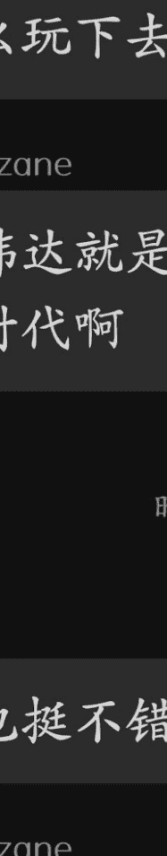

# 观海

下周准跌节奏；冲高回落趋势。
预计热点在 25 号，29 号触底

# Steven

明天要狠狠地抄底

# 黄炜

还是观大牛

# 春暖花开的日子

明天砸到 3731💥

# 观海

震荡反弹，下午冲高回落。考虑到立有一个反弹出现。

# 强磊

3650

# Steven

太强了==

# 观海:

# 令狐净zane

被白酒哈的砸了

# 水滴石穿

跌得越低就能买？那不是扯韭吗，形态加上放量，都不对了，那不是赌博。

# 丁

想买的ETF怎么不跌呢😂

# 观海

参考点3727点，不一定拿到

# 观海

这里是10年顶部，看看能否止跌

@发财 不买还好意思在群里😂
昨天 17:23

@Steven 你这反应还是话自己

@发财 这是刚预测到啊
昨天 17:45

@琉海 在人库买英美无北京时间 16:30 收涨了1.8点，涨一昨日日收涨价237点

@琉海 今天盘面很简单：内机构热线继续要买，大赛青继续热抢热门门，户线不挑捡的路，外线热线去买某些股票的有些贵了

@令磊zane 外完天明天还涨脸

@锦涛 @琉海 👏👏👍👍

@和美美 天，明天可能还有点机会
琉海: 今天盘面很简单：内机构热线继续要买，大赛青继续热抢热门门，户线...

@阿里 下午涨，没来得买股票，空了一分钟空

@阿里 今天CPO，空饼，很狂好
昨天 17:56

@令磊zane 预测明天跌你明天买了😂😂

@发财 明天有缘绿就明天买涨

@和美美 思

@和美美 主要看明天天线面如何走

@阿里 科创TF 真猛
昨天 18:03

@令磊zane 你看我昨晚晚上说今天继续加加油。你不信我。😂😂
昨天 18:08

@阿里 没有，仓位在涨和跌了。我今天今天说了你的中总磊@令磊zane

@令磊zane 你看我昨晚晚上说今天继续加加油。你不信我。😂😂

@我和和美我😂😂

@阿里 下午创是亮点

@和美美 我就是想蓝盘卖，开开了，不是跌方便😂😂

现在的寒王不是靠估值上去的，靠寒王ETF一笔买上去的。几乎和科技相关的都有它。

含时候ETF涨不动了，寒王就出来了

现在的AI方向不火了，今年市值新增AI芯片二倍增长减少对英伟达的依赖，所以芯片行业开始爆发，终结了牛芯片溃潮的英伟达大涨。

看来还有好玩

反正CPO概念还能反涨，单子都生不出来

新易暴脚了7倍还在在涨

“蜜”回了一条消息

某近期出清公告显示半导体板块分化风险，市场监管局规范芯片秩序“市场竞争规范”可能控制材料过度炒作。怕还是出清公告已经是迟了，而不是任何时候都会涨，强涨，当然任何时候都会结束终结，只是底部谁不会相信自己是接盘最后一样的韭菜，有些东西要你信就就信，要不信就信不信就买了。

今天晚上的消息偏空

9月还得抄底

就是抄作业，美国也就七条涨，别的不涨，这么下去，还要高涨，英伟达就是抄涨，那也挺不错，9月继续玩，现在的AI方向不火了，今年市值新增AI芯片二倍增长减少对英伟达的依赖，所以芯片行业开始爆发，终结了牛芯片溃潮的英伟达大涨。

今天买了紫光明天有肉，大盘预测的，龙头领先大盘见底，晚上大盘见顶，深科技有肉不明

# 26个国家参加俄乌战斗分别是俄罗斯、印度、土耳其、老挝、马来西亚、蒙古、巴基斯坦、尼加尔亚、阿尔利亚、哈萨克斯坦、乌兹基斯坦、白

没有傻朋友，来份邻穷戚，地主富豪也不来了，阿汗斯坦和阿米尼亚

现场：来份邻穷戚，地主富豪也不来了，阿汗斯坦和阿米尼亚不错，共同对俄罗斯朝近十年没来了，好像60多年，主宰是曾来了，越越南在中国搞圈，全国版A股聚焦卫星导航领域中高增长盘点（附名单）

- 第10名：卫星导航：某企业致力于全球市场，天空一体化的卫星服务。业绩增长：2025年航母卫利润增长3%。
- 第9名：卫星导航：华星通信等类技术研发。
- 第8名：卫星导航：多个客户北斗和北斗系统。业绩增长：2025年航母卫利润增长1%。
- 第7名：卫星导航：某公司双频锁天线组件。业绩增长：2025年航母卫利润增长1%。
- 第6局：空天一体化网络架构研究。
- 第5名：卫星导航：某公司双频锁天线组件，构建北A到全球技术标准，并与多家企业合作。业绩增长：2025年航母卫利润增长6.4%。
- 第4名：赛电子，卫星导航产品某客户订单并实现小规模生产。业绩增长：2025年航母卫利润增长12.5%。
- 第3名：高频微波材料攻克难题，技术提供基础支撑。

# 股市行情推演.docx 26...袋，你缺妹😂

发财 排队问哈

现海 群众公告 股市行情推演.docx 26日可关注中线走势中的上轨3910点和下轨24-78的底线3918的位置，这两个点都是重要支撑位，预计会在回调。

27号：回调趋势；但注意3874点，如果站上，继续上线；如果未站上，继续回调。

28号：下午反弹。考虑到昨天跌幅过大，日内应该有一个反弹出现。

29号：考虑到昨天底部急涨，今天上午会有回调出现，下午反弹。如果上午不出回调，回调会在下午出现。

sophie77 😊

Tiffany🙏 GO GO🐴 阴跌的主力会把回调在下午吧😂

现海 寒武纪存在一个隐藏的风险点，即使美禁对中国中高端芯片不会解除，英伟达会不会推出高性能的AI芯片，可能只有原版本的80%左右，都可能会对巨头产生影响。不过，芯片国产化仍在稳步推进，这个趋势是不会改变的。按照寒武近年50~70亿营收，确实支撑了6600亿元的市值。

@Tiffany🙏 GO GO🐴 也可能是11点开始，正好昨天割肉的没往进来了

> “自得”回了一条消息，再套一套

> “阿里”回了一条消息

自得 北京已经凉快了，夏天结束了。早晨起来凉飕的，有一半的人穿长袖了，主要是老人。24度。

阿里 👍是的的自得 引用内容已回回

自得 陈磊锋jane 机构是按照寒武纪拿到的订单定价的，预计明年寒武纪就有150亿左右利润了

现海 昨天大涨的点位好于弱势的位置，可以可能的，这个位置并不是一个安全的点，明天

昨天大盘收的点刚好处于强弱临界的位置，可上可下，这个位置并不是一个安全的买点，今天又不敢买了😅

又开始紧张了

寒武纪股价并不取决于利润大小，而是中美贸易谈判的结果，如果谈判结果允许英伟达高端芯片进入中国，寒王直接称臣***

寒武纪股价并不取决于利润大小，是中美贸易博弈的结果，如果谈判结果允许英伟达高端芯片进入中国，寒王直接称朕臣

# 令狐帅zane 我觉得不会。应该没这么傻😅😅

# 令狐帅zane 等到再说了，先把前面的钱赚了

# 和美美 9月日休吗

# 阿里 不休

# 令狐帅zane 这波行情核心就是寒王啊。寒王靠了

# 水滴石穿 寒武纪和科创暂时降温，也是国家希望的，准9月像规律预测的大盘在3800-3900之间，各板块异动，直到落地和政策出台。

@令狐帅zane 都行吧

# Steven 那肯定的

观海 周三管理调整了，如果失控，就会出现利空打压。如果今天拉，必然出利空

@阿里 今天转其他板块上涨。震荡中

# 观海 早上主力滑滑？上午冲高吸引进去，日内收割一批

我觉得好不容易出一个点，后面一定有一波涨上头

@令淼帅jane 等到就行

令淼帅jane 就算昨天也一半涨

观海 趋势从上升到下降需要踩脚，已经踩了脚了......

西西飞 👍学习大

@观海 天下应该龙队又来了

Steven 其实理解不了，周三拉压？

强强 哈哈哈哈，大妈已经在讨论

| 买卖五档 (手) | | |
|---|---|---|
| 5 | 0.748 | 2531 |
| 4 | 0.747 | 152 |
| 3 | 0.746 | 1623 |
| 2 | 0.745 | 1.5 |
| 1 | 0.744 | 181 |

# 观海 159637 新能源车龙头ETF 删

0.744 0.036 +5.08% 连连

CNY 深晶

# 观海 早上我好像加点。发财 创业板翻红了

云初 哪里，当升，云初 都是线线

令狐辩zane 看着都是支线

云初 都在大涨

云初 每天涨的，云初 都是跌前，所以风轮转，牛市向上的时候，最好不要换股，逢低补仓，现在只是指，如果继续猛冲，就会下“溃韭”了

观海 政策目前是降温，不可过热，每天太阳，会聚集大的风险，是管理层不愿意看到的大盘如果再次跌破3760就是确认见顶，现在见顶信号并没有出来

# 科创国家政策打压

苏醒 应该还会后面的主线

观海 敲打一下，

苏醒 确实太猛了，非要这么猛搞

观海 大盘下一个目标4080点，前提是今天收盘在3840点上方

观海 阅兵前不会出现利空的，国家就是希望平稳，不要闹蛾子

# 观海 早上我好像加点。

# 一袭小黄花 站3856了。下周是先涨后

Z Zoe 今天盘收应该没问题了

观海：只要求收在3856点以上，无线无

阿里 👍对

Zoe: 今天盘收应该没问题了

WIN ETF都红了

观海 工业蓝再次涨停，涨万亿，还有鬼武纪的千元A股

# 观海 早上我好像加点。

# 观海 早上我好像加点。

# 观海 早上我好像加点。

# 观海 早上我好像加点。

# 观海 早上我好像加点。

# 观海 早上我好像加点。

# 观海 早上我好像加点。

我觉得好不容易走出一个点，后面一定有一波涨上头

令淼帅jane 就算昨天也一半涨

观海 趋势从上升到下降需要踩脚，已经踩了脚了......

西西飞 👍学习大

@观海 天下应该龙队又来了

Steven 其实理解不了，周三拉压？

强强 哈哈哈哈，大妈已经在讨论

# 观海 早上我好像加点。

# 观海 早上我好像加点。

# 观海 早上我好像加点。

# 观海 早上我好像加点。

# 观海 早上我好像加点。

# 观海 早上我好像加点。

# 观海 早上我好像加点。

# 观海 早上我好像加点。

# 观海 早上我好像加点。

# 观海 早上我好像加点。

# 观海 早上我好像加点。

# 观海 早上我好像加点。

# 观海 早上翻红了

发财 创业板翻红了

云初 哪里，当升，云初 都是线线

令狐辩zane 看着都是支线

云初 都在大涨

云初 每天涨的，云初 都是跌前，所以风轮转，牛市向上的时候，最好不要换股，逢低补仓，现在只是指，如果继续猛冲，就会下“溃韭”了

观海 政策目前是降温，不可过热，每天太阳，会聚集大的风险，是管理层不愿意看到的大盘如果再次跌破3760就是确认见顶，现在见顶信号并没有出来
