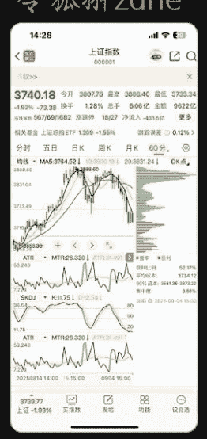

# 观海

## 最近市场调控，短线政策影响巨大

中国据考虑采取措施抑制投机行为寻求A股平发展

彭新社报道

【酷】——知情人士透露，中国金融管理部门正在采取一系列措施为股市的一些投机行为降温，8月以来1.2万亿美元的股票暴涨引发监管关注。

知情人士表示，因股市市场大波动可能会导致投资者遭受巨大损失，近几周监管层在考虑采取涨跌分类限制投机资金等选项，尚不确定这些措施是否会被采纳或实施，据信有消息，知情人士要求具名。

2015年中国股市急剧的暴涨让投资者已记忆，监管要求让股市稳健发展有助于重振经济和消费信心。与此同时，中国刚刚进行了几轮铁拳，政府越来越希望在重大活动后维持股市稳定。

证监会主任主席磊上个月在北京召开护会议时，传递要维持市场稳定的决定，他承诺将继续巩固市场向良好态势，强调价值长期投资、价值投资、理性投资管理。

金融管理部门已实现这一个目标，一位知情人士称，监管要求要严厉审查融资资金流入，为防止一些投资者利用消费贷款和网络借贷资金进行放杠。

### 证监会暂未落实

知情人士还透露，监管要求券商严密审查开展新账户的全天服务。据交易所数据，8月散户新开户较上同期同比增长166%。

另知情人士称，社交媒体平台也不得宣传相关内容，如牛市、融资余额新高以及存款户疯狂涌入股市，以避免助长股民狂热，他们任何违规和非法推荐股票的行为将受到严处罚。

络联系社报新闻人员：

微信信号:jnts8
免费进资料群
微信信号:jnts2

## 调整有一步到位之嫌……。。

股市行情推演.docx117.docx 37.2K

4号大盘：4号是个时间点，有可能变盘，预估早盘有所回调后反弹，午后震荡反弹

Alex：观大，可以加什么etf🤡
武鹏：要想奇发生只需深信不疑
观海：跌幅大的主线板块
观海：先当反弹做
观海：牛市里大跌不奇怪

牛市里大跌不奇怪

上一轮牛市是普涨，所以，可以一直拿着。这轮牛市是轮涨，恶炒板块就要出来，不能一直持仓。

阿里：刚套上一批，就想反弹解套。主力不会答应的。
观海：按照管理层的逻辑，收盘后会有安抚市场消息，毕竟是他他们出手压市场的，暴涨暴跌他们屁股都疼，坐不住的。。
自得：科创涨的太疯狂了
阿里：如果牛B明天破3700
观海：央行公开市场今日净回笼 2035亿元

## 央行公开市场今日净回笼 2035 亿元

## 进入9月，天天收水，8月是天天放水

## 明显是在调控市场

## 两市融资余额增加15.27 亿元，没看出融资踩踏逃命

观海：进入9月，天天收水，8月是天天放水
观海：明显是在调控市场 微信pep458
观海：两市融资余额增加15.27亿元，没看出融资踩踏逃命
观海：砸盘的主力就是国家队
令狐zane：关键在于把图不好
令狐zane：修复也得期
阿里：周到5周
观海：中线回调位：3730点、3700点、3674点，支撑

令狐zane：预计下午企稳
令狐zane：明天就涨。下周咋走
乐活：要是下午企稳了盘再杀
乐活：最好的走势
西西飞：不错
令狐zane：明天就涨。下周咋不知道
观海：这里没有意外，那么收盘再3760以上，都可以看，等收盘确认

## 惨不忍睹

股民巍：怎么看待股市？巍：类的“海公园”吧
这还是牛市吗
观海：牛市通常跌个月，这才跌就受不了
令狐zane：一共才3700，跌回可着急
老孙：一定要过，历史从世纪开始，一直如此
Alex：那空间看3500，时间看3-5周了
观海：“海公园”——市场

## 观海，今天还抄底吗

今狐zane：等收盘才知道
观海：抄不底，取决于仓位
今狐zane：就算不拉今天三也可以博明天反弹
今狐zane：减离场

观海：轻仓就博反弹，重仓的话，就要考虑减亏
轻仓就博反弹，重仓的话，就要考虑减亏
群里有融资的？群里有融资的多的肯定有
自有资金并不可怕，一闭眼，过一阵就回来了
是啊
观海：轻仓就博反弹，重仓的话，就要考虑减亏
估计好多杆的

观海：自有资金并不可怕，一闭眼，过一阵就回来了
Steven：是啊
观海：轻仓就博反弹，重仓的话，就要考虑减亏
佳伟：估计好多杆的零点不抄底想买不到
观海：我3500点就卸了杠杆，但大多数人都是高位去融资

观海：都是利润，放在里面，随便玩
晚上上抖音听听大v怎么说，牛还在不在
@陈丹：观大就是大V
大部分人低位却不敢买，导致自己仓位倒三角型，一旦下跌，损失惨微信rep458
我说的大v是反向指标
陶赵：@陈丹：观大就是大V
@观海：昨天减了三分二的仓位

令狐zane：9月10月一般都不是好日子
令狐zane：10月国庆大家都卖了换钱
和美美：恩
和美美：那就躺平吧
Steven：直接跌破20日线
观海：今天如果收盘价再3760之下，那么明天回踩继续一下。如果收在3760之上，则3885的回踩结束。等收盘确认
和美美：大概收在3760之下

观海：今天如果收盘价再3760之下，那么明天回踩继续一下。如果收在3760之上，则3885的回踩结束。等收盘确立
和美美：大概概率收在3760之下
观海：这里如果是中期顶部，就会去3500点，前几期群里说过的，3500是主力死守点位
岳麓：创业板跌5%

## 知识星球TOP

添加微信 付费资源分享群免费入群
微信: jntsg2

| 序号 | 公号/星球/社群 | 原价 | 领域 |
|---|---|---|---|
| 1 | 生业有木 | 2765/年 | 副业、搞钱 |
| 2 | 容众众吃瓜群 | 365/年 | 时政、历史 |
| 3 | 记忆承载/碧树西风 | 365元/年 | |
| 4 | 欧洲金 | 328/年 | |
| 5 | 卢克文青会 | 699/年 | 成长、搞钱 |
| 6 | 体内主任 | 599/年 | 体制、职场 |
| 7 | 外人的视界 | 669/年 | 金融、时政 |
| 8 | 濑译异谈 | 4166/年 | 财富、成长 |
| 9 | 守夜人总 |599/年 | 时政、经济 |
| 10 | 江宁知府 | 365/篇 | 时政、国际 |
| 11 | 政堂/顾子明 | 568/年 | 时政、经济 |
| 12 | 唐书院 | 1399/篇 | 金融、财富 |
| 13 | 大树乡谈 | 199/年 | 时政、成长 |
| 14 | 水库欧大 | 10000远 | 房产、经济 |
| 15 | 洪灏的宏观策略 | 4376/年 | 经济、搞钱 |
| 16 | 金政通鉴/北海道南山 | 4576/年 | 股票、行研 |
| 17 | 猫留的世界 | 299/年 | 时政、社会 |
| 18 | 飞沫 | 3600/年 | 股市、经济 |
| 19 | 米联储见闻 | 599/年 | 经济、金融 |
| 20 | 鉴茶财经院 | 330/年 | 房产、股票 |
