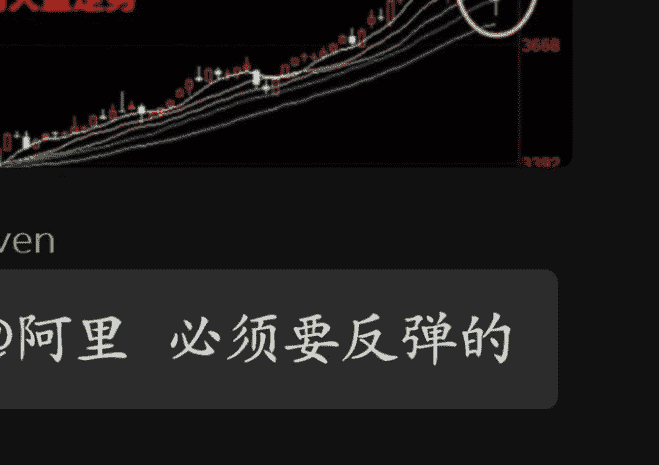
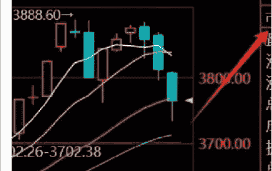

# 当到期1.5万亿，对冲而已。

本周已经回测8000亿了。

一天小贵花

# 明天可以下千芯片了吗

Steven:

和和美美

# 还能回来吗

观海：当到期1.5万亿，对冲而已。本周已经回测8000亿了。

# 不买不买

# 可以买消费旅游

# 今天都动了

下午2点22分，两部门突然发布重磅消息——《电子制造业2025-2026年稳增长行动方案》正式发布。方案明确提出：
- 鼓励人工智能终端创新应用
- 推进5G/6G关键器件、芯片、模块等技术攻关
- 集中优势资源，大力发展高科技，推动新质生产力
这无疑是未来产业的重要指标，对人工智能、半导体芯片、算力、消费电子等板块成长利好！

但令人疑惑的是——为什么消息一出，科技不反涨？核心原因在于：利好释放的时点，恰好上大科技处于深度调整周期。市场情绪较弱，资金更倾向于释放短期压力。利代表的是长期逻辑，而当面反应的是短期逻辑，两者之间出现了节奏错。所以，尽量大科技未能借利好扭转趋势，但请记住：下半年市场的机会，大概率将开启大科技！

没事别烦我啊，不好好友😉😉

昨天 21:07

# 阿里

刚看了看，明天的反弹强度真不好说，估计没那么强

昨天 21:51

# 现海



# 现海

熊熊大趋势

# Steven

@阿里 必须反弹的

昨天 21:54

# 阿里

上证线macd翻绿刚刚翻第二天。

# 阿里

上证线macd翻绿刚刚翻第二天。

# Steven

不可能反弹

# 阿里

看我刚才说的了吗？估计没那么强

昨天 22:17

# Hy

历史不会重复，但是总是相似的

现海:


昨天 22:24

# 北岭

最近一周会反弹，如果反弹后后再弹，摆说是3浪4完成，还有个3浪，上证有提到4000点 微信pep458

昨天 23:24

# 阿里


00:18

# 令醉zane


06:42

# 日月生

9月迎发热浪，全部124只新签，权益类近68%

07:28

# Steven

@令醉zane 这个图什么意思

08:39

# 现海

还有7万元产业大利太好了概念出击！

# 西浩飞

光伏？

# 现海

| 行业 | 证券 | 行业内排名 | 行业内份额 | 行业 | 行业份额 |
| --- | --- | --- | --- | --- | --- |
| 305079 | 医药 | 612.7 | -30.30 | 医药 | -30.30 |
| 305080 | 医药 | 612.7 | -30.30 | 医药 | -30.30 |
| 305096 | 电子 | 423.7 | -94.21 | 电子 | -94.21 |
| 025099 | 建筑 | 142.3 | -14.31 | 建筑 | -14.31 |
| 027001 | 机械 | 142.8 | -15.20 | 机械 | -15.20 |
| 306358 | 能源 | 50.8 | 4.5 | 能源 | 4.5 |
| 306359 | 传媒 | 121.5 | -18.56 | 传媒 | -18.56 |
| 002854 | 钢铁 | 80.4 | 35.1 | 钢铁 | 35.1 |
| 002858 | 农业 | 22.1 | 19.49 | 农业 | 19.49 |

观海
个股我研究的少，我基本都是etf，跟着大资金思路走

Alex
观大早，今天预测有吗，开盘加消费 ETF 吗🤡

观海
群公告
[File] 股市行情推演.docx117.docx
5号大盘:上午触复苏反弹，下午反弹震荡（附图）。
[Image]

了解更多

观海
预判大盘低点在21年的高点3731点附近，昨天最低到了3732点，昨天又是时间点，预判大盘已经见底了。

# 观海
预判大盘低点，在21年的高点3731点附近，昨天最低到了3732点，昨天又是时间点，预判大盘已经见底了。

# 日月生
抱团固态电池
09:44

# 鲲鸥
还没有找到新主线逻辑前乌合之众起不起来，只能震荡

# 和和美美
大盘震荡，个股废了

# 和和美美
又开始跌跌不休

# 观
如果等上证跌，科创和创业板就吃不上热的了

如果等上证止跌，科创和创业板就吃不上热的了进了科创创新药ETF

观大，那科创和创业板ETF该出了就出了？

观海：如果等上证止跌，科创和创业板就吃不上热的了。参考今天画的走势图。本周是政策强行打压，国家队又控盘，只能按照国家意志下跌了。

观海
上周停止基金申购就暴露出苗头了。

鲲鹏
这个成交量有意思，全体套牢

观海
从彭博社报道来看，各种打压股市的措施已经摆在领导案头，等待领导签字

观海
从彭博社报道来看，各种打压股市的措施已经摆在领导案头，等待领导签字。

观海
所以，9月很难有新高了，一旦股市强行冲关，肯定利空出来。

# 观海

| | 代码 | | 名称 | 涨幅 |
|---|---|---|---|---|
| 52 | 515030 | 新能源车ETF | +4.98% |
| 53 | 159780 | 双创ETF | +2.33% |
| 54 | 159637 | 新创龙头 | +4.32% |
| 55 | 159949 | 创业板50 | +3.03% |
| 56 | 159681 | 创业50ETF | +2.92% |
| | 取消排序 | 最新 | 涨幅 | 跌 |
| | 多赢50 | 152407 | +9.99% | 1.38 |
| | 电池50ETF 159796 | +7.35% | 0.056 |
| | 科创电子 002121 | +6.68% | 0.49 |
| | 锂电池ETF 159840 | +5.91% | 0.40 |
| | 储能电池ETF 159566 | +1.87% | 0.92 |

太香了

观海
股市行情测.docx117.docx
5号大盘:上午랠反弹，下午反弹震荡（附图）。


# 观海
如果等上证止跌，科创和创业板就吃不上热了ETF

# 观海
预判大盘低点在21年的高点3731点附近，昨天最低到了3732点，昨天又是时间点，预判大盘已经见底了。

# 小强
观海
早晨提示，还不买创业板和科创就吃不到热的。专门写了昨天3732点见底啊。

鲲鹏


观海
还画了图，怎么理解呢？


# 创业板和科创就吃不上热了
观海
如果等上证止跌，科创和创业板就吃不上热了。

观海
“吃”不是“进”的意思吗？

Steven
感恩大，非常厉害了。

发财
震荡代表啥意思

发财
我感觉震荡起来，好魔性，上可可以，下可可以。

观海
震荡秋千的意思@发财

# 震荡时
震荡时都能新高
观海
小时候震荡过秋千吧？

发财
每次看到震荡两个字，特别注意操作。好难

观海
早盘这个说明，为什么在此见底了


令帅洋zane
火车转弯的时候，车向前了，车尾还在向后走这就是啥大盘还在俯冲创业板已经涨了一段

观海
一旦突破重阻力，回调就会重要支撑

观海
所以，3731点附近是底部。所以，3731点还是底部牛市里回调都是创业板和科创先见底。资金最明显的知道谁抢什么

1:42
上轮牛市，中途回调10%，这才3%就不上了。中期走势发过几次，一次突破上轨几乎见到观大的说的后面还会回脚，会在9月份吗。本周如果管理层主动打压，会有两次冲顶，但给坏了。突破上轨接5800点，中途几乎没阻力，管理层不允许他镰刀还没准备好就是大量发新股经济蹦涨到6000点，都跑路，管理层目的怎么达到他们在准备股票吗？每次目的都一样。股市就是“海德公园”，皇家的垃圾场。

观海
非常深刻，这是上海街头那个韭头发沈雷说的，一个疯子都能理解透的

```
今天看到一根数据
周线 时间范围：沪上日线 20230125 00:00:00
今天看到一根线，上周的3751点，韭头可能是收割资金的最后一次
-500点，跌5%，回撤概率82%
50-300点，跌12.5%，回撤概率75%
300-1000点，跌7%，回撤概率15%
1000点以上，跌5.5%，回撤概率3%
```

牛市里只有韭户亏

# 知识星球TOP
付费资源分享群

添加微信
# 免费入群

微信: jntsg2

| 序号 | 公号/星球/社群 | 原价 | 领域 |
| --- | --- | --- | --- |
| 1 | 生态有木 | 2765/年 | 副业、搞钱 |
| 2 | 怂众众吃瓜群 | 365/年 | 时政、历史 |
| 3 | 记忆载/碧树西风 | 365元/年 | 成长、搞钱 |
| 4 | 欧洲金靴 | 328元/年 | 时政、历史 |
| 5 | 卢克文青友会 | 699/年 | 时政、社会 |
| 6 | 体内主任 | 599/年 | 体制、职场 |
| 7 | 外局人的视角 | 669/年 | 金融、时政 |
| 8 | 灏泽异谈 | 4166/年 | 财富、成长 |
| 9 | 守总司令 | 599/年 | 时政、经济 |
| 10 | 江宁知府 | 365/篇 | 时政、国际 |
| 11 | 政堂/顾子明 | 568/年 | 时政、经济 |
| 12 | 唐书院 | 1399/篇 | 金融、财富 |
| 13 | 大树乡谈 | 199/年 | 时政、成长 |
| 14 | 水库欧大 | 1000远 | 房产、经济 |
| 15 | 洪灏的宏观策略 | 4376/年 | 经济、搞钱 |
| 16 | 金政通鉴/北海道南山 | 4576/年 | 股票、行研 |
| 17 | 猫留的世界 | 299/年 | 时政、社会 |
| 18 | 飞沫云 | 3600/年 | 股市、经济 |
| 19 | 米联债见闻 | 599/年 | 经济、金融 |
| 20 | 鉴茶财经院 | 330/年 | 房产、股票 |
| 21 | 赢在八小时之外 | 365元/年 | 成长、职场 |
