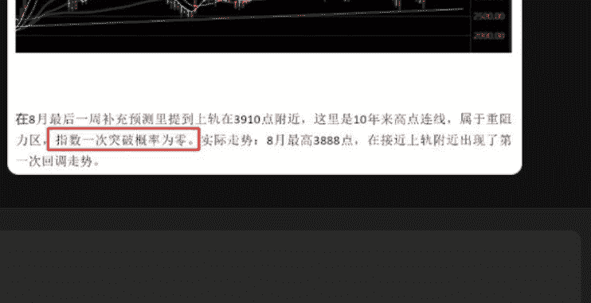

# 观海
牛市里只有散户亏钱

观海
1800点涨到6000点，牛市结束，平均亏32%

观海
类似现在，跌跑了，过几天大涨，又追进去，再过几天又有大跌，又跑了。。

北瑜
二次冲顶要到下周了吧。

岳麓了吧
北瑜：二次冲顶要到下周了吧。

周一可能还要冲一段，我感觉8号左右吧。具体看下周观大的预测。

# 观海103(163)

丁
> 科创变成牛夫人了嘛🤦

观海
> 又3800了吧，牛市转杀那些追涨杀跌的

朱明明广发银行
sophie77
> 给观海的红包恭喜发财，大吉大利 微信红包 sophie77

令狐捍zane
> 昨天尾盘买妥妥的

观海
> 记住这个数据，你提前个座位

观海
今天看到一组很火的数据
观海对股市的粉丝 观海五行策略 2025年09月01日 20:20

今天这一组数据，上一个2015年大牛市，平均收益率。统计了不同资金规模的投资者：
- 0-50万元：占比5%，平均收益率32%；
- 50-300万元：占比12.5%，资金基本持平；
- 300-1000万元：占比2%，平均收益率15%；
- 1000万元以上：占比0.5%，平均收益率33%。

# Steven
观海
大资金进出少，所以最终是挣钱的

# Steven
给观海的红包恭喜发财，大吉大利

# Steven
@观海 感谢观大👍👍👍

# Steven
很厉害

# 朱明明广发银行
感谢观大给信心

# Alex
还是买etf

# 小强
牛通

# 观海
把主线抛了的，估计很多人很难追回来了

# 观海
| 代码 | 名称 | 涨涨幅 |
| :--- | :--- | :--- |
| 515880 | 通信ETF | +5 |
| 515050 | 5G通信ETF | +5 |
| 159994 | 5GETF | |

# 今涵zane
昨天买了电池ETF，早盘冲高卖了换别的ETF。少赚颇多😁😁😁了摸成的别的ETF。少赚挺🤩🤩🤩

今缘兼zane
# 人工智能跑不过电池ETF

Alex
昨天买了一半etf，一半个股，个股在睡觉，etf在蹦迪

# 观海
# 创业板指
观海
399006 创业板指 加自选
2926.26 15001 +5.40%
市场成交总额:18494亿 上涨跌时:-2246亿
最新 2926.26 开盘 2789.91
跌幅 150.01 最高 2926.26 涨幅 +5.40% 最低 2775.17

自得
竟然涨了2只etf，宁德时代成分的，都涨了。谢谢@观海
> 👋撤回了一条消息

Alex
观大，这波反弹可以看到多少

Alex
昨天观大判断3760时，买满了，谢感谢观大

bruce
向观海转账已被接收
观海
来自bruce的转账已收款

观海
反复冲击上轨@Alex
观海

Alex
> 谢谢观大，有可能试探3888吗 😉😉

观海：反复冲击上轨@Alex
Alex
> 想上券商etf

小强
> 我昨天吓坏了，一毛没买

令狐兽zane
> 前天我就说周四盘日 周五普涨日😎😎

观海
> 本周政策打压，下跌难免，但政策目的是慢牛，所以就可以继续干

"小强"撤回了一条消息
令狐兽zane
> 最后这波拉升很多大V出来基本是保险机构的钱

# 知识星球TOP
付费资源分享群

添加微信免费入群
微信：jntsg2

| 序号 | 公号/星球/社群 | 原价 | 领域 |
| :--- | :--- | :--- | :--- |
| 1 | 生态有木 | 2765/年 | 副业、搞钱 |
| 2 | 怂容从吃瓜群 | 365/年 | 时政、历史 |
| 3 | 记忆承载/碧树西风 | 365元/年 | 成长、搞钱 |
| 4 | 欧洲金靴 | 328元/年 | 时政、历史 |
| 5 | 卢克文青会 | 699/年 | 时政、社会 |
| 6 | 体制内主任 | 599/年 | 体制、职 |
| 7 | 外人的视界 | 669元/年 | 金融、时政 |
| 8 | 濑泽异谈 | 4166/年 | 财富、成长 |
| 9 | 守护人总令 | 599/年 | 时政、经济 |
| 10 | 江宁知府 | 365/篇 | 时政、国际 |
| 11 | 政堂/顾子明 | 568/年 | 时政、经济 |
| 12 | 唐书院 | 1399/篇 | 金融、财富 |
| 13 | 大树乡谈 | 199/年 | 时政、成长 |
| 14 | 水库欧大 | 10000元 | 房产、经济 |
| 15 | 洪灏的宏观策略 | 4376/年 | 经济、搞钱 |
| 16 | 金政通鉴/北海道南山 | 4576/年 | 股票、行研 |
| 17 | 猫留的世界 | 299/年 | 时政、社会 |
| 18 | 飞沫 | 3600/年 | 股市、经济 |
| 19 | 米联储见闻 | 599/年 | 经济、金融 |
| 20 | 鉴茶财经院 | 330/年 | 房产、股票 |
| 21 | 赢在八小时之外 | 365元/年 | 成长、职场 |
