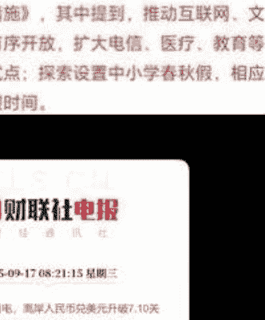
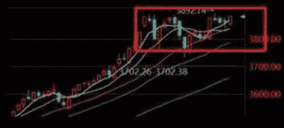

# 美国8月零售销售率预期

特朗普政府将就法庭对美联储储克的裁决提出上诉

美国商务部考虑对更多汽车零部件加关税

特朗普与普京通话，寻求缓解关税与俄油分歧

内塔尼亚亚本月底将再访白宫

商务部等9部门发布《关于扩大服务消费的若干政策措施》

我国成功发射互联网技术卫星

- 2、商务部等9部门发布《关于扩大服务消费的若干政策措施》，其中提到，推动互联网、文化等领域有序开放，扩大电信、医疗、教育等领域开放试点：探索设置中小春秋假，相应缩短寒假时间。

15号大盘：上午震荡反弹，午盘后震荡有所回调。本周高点可能在周三，注意风险。

16号大盘：上行还有阻力，盘中有一波上行走势。如果上午提前冲高，下午就会出现调整；如果上午提前调整，那么这个上行走势就会发生在下午。

17号大盘：上午反弹震荡，下午调整震荡。近期沪指以3850点为中枢，上下30个点进行波动，3900点是过去十年的重力区，短期内很难突破。

大盘跌节后，冲高见回落的趋势。

“时间点”预判，下周底部在 15 或 16 号：如果按照中美贸易谈判判别出

看来，高点是在 17 号，如果提前前一天出来会谈结果，高点就在 16。

微信 pep458

南三前盯妥大盘建议：

观望为宜，不可加仓

如果现在震荡修整，年底前还能起一波拉到4200；如果现在急于上拉，4000点估计就会引发大的调整。

现在是：之前涨幅大的票，停下来修整；等待那些没涨或涨幅小的低价股涨一涨。

明早凌晨2点公布美联储降息，如果降0.25，利好已经提前消化；如果降0.5属于超预期，如果不降，属于大利空。

外媒预测0.5的概率不到5%，真按0.5来，美股会不会交易衰退预期呀？

中美元首通话通话，估计会在电话里邀请特朗普10月访华；如果电话临时取消，属于大利空。

这些都属于我们散户不能提前知道的信息，所以，持股观望为宜。

外媒还报道，李强总理亲自出席联合国大会，游说特朗普访华。

中美友好关系对我们很重要。

# 对比上次牛市，大盘在这个位置做个中枢

中华民族传统美德，懂得成人之美

【猜寻】：不是普子自己很想来？怎么成了我们强烈邀请？😳

大盘下午冲高回落。

# 知识星球TOP

添加微信
资源分享群
免费入群

微信:top26868

| 序号 | 公号/星球/社群 | 原价 | 领域 |
| --- | --- | --- | --- |
| 1 | 生财有木 | 2765/年 | 同业，搞钱 |
| 2 | 众宗众吃瓜群 | 365/年 | 时政，历史 |
| 3 | 记忆亥/逸树风 | 365/年 | 成长 |
| 4 | 欧洲金轨 | 328/年 | 时政，历史 |
| 5 | 卢克文青云会 | 699/年 | 时政，社会 |
| 6 | 体制内主任 | 599/年 | 体制，职场 |
| 7 | 局外人的视界 | 669/年 | 金融，时政 |
| 8 | 溯泽异迁 | 4166/年 | 财富，成长 |
| 9 | 守夜人总司令 | 599/年 | 时政，经济 |
| 10 | 江宁知府 | 365/年 | 时政，国际 |
| 11 | 政堂/顾子明 | 568/年 | 时政，经济 |
| 12 | 唐书 | 1399/年 | 金融，财富 |
| 13 | 大树乡村谈 | 199/年 | 时政，成长 |
| 14 | 水库联大 | 10000/年 | 房产，经济 |
| 15 | 洪灏宏观策略 | 4376/年 | 经济，搞钱 |
| 16 | 金政通鉴/北海南山 | 4576/年 | 股票，行研 |
| 17 | 猫哥的世界 | 299/年 | 时政，社会 |
| 18 | 飞龙沃 | 3600/年 | 股市，经济 |
| 19 | 米联诸见闻 | 599/年 | 经济，金融 |
| 20 | 茶茶财经 | 330/年 | 房产，股票 |
| 21 | 赢在八小时之外 | 365/年 | 成长，职场 |

...... 更多资源，不再列举

+ 图书、报告、课程等高价值资源

★ 免费群 每日分享优质资源

★ VIP群 每日分享所有资源（日均20+），75/年

赠送付费资源合集，市场价数万元
