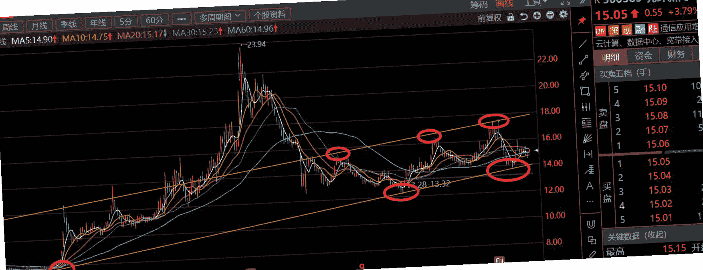
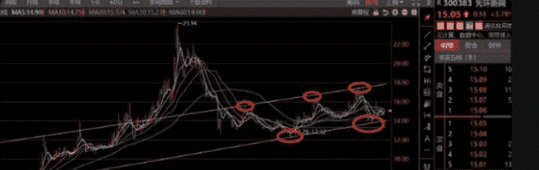
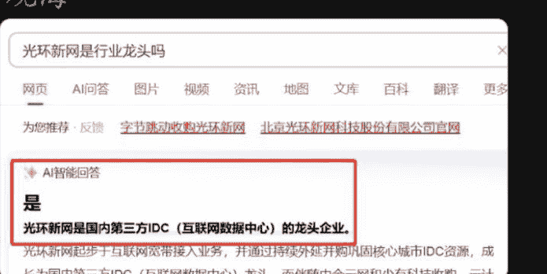

# 观海

欧盟委员会通过第19项对制裁方案，原油价格上限降至每桶47.6美元

美媒：特朗普周二将与阿拉伯国家领导会晤，商讨加沙停火

特朗普与马斯克被曝在一场活动上进行了简短交流并握手

据CNBC：伯克希尔哈撒韦已清仓比亚迪股份

# 观海

47美元估计不够开采费用的

09:15

# 观海

本周上半周的A股将先反弹，将给高位股一次的逃命机会，到了下半周，小心高位股暴力回调

前两期群里提到过此票，群友还说持有此票，当时点评此票是因为竞标申被制裁大跌，但此票质地是非常不错的。

## 观海106(179)

前期靠群里提到过此票，群友还说持有此票，当时点评此票是因为竞标失败被制裁大跌，但此票质地是非常不错的。

#08011 四川九州
78 1.23 +7.91% 连线

攀登者 德明利准也提过

只要是龙头，不涨是时间不到，总是要涨的

核心顶级供应商，国内领先的智能网终端、微波频三大领域，其内部

走思雅洛泽 @攀登者 也是观太大的提

@攀登者 群里说过的，当时截图就是这三个，排名前前三

| 股票 | 名称 | 涨幅 |
| :--- | :--- | :--- |
| 融通 | 昆股份 | +0.60% |
| 融通 | 德明利 | +10.00% |
| 融通 | 兆力创新 | +4.21% |

走思雅洛泽 @观海 什么时候可以入手

攀登者 现在不管管入手了

此票是世界级的，多次提到过的，只要遇到龙板行情，比如4月那种大跌，就是给机会

R601138 工业富联 68.86 2.76 +4.18% 连线选价

攀登者 四川九州可以

观海 只要细分板块的细分龙头，没戏看，早晚要表现

攀登者 找回了一条消息，低位好吗，补一点

走思雅洛泽 @观海 同问

观海 只要跌到区间下方向上

Photogenic 说的哪票是四川九州

观海 此票是世界级的，多次提到过，只要遇到极端行情，比4月那种大跌，就是机会

小姐 好多拿着性子没有了，还在黎明

观海：本上半周的A股将先反弹，将给高位股一次的逃命机会，到了下半周，小心高位股暴力回调

观海：只要涨了，就要减，你看跌的

花王 我以为能够破局到420左右

观海：只要涨了，就要减，你看跌的

听雨 英文快停了，需要减

观海 @妮娃娃 观海 回访向上

观海：只要涨了，就要减，你看跌的

花王 只要涨了，就要减，你看跌的

观海：只要涨了，就要减，你看跌的

观海 25日，26号回调，可以再次询问

攀登者 现在可以加了

## 观海106(179)

观海 @妮娃娃 观海 底线:150

强涨后：高回调趋势。22探底；23上涨；24下跌；25下跌；26探底回升，底部再次回调

如此看来，这周不宜加仓，还要周中减

攀登者 现在可以了

听雨 22,23，适当减仓

妮娃娃 谢谢观大

3800就是低了，等明天会不会出现大阳线再说

一丹青 不破3800没事吧

观海 大大，您用的是什么AI软件呀？就是AI选股软件，能不能推荐一下？我是玩股票的新手，要是AI搜索都是的，比如面上的快捷软件

指数发疯，少则调整月，多者按年算，这种走势上面不愿意看到

宁愿慢牛

走出思维泽 @观海 光环上涨，现在可以买么

观海 刚提了票，现在涨幅5%了，不会群里有人买吧？

我买了

大林 观海说的时候此票也是个细分龙头，此波算力大涨，这票不涨，不知内部出了问题

丁 我周五卖了

问别人不如问AI，回答比专家都靠谱

走出思维泽 @观海 观大，中科曙光属于龙头发么

## 观海106(179)

| 序号 | 股票 | 涨幅 | 价格 |
| :--- | :--- | :--- | :--- |
| 观海-PO将于9月26日上会【热议】 | +5.38% | 15.28 | 683 |
| 5 | | 15.28 | 2371 |
| 4 | | 15.26 | 532 |
| 3 | | 15.25 | 157 |

大林 估计没涨停

日月生 芯片主要是存储和消费类领涨

观海 这3个股，我也是用的AI选的，这种选股的人多了，自然就涨了。

| 股票 | 名称 | 涨幅 |
| :--- | :--- | :--- |
| 688416 融 恒骄股份 | +1% |
| 001309 融 德明利 | +10% |
| 603986 融 龙易创新 | +5% |

观海 这种就是A股里的稀缺资源

| 股票 | 名称 | 涨幅 | 价格 |
| :--- | :--- | :--- | :--- |
| 601138 工业富联 删自选 | +7.67% | 71.17 (5.07连续竞价) |
| 中沪 融 消费电子零部件和组装 | +2.66% | |
| 球领先的云计算和通信网络设备制造商，AI... | | |

观海 这才是真科技，在世界的排名。科技板块，要优选进行龙头，其他企业基本做不大的。

科技板块，要优选进行龙头，其他企业基本做不大的。

## 观海106(179)

市场没有主题，快速轮动，就会被。

mojin：你们又是韭菜，不知道自己已经了，要除。。使用的人太多了。

几个月前就开始关注了

马头优先选择核心概念，如导体、AI科技、机器人相关的

腾讯和阿里，你可以买三单

龙马精神是积极向上的，符合时代要求的，羊是弱的，任人割的。

一青：我准备关注单票

羊不会被抄的笨蛋国东没啥抄的票

明年是马年，周末炒是不变吗？

现海：科技股要优选国产控

# # 知识星球

添加微信免费入群 微信:top2868

| 序号 | 公号/星球/社群 | 原价 | 领域 |
| :--- | :--- | :--- | :--- |
| 1 | 生财有木 | 2765/年 | 副业，搞钱 |
| 2 | 众宗吃瓜群 | 365/年 | 时政、历史 |
| 3 | 记忆巷/裁树西风 | 365/年 | 成长 |
| 4 | 欧洲金轨 | 328/年 | 时政、历史 |
| 5 | 卢克文云会 | 699/年 | 时政、社会 |
| 6 | 体内主任 | 599/年 | 体制、职场 |
| 7 | 局外人的视界 | 669/年 | 金融、时政 |
| 8 | 溯泽异昂 | 4166/年 | 财富、成长 |
| 9 | 宁夜人总司令 | 599/年 | 时政、经济 |
| 10 | 江宁知府 | 365/年 | 时政、国际 |
| 11 | 政事堂/顾子明 | 568/年 | 时政、经济 |
| 12 | 唐书院 | 1399/年 | 金融、财富 |
| 13 | 大树乡村谈 | 199/年 | 时政、成长 |
| 14 | 水库联大 | 10000元 | 房产、经济 |
| 15 | 洪灏宏观策略 | 4376/年 | 经济、搞钱 |
| 16 | 金企通鉴/北海南山 | 4576/年 | 股票、行研 |
| 17 | 猫哥的世界 | 299/年 | 时政、社会 |
| 18 | 飞浅龙 | 3600/年 | 股市、经济 |
| 19 | 米来联债 | 599/年 | 经济、金融 |
| 20 | 茶茶财经院 | 330/年 | 房产、股票 |
