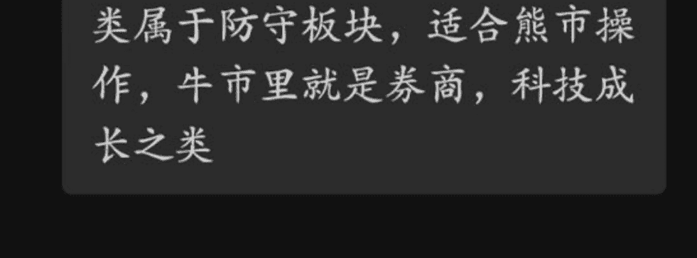
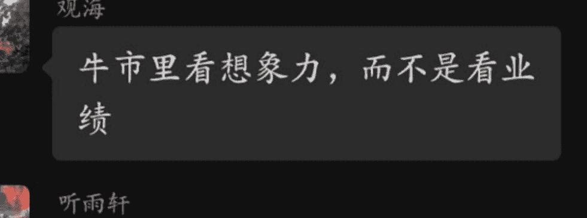
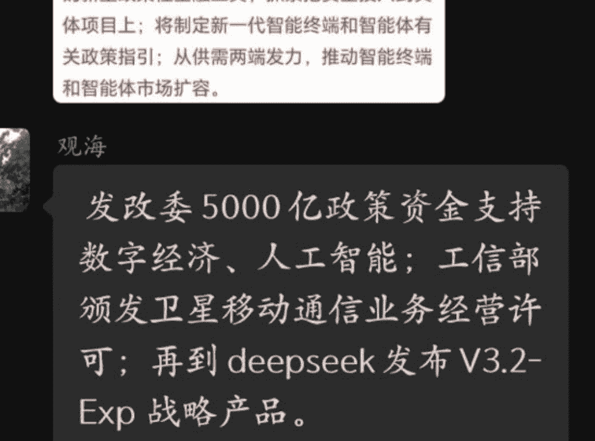
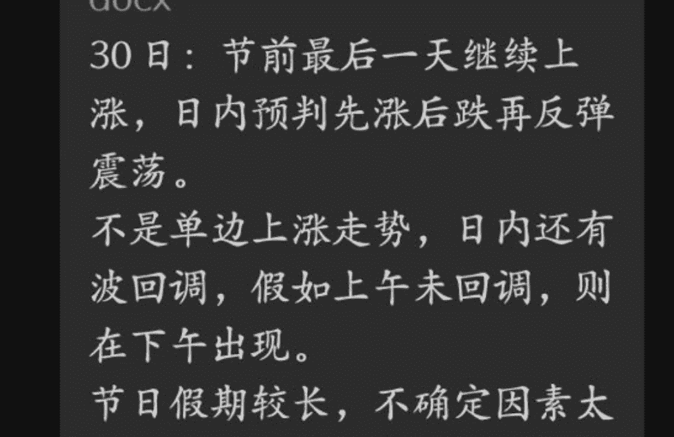

# 观海
牛市不空仓，这是实践得出的教训除了科技线，十五五主要在两个方向：一是反内卷，二是内需消费！在A股必然也会反应的。

中国神话、银行、长江电力之类属于防守板块，适合熊市操作，牛市里就是券商、科技成长之类。

# 走出思维沼泽
收到

观海：中国神话从2020年到今年涨了10倍，新进来资金没人愿意去拍轿桥的。
观海：牛市里看想象力，而不是看业绩。
听雨轩：👍👍
观海：科技股今年亏损，明年可能高盈利，主力可以画饼给人美好美好幻想。

# 听后斥
做自己熟悉和了解的领域。

# 听后斥
市场的主力于5月2日收盘，维持强势。后，市场活跃有望反弹。金色金属将迎来暴涨，苏近期暴涨等，关注金色金属的后市的行情可以回归。

# 现诡
中国神话、银行、长江电力等属于处于防守状态，适合熊市操作，牛市里就是避风港、科技成长之类。

# 走出隐落浮
收到

# 现诡
中国神话从2020年至今涨了10倍，新进来资金人气愿意去拍股的。

# 现诡
市里看看想象力，而不是看业绩。

# 听后斥
科技今年亏损，明年可能高盈利，主力可以画饼给人美好设想。

# 可哥
需要集筹做决策时可以关注行业运行。近期工作将获得部门支持绩效，胜负也不受波动。特别关注大盘的成交量，如果成交放大将是机会。已经到位，后可以布局。政策面对该行业有利好，特别是制定了一了一系列限制性政策后，行业有望迎来大反转。

政策利好：新能源将迎来结构性行情机会，500亿基金将有望重点布局，中国基金将新能源及相关受益板块智能市场。

# 现诡
发改后500亿政策基金支持数字经济、人工智能；工信部将发放移动通信业务经营权；再看到DeepSeek发布V3的战略机会。

跟着国家政策炒股，国家大涨。英伟达是AI的代表，特斯拉是机器人的代表，美光则为储备芯片的代表，差不多大A全是跟美股这边的涨，盯看美股涨也可。

# 走出隐落浮
A股对应的标的有些。

# 现诡
群公告
[File]股市行情推演.docx
121.
30日：
节前最后一天继续上涨，日内预测先后涨后再反弹震荡。
不是单边涨，日内会有回调，假如上午未回，则在下午收回。
节日前涨较长，不一定，因素太多，要不要持股节过自己决定。从预测来看，看到节后最后一天看到有下跌异。

了解更多 更多*

[File]股市行情推演.docx121.
30日：
节前最后一天继续上涨，日内预测先后涨后再反弹震荡。
不是单边涨，日内会有回调，假如上午未回，则在下午收回。
节日前涨较长，不一定，因素太多，要不要持股节过自己决定。从预测来看，看到节后最后一天看到有下跌异。

# 走出隐落浮
收到

# 现诡
中国神话从2020年至今涨了10倍，新进来资金人气愿意去拍股的。

# 现诡
市里看看想象力，而不是看业绩。

# 听后斥
科技今年亏损，明年可能高盈利，主力可以画饼给人美好设想。

# 可哥
需要集筹做决策时可以关注行业运行。近期工作将获得部门支持绩效，胜负也不受波动。特别关注大盘的成交量，如果成交放大将是机会。已经到位，后可以布局。政策面对该行业有利好，特别是制定了一了一系列限制性政策后，行业有望迎来大反转。

政策利好：新能源将迎来结构性行情机会，500亿基金将有望重点布局，中国基金将新能源及相关受益板块智能市场。

# 现诡
发改后500亿政策基金支持数字经济、人工智能；工信部将发放移动通信业务经营权；再看到DeepSeek发布V3的战略机会。

跟着国家政策炒股，国家大涨。英伟达是AI的代表，特斯拉是机器人的代表，美光则为储备芯片的代表，差不多大A全是跟美股这边的涨，盯看美股涨也可。

# 走出隐落浮
A股对应的标的有些。

# 现诡
群公告
[File]股市行情推演.docx
121.
30日：
节前最后一天继续上涨，日内预测先后涨后再反弹震荡。
不是单边涨，日内会有回调，假如上午未回，则在下午收回。
节日前涨较长，不一定，因素太多，要不要持股节过自己决定。从预测来看，看到节后最后一天看到有下跌异。

了解更多 更多*

[PAGE 5]
# 走出隐落浮
收到

# 现诡
中国神话从2020年至今涨了10倍，新进来资金人气愿意去拍股的。

# 现诡
市里看看想象力，而不是看业绩。

# 听后斥
科技今年亏损，明年可能高盈利，主力可以画饼给人美好设想。

# 可哥
需要集筹做决策时可以关注行业运行。近期工作将获得部门支持绩效，胜负也不受波动。特别关注大盘的成交量，如果成交放大将是机会。已经到位，后可以布局。政策面对该行业有利好，特别是制定了一了一系列限制性政策后，行业有望迎来大反转。

政策利好：新能源将迎来结构性行情机会，500亿基金将有望重点布局，中国基金将新能源及相关受益板块智能市场。

# 现诡
发改后500亿政策基金支持数字经济、人工智能；工信部将发放移动通信业务经营权；再看到DeepSeek发布V3的战略机会。

跟着国家政策炒股，国家大涨。英伟达是AI的代表，特斯拉是机器人的代表，美光则为储备芯片的代表，差不多大A全是跟美股这边的涨，盯看美股涨也可。

# 走出隐落浮
A股对应的标的有些。

# 现诡
群公告
[File]股市行情推演.docx
121.
30日：
节前最后一天继续上涨，日内预测先后涨后再反弹震荡。
不是单边涨，日内会有回调，假如上午未回，则在下午收回。
节日前涨较长，不一定，因素太多，要不要持股节过自己决定。从预测来看，看到节后最后一天看到有下跌异。

了解更多 更多*

[PAGE 5]
# 走出隐落浮
收到

# 现诡
中国神话从2020年至今涨了10倍，新进来资金人气愿意去拍股的。

# 现诡
市里看看想象力，而不是看业绩。

# 听后斥
科技今年亏损，明年可能高盈利，主力可以画饼给人美好设想。

# 可哥
需要集筹做决策时可以关注行业运行。近期工作将获得部门支持绩效，胜负也不受波动。特别关注大盘的成交量，如果成交放大将是机会。已经到位，后可以布局。政策面对该行业有利好，特别是制定了一了一系列限制性政策后，行业有望迎来大反转。

政策利好：新能源将迎来结构性行情机会，500亿基金将有望重点布局，中国基金将新能源及相关受益板块智能市场。

# 现诡
发改后500亿政策基金支持数字经济、人工智能；工信部将发放移动通信业务经营权；再看到DeepSeek发布V3的战略机会。

跟着国家政策炒股，国家大涨。英伟达是AI的代表，特斯拉是机器人的代表，美光则为储备芯片的代表，差不多大A全是跟美股这边的涨，盯看美股涨也可。

# 走出隐落浮
A股对应的标的有些。

# 现诡
群公告
[File]股市行情推演.docx
121.
30日：
节前最后一天继续上涨，日内预测先后涨后再反弹震荡。
不是单边涨，日内会有回调，假如上午未回，则在下午收回。
节日前涨较长，不一定，因素太多，要不要持股节过自己决定。从预测来看，看到节后最后一天看到有下跌异。

了解更多 更多*

[PAGE 5]
# 走出隐落浮
收到

# 现诡
中国神话从2020年至今涨了10倍，新进来资金人气愿意去拍股的。

# 现诡
市里看看想象力，而不是看业绩。

# 听后斥
科技今年亏损，明年可能高盈利，主力可以画饼给人美好设想。

# 可哥
需要集筹做决策时可以关注行业运行。近期工作将获得部门支持绩效，胜负也不受波动。特别关注大盘的成交量，如果成交放大将是机会。已经到位，后可以布局。政策面对该行业有利好，特别是制定了一了一系列限制性政策后，行业有望迎来大反转。

政策利好：新能源将迎来结构性行情机会，500亿基金将有望重点布局，中国基金将新能源及相关受益板块智能市场。

# 现诡
发改后500亿政策基金支持数字经济、人工智能；工信部将发放移动通信业务经营权；再看到DeepSeek发布V3的战略机会。

跟着国家政策炒股，国家大涨。英伟达是AI的代表，特斯拉是机器人的代表，美光则为储备芯片的代表，差不多大A全是跟美股这边的涨，盯看美股涨也可。

# 走出隐落浮
A股对应的标的有些。

# 现诡
群公告
[File]股市行情推演.docx
121.
30日：
节前最后一天继续上涨，日内预测先后涨后再反弹震荡。
不是单边涨，日内会有回调，假如上午未回，则在下午收回。
节日前涨较长，不一定，因素太多，要不要持股节过自己决定。从预测来看，看到节后最后一天看到有下跌异。

了解更多 更多*

[PAGE 5]
# 走出隐落浮
收到

# 现诡
中国神话从2020年至今涨了10倍，新进来资金人气愿意去拍股的。

# 现诡
市里看看想象力，而不是看业绩。

# 听后斥
科技今年亏损，明年可能高盈利，主力可以画饼给人美好设想。

# 可哥
需要集筹做决策时可以关注行业运行。近期工作将获得部门支持绩效，胜负也不受波动。特别关注大盘的成交量，如果成交放大将是机会。已经到位，后可以布局。政策面对该行业有利好，特别是制定了一了一系列限制性政策后，行业有望迎来大反转。

政策利好：新能源将迎来结构性行情机会，500亿基金将有望重点布局，中国基金将新能源及相关受益板块智能市场。

# 现诡
发改后500亿政策基金支持数字经济、人工智能；工信部将发放移动通信业务经营权；再看到DeepSeek发布V3的战略机会。

跟着国家政策炒股，国家大涨。英伟达是AI的代表，特斯拉是机器人的代表，美光则为储备芯片的代表，差不多大A全是跟美股这边的涨，盯看美股涨也可。

# 走出隐落浮
A股对应的标的有些。

# 现诡
群公告
[File]股市行情推演.docx
121.
30日：
节前最后一天继续上涨，日内预测先后涨后再反弹震荡。
不是单边涨，日内会有回调，假如上午未回，则在下午收回。
节日前涨较长，不一定，因素太多，要不要持股节过自己决定。从预测来看，看到节后最后一天看到有下跌异。

了解更多 更多*

[PAGE 5]
# 观海
牛市不空仓，这是实践得出的教训除了科技线，十五五主要在两个方向：一是反内卷，二是内需消费！在A股必然也会反应的。

中国神话、银行、长江电力之类属于防守板块，适合熊市操作，牛市里就是券商、科技成长之类。

中国神话、银行、长江电力之类属于防守板块，适合熊市操作，牛市里就是券商、科技成长之类。

08:50

走出思维沼泽
收到

观海：中国神话从2020年到今年涨了10倍，新进来资金没人愿意去拍轿桥的。
观海：牛市里看想象力，而不是看业绩。
听雨轩：👍👍
观海：科技股今年亏损，明年可能高盈利，主力可以画饼给人美好美好幻想。

# 听后斥
做自己熟悉和了解的领域

# 听后斥
市场的主力于5月2日收盘，维持强势。后，市场活跃有望反弹。金色金属将迎来暴涨，苏近期暴涨等，关注金色金属的后市的行情可以回归。

# 现诡
中国神话、银行、长江电力等属于处于防守状态，适合熊市操作，市里就是避风港、科技成长之类。

# 走出隐落浮
收到

# 现诡
中国神话从2020年至今涨了10倍，新进来资金人气愿意去拍股的。

# 现诡
市里看看想象力，而不是看业绩。

# 听后斥
科技今年亏损，明年可能高盈利，主力可以画饼给人美好美好设想。

# 可哥
需要集筹做决策时可以关注行业运行。近期工作将获得部门支持绩效，胜负也不受波动。特别关注大盘的成交量，如果成交放大将是机会。已经到位，后可以布局。政策面对该行业有利好，特别是制定了一了一系列限制性政策后，行业有望迎来大反转。

政策利好：新能源将迎来结构性行情机会，500亿基金将有望重点布局，中国基金将新能源及相关受益板块智能市场。

# 现诡
发改后500亿政策基金支持数字经济、人工智能；工信部将发放移动通信业务经营权；再看到DeepSeek发布V3的战略机会。

跟着国家政策炒股，国家大涨。英伟达是AI的代表，特斯拉是机器人的代表，美光则为储备芯片的代表，差不多大A全是跟美股这边的涨，盯看美股涨也可。

# 走出隐落浮
A股对应的标的有些。

# 现诡
群公告
[File]股市行情推演.docx
121.
30日：
节前最后一天继续上涨，日内预测先后涨后再反弹震荡。
不是单边涨，日内会有回调，假如上午未回，则在下午收回。
节日前涨较长，不一定，因素太多，要不要持股节过自己决定。从预测来看，看到节后最后一天看到有下跌异。

了解更多 更多*
